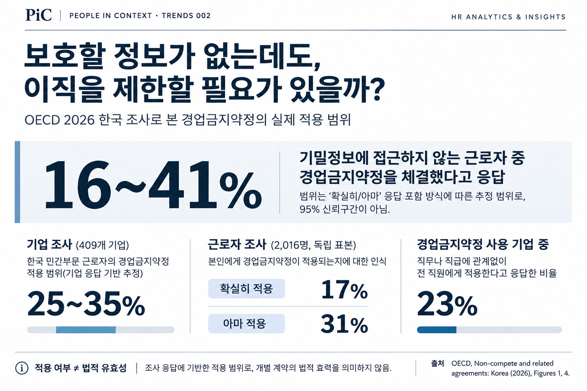
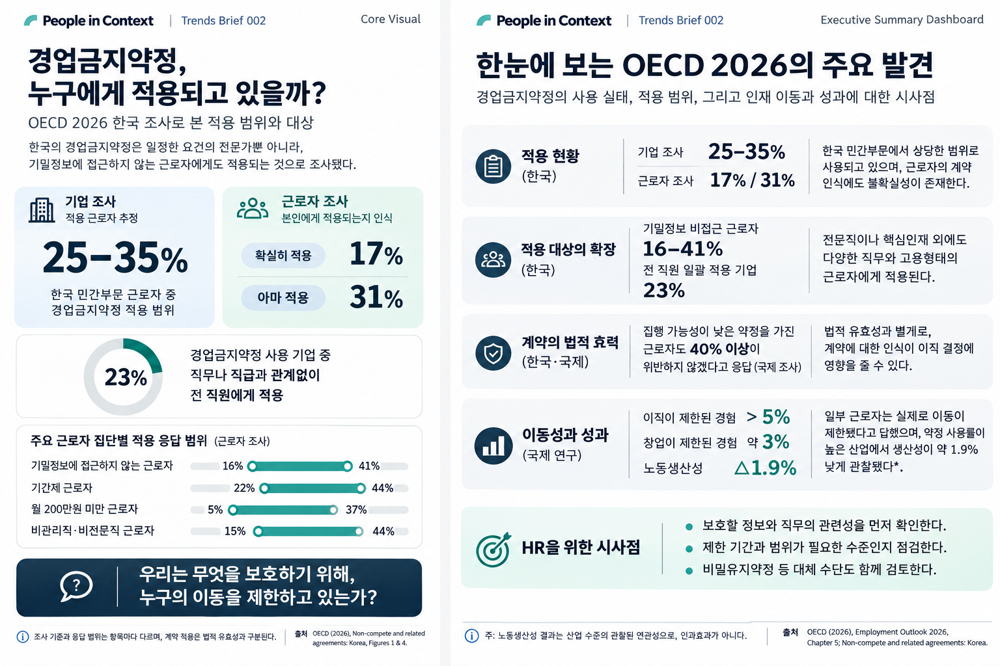

## Key Takeaways

- **경업금지약정은 일부 전문직이나 핵심인재에게만 적용되는 계약이 아니다.** OECD의 한국 조사에서는 기밀정보에 접근하지 않는 근로자에게도 약정이 적용된다는 응답이 확인됐다.
- **계약의 적용, 법적 효력, 근로자의 실제 행동은 구별해야 한다.** 법원이 집행하기 어려운 약정이라도 근로자가 이직을 주저할 가능성은 있다. 다만 한국에서 나타난 인과효과의 크기를 확인한 결과는 아니다.
- **HR의 질문은 계약을 얼마나 넓게 적용할지가 아니라, 무엇을 보호하기 위해 어디까지 제한해야 하는가에 있다.** 직무와 보호 이익의 관련성, 제한 기간·범위, 대체 수단을 함께 살펴야 한다.

## 01. What Changed? — 경업금지약정은 얼마나 사용되고 있는가?

회사를 떠난 직원이 일정 기간 경쟁기업에 취업하거나 경쟁 사업을 하지 못하도록 제한하는 계약이 있다. **경업금지약정(Non-compete clause)**이다. 기업은 영업비밀이나 고객관계, 교육·투자에 따른 이익을 지키기 위해 이런 약정을 활용할 수 있다. 하지만 직원에게는 퇴직 후 어디에서 일할 수 있는지와 직결되는 문제다.

OECD와 보코니대학교의 2025년 조사에서 한국 기업들의 응답을 바탕으로 추정한 민간부문 근로자의 약정 적용 비율은 **25~35%**였다. 근로자 조사에서는 **17%가 ‘확실히 적용된다’**, 별도의 **31%가 ‘아마 적용될 것’**이라고 답했다. 두 조사는 표본과 응답 기준이 달라 같은 적용률로 직접 비교할 수 없다. 이 비율을 법적 효력이 인정된 계약의 비율로 해석해서도 안 된다.

## 02. What Does the Data Say? — 계약은 누구에게까지 적용되는가?

이번 조사에서 더 주목할 결과는 적용 대상의 범위다. **기밀정보에 접근하지 않는 한국 근로자 중에서도 16~41%가 경업금지약정을 체결했다고 응답**했다. 하한과 상한은 응답의 확실성을 반영한 값이며 통계적 신뢰구간이 아니다. 또한 **경업금지약정을 사용하는 한국 기업의 23%는 직급이나 역할에 관계없이 모든 직원에게 약정을 적용**한다고 답했다.

그렇다면 기밀정보를 다루지 않는 직원에게도 경쟁사 취업을 제한할 필요가 있을까? 이 사실만으로 개별 계약이 부당하거나 무효라고 결론 내릴 수는 없다. 기밀정보 이외의 보호할 이익도 있을 수 있고, 법적 효력은 구체적인 계약 내용과 사정에 따라 판단되기 때문이다.

그럼에도 계약의 효력이 불확실하다는 사실과 근로자가 이직을 주저한다는 것은 별개다. OECD의 다국가 조사에서는 법원에서 집행되기 어려운 약정을 가진 근로자 가운데서도 40% 이상이 이를 위반하지 않겠다고 답했다. 이는 **계약의 법적 집행 가능성뿐 아니라, 근로자가 받아들이는 제한의 의미**도 살펴볼 필요가 있음을 보여준다. 한국만의 이직 억제 효과를 추정한 수치는 아니다.

## 03. Why Does It Matter for HR? — 무엇을 보호하기 위해 이동을 제한하는가?

기업이 핵심 기술과 거래관계를 지키려는 목적은 정당할 수 있다. 그러나 보호할 이익이 있다고 해서 모든 직무에 동일한 제한이 필요하다는 뜻은 아니다. HR은 약정의 사용 여부를 넘어 **어떤 정보를 보호해야 하는지, 해당 직원의 직무와 얼마나 관련되는지, 제한하는 기간과 업무 범위가 그 목적에 비례하는지** 확인할 필요가 있다. 비밀유지약정이나 정보 접근 통제 같은 다른 수단으로 목적을 달성할 수 있는지도 검토할 수 있다.

국제 연구에는 경업금지약정의 활용이 노동 이동성과 임금에 불리하게 작용할 가능성을 뒷받침하는 결과가 있다. 그러나 이번 한국 현황 조사에서 그 인과효과를 측정한 것은 아니다. 따라서 필요한 것은 계약을 일괄적으로 폐지하거나 확대하자는 결론이 아니라, **보호할 이익과 근로자의 이동을 제한하는 정도 사이에 설명 가능한 기준을 세우는 일**이다.

**우리는 무엇을 보호하기 위해, 누구의 이동을 제한하고 있는가?**

## Executive Summary Dashboard — OECD 2026의 주요 발견

이 대시보드는 한국의 적용 현황뿐 아니라 계약의 법적 집행 가능성, 다국가 근로자의 이동 제한 경험, 생산성과의 **관찰된 연관성**을 함께 정리한다. 서로 다른 조사와 연구에서 나온 결과를 하나의 인과적 추정치처럼 읽어서는 안 된다.

## Sources & Notes

**Primary Source**  
OECD (2026). *Non-compete and related agreements: Korea* (country note; October 2026 revision). [원문 확인](https://www.oecd.org/en/publications/non-compete-and-related-agreements_d7cb2f7d-en/korea_4873ca03-en.html).

**Supporting Source**  
OECD (2026). *OECD Employment Outlook 2026*, Chapter 5, *Non-compete and related agreements: Hoarding talent, holding back growth?* [원문 확인](https://www.oecd.org/en/publications/2026/07/oecd-employment-outlook-2026_a41e8b9f/full-report/non-compete-and-related-agreements-hoarding-talent-holding-back-growth_a3219c43.html).

**조사와 수치에 관한 주석**

1. 한국 근로자 조사 2,016명(18~64세 민간부문 근로자, 온라인), 기업 조사 409곳(직원 5명 이상 영리기업, 전화). 두 표본은 독립적이며 기업과 근로자를 연결해 비교한 자료가 아니다.
2. 25~35%는 기업 응답을 이용한 적용 추정 범위, 17%와 31%는 근로자의 ‘확실히’와 ‘아마’라는 별도 응답 범주다. 16~41%도 응답의 확실성에 따른 범위로 95% 신뢰구간을 뜻하지 않는다.
3. 전 직원 적용 기업 23%의 분모는 **경업금지약정을 사용하는 기업**이다. 모든 기업 중 23%가 아니다.
4. 계약을 체결했다는 응답과 법원에서 유효하다는 판단은 다르다. 비밀유지약정(NDA) 역시 경업금지약정과 구별해야 한다.
5. 위축 효과에 관한 40% 이상이라는 수치는 OECD 다국가 조사 결과다. 임금·생산성과의 관련성은 연구설계에 따라 인과 해석 수준이 다르며, 한국 기업에 대한 인과효과로 일반화하지 않는다.
6. 본문 마지막 HR 제언은 OECD가 직접 검증한 정책 효과가 아니라 PiC의 판단·검토 제안이다.
