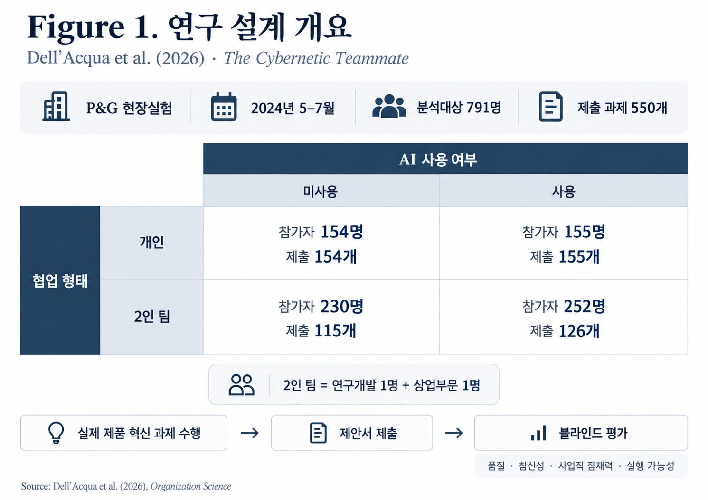
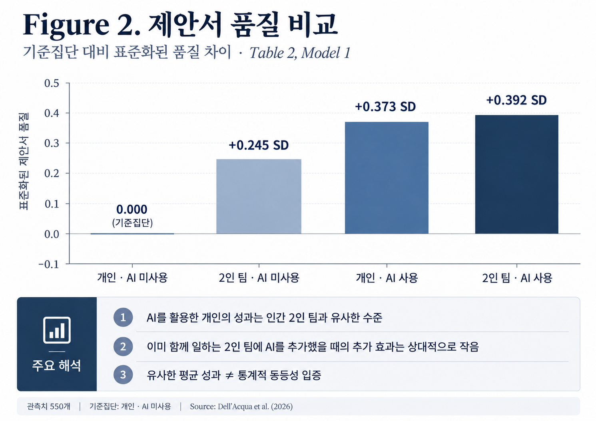
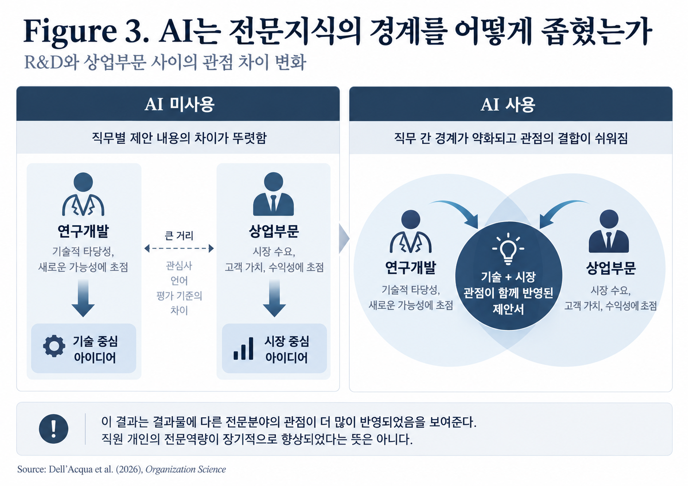
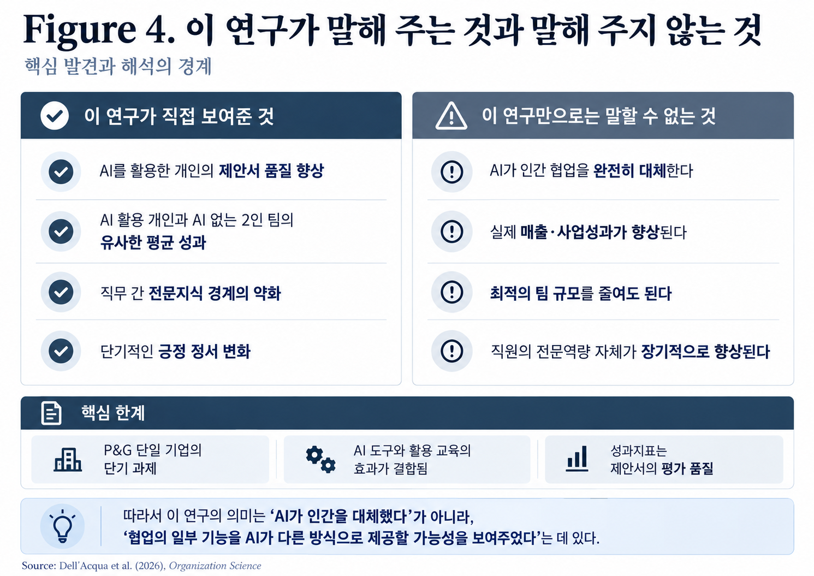

---
title: "AI와 협업의 재구성"
subtitle: "생성형 AI는 인간의 협업을 대체할 수 있는가"
date: 2026-11-06
title-block-style: default
toc: false
categories: ["INSIGHTS", "생성형 AI", "인간-AI 협업", "팀 성과", "전문성"]
description: "생성형 AI는 인간의 협업을 대체할 수 있을까? 해외 실증연구를 통해 AI와 인간의 협업 방식, 팀 구성, 조직 설계에 대한 시사점을 살펴본다."
---

**INSIGHTS | AI · Collaboration · Organizational Design**

<section class="pic-audio-edition">

<strong>🎧 PiC AUDIO</strong>

AI 혼자 인간 2인 팀을 이긴 이유

<audio controls preload="metadata" style="width:100%;">
  <source src="../assets/audio/AI_혼자_인간_2인_팀을_이긴_이유.m4a" type="audio/mp4">
  브라우저에서 오디오 재생을 지원하지 않습니다.
</audio>
</section>

## Governing Message

생성형 AI는 인간 협업의 필요성을 없애기보다, 협업을 통해 얻던 일부 이점을 다른 방식으로 제공할 가능성을 보여준다. P&G의 현장실험에서 AI를 활용한 개인은 AI를 사용하지 않은 2인 팀과 유사한 수준의 결과물을 만들었고, 서로 다른 직무의 전문지식을 활용하는 방식에서도 변화가 관찰되었다.

이 결과는 AI가 인간을 대체한다는 결론보다, 조직이 왜 함께 일하고 어떤 역할을 사람과 AI에 맡겨야 하는지 다시 생각하게 한다.

## Key Takeaways

**1. AI를 활용한 개인의 성과는 인간 2인 팀과 유사한 수준으로 나타났다.**

AI를 활용한 개인의 제안서 품질은 AI를 사용하지 않은 개인보다 평균 0.373표준편차 높았다. AI를 사용하지 않은 2인 팀 역시 개인보다 높은 성과를 보였으며, 두 집단의 성과 분포는 유사하게 나타났다. 다만 이는 AI 활용 개인과 인간 팀의 통계적 동등성이 입증되었다는 의미는 아니다.

**2. AI는 전문지식의 경계를 넘어서는 데 도움을 주었다.**

AI를 사용하지 않았을 때 연구개발 담당자는 기술 중심의 해결책을, 상업부문 담당자는 시장 중심의 해결책을 제안하는 경향이 있었다. AI를 사용하면 이러한 직무 간 차이가 줄어들었다. 이는 AI가 다른 전문분야의 관점을 결과물에 반영하도록 지원할 가능성을 보여준다.

**3. 협업 기능의 일부를 수행하는 것과 인간의 협업을 대체하는 것은 다르다.**

AI는 아이디어를 발전시키고 전문지식을 활용하는 데 기여했지만, 인간의 판단과 최종 선택은 여전히 중요했다. 또한 연구는 단기적인 제품 혁신 과제를 다루었으므로 실제 조직의 팀 규모나 장기적인 협업 성과까지 판단할 수는 없다.

---

## Research Question — 우리는 왜 함께 일하는가

기업이 새로운 제품을 개발한다고 생각해 보자.

제품의 기술적 가능성을 검토하려면 연구개발 담당자가 필요하다. 소비자의 요구와 시장성을 판단하려면 영업이나 마케팅 분야의 전문지식도 필요하다. 기술적으로 뛰어난 제품이라도 소비자가 필요로 하지 않으면 성공하기 어렵고, 시장성이 높은 아이디어라도 실제로 구현할 수 없다면 의미가 없다.

그래서 기업은 서로 다른 전문성을 가진 사람들을 한 팀으로 구성한다.

이러한 협업은 단순히 사람 수를 늘리는 일이 아니다. 한 사람이 갖추지 못한 지식을 다른 사람에게서 얻고, 서로 다른 관점을 결합하며, 아이디어의 문제점을 함께 검토하는 과정이다.

그런데 생성형 AI가 등장하면서 새로운 질문이 생겼다.

AI를 활용하면 개인도 자신이 속하지 않은 전문분야의 지식을 얻고, 여러 관점에서 문제를 검토하며, 아이디어를 발전시킬 수 있다. 그렇다면 인간 동료와의 협업을 통해 얻던 이점 중 일부를 AI를 통해서도 얻을 수 있지 않을까.

2026년 *Organization Science*에 발표된 Dell’Acqua와 동료 연구자들의 논문 *The Cybernetic Teammate: A Field Experiment on Generative AI and Teamwork*는 이 질문을 실험적으로 검토했다.

연구진은 인간 협업이 제공하는 이점을 세 가지 측면에서 바라보았다.

첫째는 **성과 향상**이다. 여러 사람이 함께 일하면 개인보다 더 좋은 결과물을 만들 수 있다는 것이다.

둘째는 **전문지식의 통합**이다. 서로 다른 직무의 지식과 경험을 결합함으로써 개인이 혼자서는 제시하기 어려운 해결책을 찾을 수 있다.

셋째는 **사회적·정서적 기능**이다. 동료와 함께 일하는 과정에서 격려나 동기부여를 얻고, 업무에 대한 긍정적인 감정을 경험할 수 있다.

연구진은 생성형 AI가 이러한 협업의 기능에 어떤 영향을 미치는지 확인하고자 했다.

중요한 점은 이 연구가 AI를 사용하는 개인의 성과만 살펴본 것이 아니라는 사실이다. AI를 사용하는 사람과 사용하지 않는 사람, 혼자 일하는 사람과 팀으로 일하는 사람을 비교함으로써 AI와 인간 협업이 제공하는 이점을 함께 검토했다.

## Research Design — P&G 직원 791명을 대상으로 한 실험

연구는 글로벌 소비재 기업 Procter & Gamble(P&G)에서 수행되었다.

2024년 5월부터 7월까지 진행된 실험에는 무작위 배정 분석대상으로 791명의 전문인력이 참여했다. 이들은 실제 기업의 제품 혁신 과제를 바탕으로 새로운 제품이나 사업 아이디어를 제안하는 워크숍에 참여했다.

연구진은 참가자들을 네 가지 조건으로 나누었다.

| 실험 조건 | 참가자 | 제출된 과제 |
|:---|---:|---:|
| 개인 · AI 미사용 | 154명 | 154개 |
| 개인 · AI 사용 | 155명 | 155개 |
| 2인 팀 · AI 미사용 | 230명 | 115개 |
| 2인 팀 · AI 사용 | 252명 | 126개 |
| **합계** | **791명** | **550개** |

*Figure 1. 연구 설계 개요. 참가자는 791명이지만 2인 팀은 한 개의 제안서를 제출하므로 평가 대상 제안서는 550개다. 출처: Dell’Acqua et al. (2026).*

2인 팀은 연구개발 담당자와 상업부문 담당자 각 한 명으로 구성되었다. 따라서 이 실험의 팀은 서로 다른 전문분야를 가진 두 사람이 협력하는 형태였다.

AI 사용 집단에는 GPT-4 기반 도구가 제공되었으며, 참가자들은 AI 활용 방법에 관한 교육도 받았다.

이 점은 결과를 해석할 때 중요하다. 연구에서 비교한 것은 엄밀히 말해 AI 도구에 대한 접근과 활용 교육이 결합된 조건이다. 교육을 받지 않고 동일한 도구만 사용했을 경우에도 같은 효과가 나타나는지는 별도로 검증되지 않았다.

연구진은 실험이 끝난 후 제출된 550개의 제안서를 평가했다.

평가자들은 제안서의 전반적인 품질을 1점부터 10점까지 평가했으며, 참신성, 사업적 잠재력, 실행 가능성 등도 별도로 살펴보았다. 평가 과정에서 제안서가 어떤 실험집단에서 나왔는지는 알 수 없도록 했다.

여기서 성과란 직원 개인의 인사평가 점수나 기업의 매출성과가 아니다.

**연구가 직접 측정한 것은 제한된 시간 안에 작성한 제품 혁신 제안서의 평가 품질**이다.

이 구분을 이해해야 이후의 결과를 정확하게 해석할 수 있다.

## Key Findings — AI를 활용한 개인은 얼마나 좋은 결과물을 만들었는가

### 1. 개인에게 AI를 제공했을 때 성과가 높아졌다

연구의 첫 번째 발견은 AI 활용에 따른 결과물 품질의 개선이다.

연구진은 AI를 사용하지 않고 혼자 일한 집단을 기준으로 나머지 세 집단의 성과를 비교했다.

정식 출판본의 Table 2, 첫 번째 회귀모형에서 확인된 결과는 다음과 같다.

| 실험 조건 | 기준집단 대비 제안서 품질 |
|:---|---:|
| 개인 · AI 미사용 | 기준 |
| 2인 팀 · AI 미사용 | +0.245 SD |
| 개인 · AI 사용 | +0.373 SD |
| 2인 팀 · AI 사용 | +0.392 SD |

*Figure 2. 제안서 품질 비교. 수치는 AI 미사용 개인을 기준으로 한 회귀계수이며 증가율(%)이 아니다. 두 집단의 평균이 유사하다는 사실만으로 통계적 동등성이 입증되지는 않는다. 출처: Dell’Acqua et al. (2026), Table 2, Model 1.*

SD는 표준편차를 의미한다.

예를 들어 개인·AI 사용 집단의 0.373이라는 값은 성과가 37.3% 증가했다는 뜻이 아니다. AI를 사용하지 않은 개인을 기준으로 비교했을 때, 제안서 품질의 차이가 전체 제안서 품질 점수의 표준편차를 기준으로 약 0.37에 해당한다는 의미다.

세 집단 모두 기준집단보다 통계적으로 유의하게 높은 성과를 보였다. 다만 AI 미사용 팀에 관한 결과는 일부 대안적 추론 방법에서는 통상적인 5% 유의수준을 충족하지 못했다.

여기서 흥미로운 부분은 AI를 사용하는 개인과 AI를 사용하지 않는 2인 팀의 성과를 비교했을 때다.

두 집단의 추정치는 각각 0.373과 0.245였다. AI를 사용하는 개인이 평균적으로 더 높은 값을 보였지만, 이러한 추정치만으로 어느 방식이 통계적으로 우월하다고 판단할 수는 없다. 또한 두 집단의 성과가 유사하다고 해서 통계적으로 동등하다는 결론이 입증된 것도 아니다.

그럼에도 연구 결과는 중요한 가능성을 제시한다.

서로 다른 전문분야의 두 사람이 협력하여 얻을 수 있었던 일부 성과상의 이점을, 생성형 AI를 활용하는 개인도 얻을 수 있다는 것이다.

반면 이미 함께 일하는 2인 팀에 AI를 추가했을 때 나타나는 추가적인 성과 개선은 상대적으로 작았다. AI 미사용 팀과 AI 사용 팀의 차이는 해당 모형에서 통계적으로 유의하지 않았다.

이는 AI가 언제나 팀의 성과를 추가로 높이는 것은 아닐 수 있음을 보여준다. 다만 유의한 차이가 발견되지 않았다는 사실만으로 추가적인 효과가 전혀 없다고 단정할 수도 없다.

무엇보다 이 결과를 근거로 기업이 직원 한 명을 AI로 대체할 수 있다고 판단해서는 안 된다. 연구에서 비교한 것은 특정한 과제의 결과물 품질이지, 실제 조직에서 두 사람이 장기간 수행하는 업무의 전체 가치가 아니기 때문이다.

### 2. AI는 전문지식의 경계를 넘는 데 도움을 주었다

두 번째 발견은 성과 개선의 크기만큼이나 중요하다.

일반적으로 연구개발 담당자는 기술적인 해결책에 익숙하다. 제품의 성능이나 구현 가능성, 기술적 차별성을 중심으로 문제를 바라볼 가능성이 크다.

반면 상업부문 담당자는 소비자의 반응, 시장의 기회, 판매 가능성에 더 관심을 둘 수 있다.

서로 다른 전문성을 가진 사람들이 협업하는 이유는 이러한 관점을 결합하기 위해서다.

실험에서도 AI를 사용하지 않은 참가자들에게서 비슷한 경향이 관찰되었다.

연구개발 담당자들은 상대적으로 기술 중심의 아이디어를 제안했고, 상업부문 담당자들은 시장 중심의 아이디어를 제안했다.

그러나 AI를 사용한 집단에서는 이러한 직무별 차이가 크게 줄었다.

*Figure 3. 전문지식 경계의 변화에 관한 개념도. 서로 다른 직무의 관점이 결과물에 반영되었다는 의미이지, 직원 개인의 장기적인 숙련 향상을 증명하는 그림은 아니다. 출처: Dell’Acqua et al. (2026)의 결과를 바탕으로 PiC 재구성.*

연구개발 담당자도 상업적인 관점을 포함한 제안서를 만들었고, 상업부문 담당자 역시 기술적인 관점을 보다 균형 있게 반영했다.

이 결과는 AI가 다른 전문분야의 지식에 접근하고 이를 업무에 활용하는 데 도움을 줄 수 있음을 보여준다.

다만 여기서 한 가지를 구별해야 한다.

AI를 활용해 상업적인 관점이 포함된 제안서를 작성했다고 해서 연구개발 담당자가 실제로 마케팅 전문가가 된 것은 아니다. 반대의 경우도 마찬가지다.

연구는 **AI를 활용한 결과물에서 전문지식의 경계가 약화되는 현상**을 보여주었을 뿐, 직원 개인의 전문역량이 장기적으로 향상되었는지를 측정하지 않았다.

이 차이는 조직의 인재관리를 생각할 때 매우 중요하다.

기존에는 직원이 보유한 지식과 경험의 범위가 업무 수행능력을 결정하는 중요한 조건이었다. 그러나 AI를 활용하는 환경에서는 개인이 직접 보유하지 않은 지식도 일정 부분 업무 수행에 활용할 수 있다.

그렇다면 조직은 직원이 무엇을 알고 있는지만이 아니라, 필요한 지식을 어떻게 확보하고 검증하며 업무에 적용하는지도 살펴볼 필요가 있다.

이는 논문이 직접 검증한 인사제도의 효과가 아니라, 연구 결과에서 도출할 수 있는 하나의 실무적 시사점이다.

### 3. AI는 아이디어의 생성과 선택에서 서로 다른 역할을 보였다

새로운 제품을 개발하는 과정에서는 좋은 아이디어를 만들어내는 것과 그중 가장 가치 있는 아이디어를 선택하는 것이 모두 중요하다.

그런데 두 활동이 반드시 같은 능력을 요구하는 것은 아니다.

연구진의 추가 분석에 따르면 AI 활용은 초기 아이디어의 평균적인 품질을 높이는 데 중요한 역할을 했다.

반면 여러 후보 가운데 가장 좋은 아이디어를 선택하는 과정에서는 인간의 판단이 여전히 가치를 보였다.

예컨대 AI를 사용하지 않은 2인 팀은 다섯 개의 후보 중 평가 품질이 가장 높은 아이디어를 선택하는 비율이 약 50%였던 반면, AI 활용 조건에서는 약 37%로 보고되었다.

이는 AI를 활용해 더 좋은 후보를 만들더라도 그중 무엇을 선택해야 하는지에 관한 판단까지 반드시 개선되는 것은 아니라는 점을 시사한다.

그렇다고 AI를 활용한 집단의 최종 결과물이 더 나빴던 것은 아니다. AI가 초기 아이디어의 평균 품질을 높인 효과가 선택 과정의 상대적인 약점을 상쇄하여, 최종적으로 선택한 아이디어의 품질 역시 높게 나타났다.

따라서 이 결과를 인간이 AI보다 의사결정을 더 잘한다는 일반적인 결론으로 확대할 수는 없다. 연구가 보여준 것은 아이디어를 만들어내는 과정과 최종 후보를 선택하는 과정에서 AI의 기여가 다르게 나타날 수 있다는 사실이다.

연구는 또 다른 흥미로운 현상을 보고했다.

AI를 활용한 제안서들은 내용상 서로 비슷해지는 경향을 보였다. 이는 개별 제안서의 평균 품질이 개선되는 것과 조직 전체에서 생산되는 아이디어의 다양성이 증가하는 것이 반드시 같은 현상은 아니라는 점을 보여준다.

다만 연구에서 관찰된 내용상의 유사성 증가가 곧바로 아이디어의 창의성이나 품질 분산의 감소를 의미하지는 않는다. 실제로 연구진은 AI를 활용하더라도 우수한 아이디어와 그렇지 않은 아이디어 사이의 품질 격차가 크게 줄어들지는 않았다고 보고했다.

기업이 새로운 아이디어를 평가할 때 평균적인 품질뿐 아니라 아이디어 간 차별성과 선택 과정에도 주의를 기울일 필요가 있는 이유다.

### 4. AI 활용은 긍정적인 정서 경험과도 관련이 있었다

연구진은 참가자들이 업무를 수행하면서 경험한 감정의 변화도 측정했다.

AI를 활용한 참가자들은 전반적으로 더 긍정적인 정서 변화를 보고했다. 연구진은 이러한 발견을 바탕으로 AI가 인간 동료의 사회적·동기부여 기능 중 일부를 제공할 가능성을 논의했다.

연구진은 이러한 정서 변화를 과제 수행 전후의 자기보고 설문으로 측정했다. 긍정적 정서는 열정·활력·흥분, 부정적 정서는 불안·좌절·괴로움에 관한 응답을 종합한 것이다. 아래 수치는 과제 종료 후의 감정 수준 자체가 아니라, **과제 수행 전후의 변화량**을 AI 미사용 개인 집단과 비교한 표준화 회귀계수다.

| 실험 조건 | 긍정적 정서 변화 | 부정적 정서 변화 |
|:---|---:|---:|
| 개인 · AI 미사용 | 기준 | 기준 |
| 2인 팀 · AI 미사용 | +0.269 SD (p < 0.05) | −0.136 SD (유의하지 않음) |
| 개인 · AI 사용 | +0.457 SD (p < 0.01) | −0.233 SD (p < 0.05) |
| 2인 팀 · AI 사용 | +0.635 SD (p < 0.01) | −0.235 SD (p < 0.05) |

*표. 과제 수행 전후의 자기보고 정서 변화 비교. 정식 출판본 Table 5(긍정적 정서, 관측치 533개) 및 Table 6(부정적 정서, 관측치 530개)의 첫 번째 모형을 기준으로 재구성했다. SD는 표준편차를 뜻하며, 각 유의확률은 AI 미사용 개인 집단과의 비교에 해당한다. 출처: Dell’Acqua et al. (2026).*

먼저 AI를 사용하지 않은 2인 팀에서도 혼자 일한 집단보다 긍정적 정서 변화가 유의하게 크게 나타났다(+0.269 SD). 이는 인간 동료와 함께 과제를 수행하는 경험에 정서적 이점이 있을 수 있음을 보여준다. 다만 이 집단의 부정적 정서 감소 추정치(−0.136 SD)는 통계적으로 유의하지 않았다.

AI를 사용한 개인은 긍정적 정서 변화가 +0.457 SD, 부정적 정서 변화가 −0.233 SD로 나타났다. AI를 활용한 2인 팀에서는 각각 +0.635 SD와 −0.235 SD였다. 두 AI 활용 집단 모두 기준집단보다 긍정적 정서의 증가와 부정적 정서의 감소가 통계적으로 유의하게 관찰되었다.

여기서 **AI 활용 개인의 긍정적 정서 변화 추정치(+0.457)가 AI 미사용 2인 팀(+0.269)보다 크다**는 점은 흥미롭다. 그러나 각 계수가 기준집단 대비 유의하다는 사실만으로 두 실험집단 사이의 차이까지 통계적으로 유의하다고 결론 내릴 수는 없다. 이러한 집단 간 우열을 확정하려면 해당 차이에 대한 별도의 통계적 검정이 필요하다. 마찬가지로 AI 활용 2인 팀의 추정치가 가장 크다는 이유만으로 다른 두 집단보다 확실히 우수하다고 단정할 수 없다.

또한 이 결과는 **정서 변화가 제안서 품질을 높인 원인**이라는 증거가 아니다. 연구는 정서 변화와 제안서 품질을 측정했지만, 긍정적인 감정이 성과를 매개하여 향상시켰다는 인과적 경로를 별도로 입증하지 않았다. 정서 변화와 향후 AI 활용 기대 사이의 관련성 역시 인과관계로 해석할 수 없다.

그러나 이 결과는 신중하게 해석해야 한다.

연구에서 측정한 것은 단기 워크숍 전후의 자기보고 감정이다. 장기간에 걸쳐 형성되는 동료 간 신뢰, 소속감, 협력관계의 질까지 확인한 것은 아니다.

AI와 대화하면서 긍정적인 경험을 했다는 사실만으로 인간 동료와의 관계가 불필요해졌다고 판단할 수는 없다.

오히려 이 결과는 AI가 업무 수행을 돕는 과정에서 인지적 지원뿐 아니라 사용자의 주관적 경험에도 영향을 미칠 수 있다는 가능성을 보여준다.

---

## Interpretation — AI가 바꾼 것은 협업 자체인가, 협업의 방식인가

이 연구를 통해 가장 중요한 질문으로 돌아갈 수 있다.

우리는 왜 함께 일하는가.

여러 사람이 협업하는 이유 중 하나는 개인이 가진 지식과 능력에 한계가 있기 때문이다. 서로 다른 전문지식을 결합하면 혼자서는 생각하기 어려운 해결책을 찾을 수 있다.

그런데 AI는 이러한 협업의 일부 기능을 다른 방식으로 수행할 가능성을 보여준다.

다른 분야의 지식을 설명하고, 아이디어를 발전시키며, 대안을 비교하고, 결과물을 정리하는 과정에서 AI가 개인의 업무를 지원할 수 있기 때문이다.

이 점에서 연구 결과는 단순한 생산성 향상을 넘어선 의미를 갖는다.

기존에는 어떤 일을 수행하기 위해 다른 전문분야의 동료와 협력해야 했다면, AI를 활용하는 환경에서는 개인이 그 전문지식의 일부를 활용하여 업무를 수행할 가능성이 넓어진다.

그러나 여기에서 인간 협업의 필요성이 사라진다고 결론 내릴 수는 없다.

협업은 지식을 제공하는 활동만으로 이루어지지 않는다.

사람들은 함께 일하면서 목표를 조정하고, 서로의 판단을 비판적으로 검토하며, 예상하지 못한 문제에 대응한다. 때로는 의견의 불일치를 해결하고, 의사결정에 대한 책임을 나누기도 한다.

이 연구는 이러한 기능 전체를 측정하지 않았다.

또한 P&G의 단기 제품 혁신 과제에서 관찰된 결과를 다른 산업이나 장기간 수행되는 프로젝트에 그대로 적용할 수는 없다.

따라서 이 연구의 의미는 AI가 인간 협업을 대체했다는 사실보다, **인간의 협업이 제공하던 일부 기능을 AI도 수행할 수 있는지 실험적으로 검토했고, 특정 조건에서 그 가능성을 확인했다는 데** 있다.

이는 인간과 AI의 역할을 서로 대체하는 관계로만 바라보기보다, 업무의 성격에 따라 어떤 기능을 조합할 수 있을지 살펴봐야 한다는 문제를 제기한다.

## HR Implications — 조직은 무엇을 다시 검토해야 하는가

이 연구는 성과평가나 보상제도의 효과를 직접 분석한 HR 연구는 아니다.

그러나 연구 결과는 조직설계와 인재관리에 몇 가지 검토할 만한 질문을 남긴다.

### 첫째, 업무를 수행하는 개인과 업무에 필요한 전문지식을 구별할 필요가 있다.

전통적으로 직무는 필요한 지식과 기술을 개인이 얼마나 보유하고 있는지에 따라 구분되어 왔다.

물론 이러한 구분은 앞으로도 중요하다. 전문지식에 대한 이해가 부족하면 AI가 제공한 정보를 검증하거나 적절하게 활용하기 어렵기 때문이다.

그러나 직원이 AI를 통해 다른 분야의 지식을 활용할 수 있다면, 업무 수행능력을 판단하는 기준에도 변화가 필요할 수 있다.

직원이 독자적으로 보유한 전문지식, AI를 활용해 확보한 정보, 그리고 그 정보를 판단하고 적용하는 능력은 서로 다른 차원이다.

조직은 이들을 어떻게 구분하고 평가할 것인지 검토해야 한다.

### 둘째, 팀의 구성은 인원수보다 수행해야 할 기능에서 출발할 필요가 있다.

기존에 서로 다른 전문인력을 배치했던 이유 중 하나가 부족한 지식을 보완하기 위한 것이었다면, AI는 그 역할의 일부를 지원할 수 있다.

하지만 팀이 필요한 이유에는 전문지식의 제공 외에도 조정, 실행, 판단, 책임, 의사결정이 포함된다.

따라서 AI를 도입했다는 이유만으로 팀의 인원을 줄이는 것은 이 연구가 뒷받침하는 결론이 아니다.

오히려 조직은 업무를 세분화하여 어떤 활동에 인간의 협업이 필수적인지, 어떤 활동에 AI의 지원이 유용한지를 구분할 필요가 있다.

### 셋째, AI를 활용한 성과는 결과물의 품질과 판단 과정 모두를 살펴볼 필요가 있다.

AI를 활용하는 직원이 더 좋은 결과물을 만들어냈다면, 그 자체는 중요한 업무성과일 수 있다.

그러나 결과물이 우수하다는 사실만으로 직원이 그 내용의 정확성을 충분히 이해하거나 검증할 수 있다고 판단해서는 안 된다.

특히 AI가 제공하는 정보와 제안을 활용하는 업무에서는 최종 결과물뿐 아니라 문제 정의, 검증, 선택과 수정 과정도 중요할 수 있다.

이것은 AI를 활용한 직원의 성과를 낮게 평가해야 한다는 주장이 아니다.

오히려 AI 활용이 보편화될수록 어떤 성과를 측정하고 어떤 역량을 구별해야 하는지 더 명확하게 정의해야 한다는 의미다.

이러한 시사점은 연구 결과를 바탕으로 도출한 해석이며, 실제 성과평가제도를 어떤 방식으로 변경해야 하는지까지 이 논문이 검증한 것은 아니다.

---

## Limitations — 연구가 답하지 못한 질문

연구는 무작위 현장실험이라는 강점을 가지고 있지만, 결과를 이해할 때 몇 가지 제한을 고려해야 한다.

**첫째, 연구의 성과는 실제 사업성과가 아니다.**

제안서의 평가 품질이 개선되었다는 사실은 확인되었지만, 해당 아이디어가 실제 제품으로 개발되거나 매출과 수익으로 연결되는지는 검증되지 않았다.

**둘째, 실험은 단기적인 혁신 과제에 한정되어 있다.**

하루 동안 수행한 과제의 결과를 장기 프로젝트, 일상적인 협업관계 또는 조직 전체의 생산성으로 일반화하기는 어렵다.

**셋째, AI 도구의 효과와 활용 교육의 효과가 완전히 분리되지 않았다.**

AI 활용 집단에는 도구와 함께 교육이 제공되었으므로, 효과를 AI 모델 자체에만 귀속하기보다는 실험에서 제공된 전체 활용 조건의 효과로 이해하는 편이 정확하다.

**넷째, 평가된 결과물의 품질에는 측정상의 불확실성이 있다.**

제안서는 평가자의 판단을 통해 점수가 부여되었다. 평가자 간 일치도가 완전하지 않았고, AI를 활용한 결과물이 더 길고 정교하게 작성되는 경향도 있었다. 따라서 제안서 평가점수와 실질적인 사업적 가치 사이에는 차이가 존재할 수 있다.

**다섯째, 인간 협업의 모든 기능이 측정된 것은 아니다.**

연구가 살펴본 성과 향상, 전문지식 통합, 단기 정서적 경험은 협업의 중요한 측면이다. 그러나 장기적인 신뢰, 갈등 관리, 공동 책임, 실행과 조정 등은 직접 평가되지 않았다.

마지막으로, 연구는 사전등록된 실험이지만 공개된 사전등록 계획과 최종 출판본의 모든 분석 선택에 대한 독립적인 대조가 이 리뷰 과정에서 완료된 것은 아니다. 따라서 탐색적 결과를 사전에 확정된 가설의 검증 결과처럼 제시하지 않도록 주의할 필요가 있다.

*Figure 4. 핵심 발견과 해석의 경계. 이 도표는 원문의 직접적인 실험 결과와 PiC의 해석상 주의점을 함께 정리한 편집용 시각자료다. 출처: Dell’Acqua et al. (2026)을 바탕으로 PiC 재구성.*

## Conclusion — 다시, 함께 일한다는 것의 의미

생성형 AI에 관한 논의는 종종 인간을 얼마나 대체할 수 있는지에 집중된다.

그러나 P&G의 실험은 조금 다른 질문을 던진다.

AI를 사용하는 개인이 기존의 인간 팀과 비슷한 수준의 결과물을 만들 수 있다면, 조직은 단순히 사람과 AI 중 무엇을 선택할지 고민하는 데 머물러서는 안 된다.

어떤 업무에 서로 다른 전문지식이 필요한지, 그 지식을 어떤 방식으로 결합할 수 있는지, 인간의 판단과 협업이 특히 중요한 순간은 언제인지 살펴볼 필요가 있다.

AI는 인간 협업의 일부 이점을 제공할 가능성을 보여주었다. 하지만 그 사실이 협업의 모든 기능을 대신할 수 있다는 의미는 아니다.

이 연구가 남기는 중요한 시사점은 인간과 AI 사이의 단순한 대체 관계가 아니다.

**협업을 사람의 수로만 이해하기보다, 함께 일하는 과정에서 수행되는 기능과 그 기능을 결합하는 방식으로 다시 바라볼 필요가 있다는 것이다.**

---

## References

**Primary Research**

Dell’Acqua, F., Ayoubi, C., Lifshitz, H., Sadun, R., Mollick, E., Mollick, L., Han, Y., Goldman, J., Nair, H., Taub, S., & Lakhani, K. R. (2026). *The Cybernetic Teammate: A Field Experiment on Generative AI and Teamwork*. *Organization Science*, 37(4), 1217–1242.

https://doi.org/10.1287/orsc.2025.20702

**Earlier Working Paper**

Dell’Acqua, F., et al. (2025). *The Cybernetic Teammate: A Field Experiment on Generative AI Reshaping Teamwork and Expertise*. NBER Working Paper No. 33641.

https://www.nber.org/papers/w33641

**Supplementary Materials**

Online Appendix, *Organization Science*, DOI: 10.1287/orsc.2025.20702.

AEA RCT Registry, AEARCTR-0013603.

**Editorial Note**

본 리뷰는 2026년 정식 출판본의 연구 설계, 주요 결과표 및 온라인 부록을 중심으로 작성했다. 연구의 직접적인 발견과 PiC의 해석을 구분했으며, 사전등록 계획과 최종 출판본의 모든 분석 변경사항에 대한 독립적인 검증은 완료되지 않았다.
