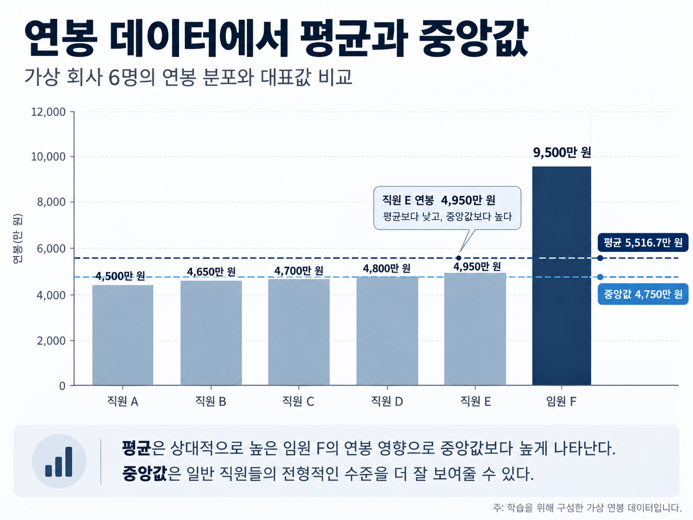
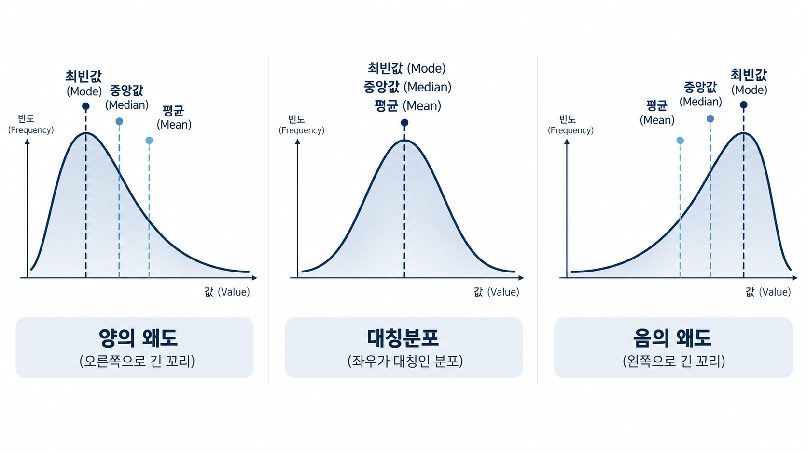
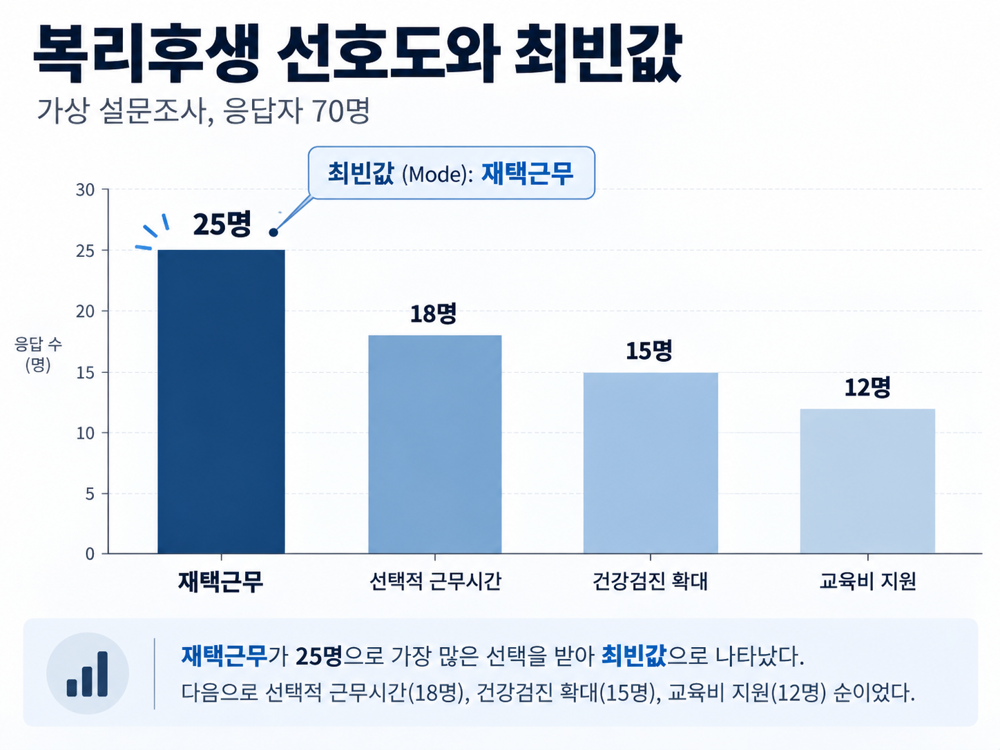

---
title: "데이터의 중심 경향"
categories: ["LEARN", "중심경향", "평균", "중앙값", "최빈값"]
description: "평균, 중앙값, 최빈값은 데이터의 중심을 어떻게 다르게 설명할까? 데이터의 분포와 측정 수준, 분석 목적에 따라 적절한 대표값을 선택하는 방법을 살펴본다."
title-block-style: none
---

*평균, 중앙값, 최빈값은 데이터의 중심을 어떻게 다르게 설명할까?*

## Key Takeaways

> 중심경향(Central Tendency)은 여러 관측값이 대체로 어느 위치에 모여 있는지를 대표적인 값으로 요약하는 통계적 개념이다. 평균은 모든 관측값의 크기를 반영하지만 극단값에 민감하고, 중앙값은 관측값을 정렬했을 때 가운데에 위치하는 값으로 극단값의 영향을 상대적으로 적게 받는다. 최빈값은 가장 자주 나타나는 값이나 범주를 보여준다. **따라서 하나의 대표값이 언제나 데이터를 가장 적절하게 설명하는 것은 아니다. 데이터의 분포와 측정 수준, 분석 목적에 따라 적합한 대표값을 선택해야 한다.**

## 데이터의 중심경향

앞선 01편에서는 모집단과 표본의 개념을 살펴보았다. 모집단 전체를 조사하기 어려울 때 우리는 표본을 추출하여 데이터를 수집하고, 표본으로부터 모집단의 특성을 추정한다.

그렇다면 수집한 데이터를 어떻게 이해할 수 있을까?

예를 들어 직원 100명의 연봉이나 근속연수를 조사했다고 가정해 보자. 모든 직원의 값을 하나씩 나열하면 개별 관측값을 확인할 수 있지만, 조직의 전반적인 특징을 한눈에 파악하기는 어렵다.

이때 여러 관측값을 하나의 값으로 요약하여 데이터가 대체로 어느 수준에 위치하는지를 살펴볼 수 있다. 이를 **중심경향(Central Tendency)**이라고 한다.

중심경향을 나타내는 대표적인 측정값으로는 평균(Mean), 중앙값(Median), 최빈값(Mode)이 있다.

다만 세 측정값은 같은 방식으로 데이터의 중심을 나타내지 않는다. 각각의 계산 방법과 특징을 이해하고, 어떤 상황에서 사용하는 것이 적절한지 살펴볼 필요가 있다.

## 평균(Mean)

평균은 여러 관측값을 대표하는 가장 익숙한 통계량이다.

일반적으로 평균이라고 하면 산술평균(Arithmetic Mean)을 의미한다. **산술평균은 모든 관측값을 더한 뒤 관측값의 개수로 나누어 계산한다.**

다섯 명의 키가 다음과 같다고 가정해 보자.

160cm, 180cm, 180cm, 170cm, 175cm

다섯 명의 키를 모두 더하면 865cm다. 이를 관측값의 개수인 5로 나누면 평균은 173cm가 된다.

$$
\bar{x}=\frac{160+180+180+170+175}{5}=173
$$

표본평균은 일반적으로 다음과 같이 표현한다.

$$
\bar{x}=\frac{1}{n}\sum_{i=1}^{n}x_i
$$

각 기호의 의미는 다음과 같다.

- $\bar{x}$: 표본평균
- $n$: 관측값의 개수, 즉 표본의 크기
- $x_i$: $i$번째 관측값
- $\sum$: 지정된 범위에 있는 값들을 모두 더하라는 합계 기호

합계 기호 아래의 $i=1$은 첫 번째 관측값부터 계산을 시작한다는 의미이며, 위의 $n$은 마지막 관측값까지 합산한다는 뜻이다.

따라서 이 공식은 첫 번째 관측값부터 마지막 관측값까지 모두 더한 후 그 합계를 관측값의 개수로 나누라는 의미다.

앞선 01편에서 살펴본 것처럼 모집단의 평균은 $\mu$(뮤), 표본평균은 $\bar{x}$(엑스 바)로 구분하여 표현한다.

평균의 특징은 **모든 관측값의 크기를 계산에 반영한다는 점**이다.

그러나 바로 이러한 특징 때문에 다른 값들과 크게 차이 나는 극단값(Extreme Value)이 존재하면 평균이 크게 변할 수 있다.

따라서 평균이 데이터의 중심을 얼마나 적절하게 나타내는지는 실제 관측값의 분포를 함께 살펴봐야 판단할 수 있다.

## 중앙값(Median)

중앙값은 **관측값을 크기순으로 정렬했을 때 가운데에 위치하는 값**이다.

평균이 모든 관측값의 크기를 반영한다면, 중앙값은 정렬된 관측값의 위치를 기준으로 결정한다.

앞서 살펴본 다섯 명의 키를 다시 사용해 보자.

160cm, 180cm, 180cm, 170cm, 175cm

먼저 작은 값부터 큰 값 순서로 정렬한다.

160, 170, 175, 180, 180

관측값이 5개이므로 가운데에 위치한 세 번째 값인 175cm가 중앙값이다.

관측값의 개수가 짝수일 때는 계산 방식이 조금 달라진다.

예를 들어 여섯 명의 키를 작은 값부터 정렬한 결과가 다음과 같다고 가정하자.

160, 165, 170, 175, 180, 185

관측값이 6개이므로 가운데에 위치하는 값은 세 번째인 170cm와 네 번째인 175cm다. 이처럼 관측값의 개수가 짝수일 때는 가운데 두 값의 평균을 중앙값으로 사용한다.

$$
\text{Median}=\frac{170+175}{2}=172.5
$$

중앙값의 중요한 특징은 **극단값의 영향을 평균보다 상대적으로 적게 받는다는 점**이다.

이를 HR 데이터의 사례로 살펴보자.

{width=100% style="max-width: 720px; height: auto;"}

*Figure 01. 연봉 데이터에서 평균과 중앙값. 주: 학습을 위해 구성한 가상 연봉 데이터다.*

가상의 회사에서 직원 5명과 임원 1명의 연봉이 각각 4,500만 원, 4,650만 원, 4,700만 원, 4,800만 원, 4,950만 원, 9,500만 원이라고 가정해 보자.

이 회사의 평균 연봉은 약 5,516.7만 원이다.

$$
\bar{x}=\frac{4500+4650+4700+4800+4950+9500}{6}\approx 5516.7
$$

반면 중앙값은 가운데 두 값인 4,700만 원과 4,800만 원의 평균인 4,750만 원이다.

$$
\text{Median}=\frac{4700+4800}{2}=4750
$$

두 값은 약 766.7만 원 차이가 난다. 평균이 중앙값보다 높은 이유는 상대적으로 높은 임원 F의 연봉이 평균을 끌어올렸기 때문이다.

실제로 직원 A부터 E까지 다섯 명의 연봉은 모두 전체 평균보다 낮다. 이 사례에서 평균 연봉만 보고 일반 직원들의 연봉 수준이 약 5,500만 원이라고 이해한다면 실제 관측값의 분포를 오해할 수 있다.

반면 중앙값은 임원 F의 연봉이 더 높아지더라도 나머지 연봉의 순서가 유지되는 한 달라지지 않는다. 이 때문에 중앙값은 일부 극단적으로 높은 값이나 낮은 값이 존재하는 데이터에서 전형적인 수준을 파악하는 데 유용하다.

그렇다고 중앙값이 언제나 평균보다 우수한 것은 아니다. 평균은 전체 연봉 수준이나 인건비를 분석할 때 중요한 정보를 제공하고, 중앙값은 구성원의 전형적인 연봉 수준을 이해하는 데 도움이 된다.

**중요한 것은 평균과 중앙값 중 하나를 선택하는 것이 아니라, 무엇을 알고 싶은지에 따라 적절한 측정값을 활용하는 것이다.**

### 데이터의 분포와 중심경향의 관계

평균과 중앙값이 서로 다른 값을 갖는 이유를 이해하려면 데이터의 분포도 함께 살펴봐야 한다.

데이터가 어느 한쪽으로 길게 퍼져 있는 특성을 왜도(Skewness)라고 한다. 특히 극단적으로 크거나 작은 값이 어느 방향에 존재하는지에 따라 평균과 중앙값의 상대적 위치가 달라질 수 있다.

{width=100% style="max-width: 720px; height: auto;"}

*Figure 02. 분포의 왜도와 중심경향. 주: 평균·중앙값·최빈값의 전형적인 위치 관계를 설명하기 위한 개념도다. 실제 데이터에서는 이 순서가 항상 성립하지는 않는다.*

그림의 왼쪽은 오른쪽 꼬리가 긴 양의 왜도(Positive Skewness)를 나타낸다. 일부 큰 값이 존재하여 평균이 오른쪽으로 이동하는 전형적인 모습이다. 연봉 데이터에서 소수의 고액 연봉자가 평균을 높이는 경우를 생각할 수 있다.

가운데는 좌우가 대칭인 분포다. 그림처럼 대칭이고 봉우리가 하나인 분포에서는 평균, 중앙값, 최빈값이 같은 위치에 나타날 수 있다.

오른쪽은 왼쪽 꼬리가 긴 음의 왜도(Negative Skewness)다. 일부 작은 값이 평균을 왼쪽으로 끌어당기는 전형적인 모습을 보여준다.

여기서 주의할 점이 있다. **양의 왜도라면 반드시 평균이 중앙값보다 크고, 음의 왜도라면 반드시 작다고 단정할 수는 없다.** 그림은 대표적인 분포 형태를 설명하는 예시이며, 실제 데이터에서는 분포의 형태와 관측값에 따라 관계가 달라질 수 있다.

따라서 중심경향을 해석할 때는 대표값뿐 아니라 히스토그램과 같은 분포 시각화도 함께 살펴보는 것이 바람직하다.

## 최빈값(Mode)

평균과 중앙값에 이어 살펴볼 세 번째 측정값은 최빈값이다.

**최빈값은 데이터에서 가장 자주 나타나는 값 또는 범주**를 의미한다.

예를 들어 구성원들의 근속연수를 조사했는데 3년이라는 값이 가장 많이 나타났다면 최빈값은 3년이다.

최빈값의 특징은 평균이나 중앙값과 달리 숫자의 크기나 순서가 없는 범주형 데이터에도 활용할 수 있다는 점이다.

이를 HR 실무의 복리후생 선호도 조사 사례로 살펴보자.

{width=100% style="max-width: 720px; height: auto;"}

*Figure 03. 복리후생 선호도와 최빈값. 주: 학습을 위해 구성한 가상 설문조사다. 응답자마다 가장 선호하는 항목 하나를 선택했다고 가정한다.*

가상의 회사에서 구성원 70명을 대상으로 가장 선호하는 복리후생 제도를 하나씩 선택하도록 설문조사를 실시했다고 가정해 보자.

| 복리후생 항목 | 응답자 수 | 응답 비율 |
|---|---:|---:|
| 재택근무 | 25명 | 35.7% |
| 선택적 근무시간 | 18명 | 25.7% |
| 건강검진 확대 | 15명 | 21.4% |
| 교육비 지원 | 12명 | 17.1% |
| **합계** | **70명** | **약 100%** |

가장 많은 구성원이 선택한 항목은 재택근무로, 전체 70명 중 25명이 선택했다.

따라서 이 데이터의 **최빈값은 재택근무**다.

그렇다면 이 데이터에서 평균이나 중앙값을 계산할 수 있을까?

복리후생 항목은 숫자의 크기나 순서를 나타내는 값이 아니다. 재택근무와 건강검진 확대 사이에 어느 것이 더 크거나 작다고 말할 수 없으며, 항목들을 더하거나 나누는 것도 의미가 없다.

이처럼 범주 간 순서가 없는 명목형 변수(Nominal Variable)에서는 평균과 중앙값이 적절하지 않지만, 최빈값은 가장 자주 선택된 범주를 알려줄 수 있다.

HR 실무에서 최빈값은 복리후생 선호 항목뿐 아니라 선호 교육 방식, 가장 많이 보고된 이직 사유, 구성원들이 주로 선택하는 근무 형태 등을 살펴볼 때 유용하다.

다만 최빈값을 해석할 때도 주의가 필요하다.

앞선 사례에서 재택근무는 가장 많이 선택된 항목이지만, 응답 비율은 35.7%다. 즉 나머지 64.3%는 다른 항목을 선택했다.

따라서 **재택근무가 최빈값이라는 사실만으로 전체 구성원의 과반수가 재택근무를 선호한다고 해석해서는 안 된다.**

또한 두 개 이상의 값이 동일한 최고 빈도를 보인다면 최빈값이 여러 개일 수 있다. 모든 값의 빈도가 동일하다면 특별히 두드러지는 최빈값이 없다고 해석하는 것이 적절할 수 있다.

## 평균·중앙값·최빈값의 비교

지금까지 살펴본 세 측정값은 모두 데이터를 간결하게 요약하는 방법이지만, 각각 답하려는 질문은 다르다.

평균은 모든 관측값을 고려했을 때의 전반적인 수준을, 중앙값은 정렬된 데이터의 가운데 위치를, 최빈값은 가장 자주 관측된 값이나 범주를 보여준다.

| 구분 | 평균(Mean) | 중앙값(Median) | 최빈값(Mode) |
|---|---|---|---|
| 산출 기준 | 관측값의 합계 ÷ 개수 | 정렬된 값의 중앙 위치 | 가장 자주 나타나는 값 |
| 주요 특징 | 모든 관측값의 크기 반영 | 극단값에 상대적으로 둔감 | 가장 빈번한 값·범주 확인 |
| 적합한 데이터 | 수치형 데이터 | 수치형·순서형 데이터 | 수치형·범주형 데이터 |
| HR 활용 | 평균 연봉·근로시간 | 연봉·근속연수의 전형적 수준 | 복리후생 선호 항목 |
| 유의사항 | 극단값에 민감 | 값의 전반적 분포 파악에 한계 | 최빈값이 여러 개일 수 있음 |

실제 HR 데이터를 분석할 때는 먼저 무엇을 알고 싶은지 질문하는 것이 중요하다.

예를 들어 조직의 인건비 수준을 살펴보려면 평균 연봉이 유용할 수 있다. 구성원들이 경험하는 전형적인 연봉 수준을 파악하고 싶다면 중앙값을 함께 살펴볼 필요가 있다. 구성원들이 가장 선호하는 복리후생 제도를 알고 싶다면 최빈값과 각 항목의 응답 비율을 확인하는 것이 적절하다.

또한 같은 데이터에서도 평균과 중앙값을 함께 제시하면 어느 한쪽으로 치우친 분포의 특징을 이해하는 데 도움이 될 수 있다. 다만 두 값의 차이만으로 분포의 형태를 확정할 수는 없으므로 실제 분포도 확인해야 한다.

## 중심경향을 이해한다는 것

데이터를 분석할 때 하나의 대표값은 복잡한 정보를 빠르게 이해하도록 돕는다. 직원 수백 명의 연봉이나 근속연수를 일일이 나열하지 않더라도 평균이나 중앙값을 통해 전반적인 수준을 파악할 수 있다.

하지만 데이터를 하나의 값으로 요약하는 과정에서는 일부 정보가 사라진다.

평균이 같은 두 조직이라도 구성원 간 연봉 격차는 다를 수 있고, 중앙값이 같더라도 데이터가 퍼져 있는 정도는 다를 수 있다. 최빈값이 같더라도 각 항목에 대한 응답 비율은 서로 다를 수 있다.

따라서 **중심경향은 데이터의 특징을 이해하기 위한 출발점이지, 데이터 전체를 설명하는 완전한 답은 아니다.**

평균, 중앙값, 최빈값의 계산 방법을 아는 것도 중요하지만, 그 값이 무엇을 설명하고 무엇을 설명하지 못하는지 이해하는 것이 더욱 중요하다.

다음 03편에서는 중심경향만으로 파악하기 어려운 데이터의 또 다른 특징인 **산포(Dispersion)**를 살펴본다. 데이터의 중심이 같더라도 관측값이 얼마나 넓게 퍼져 있는지에 따라 서로 다른 해석이 가능하다는 점을 알아볼 것이다.
