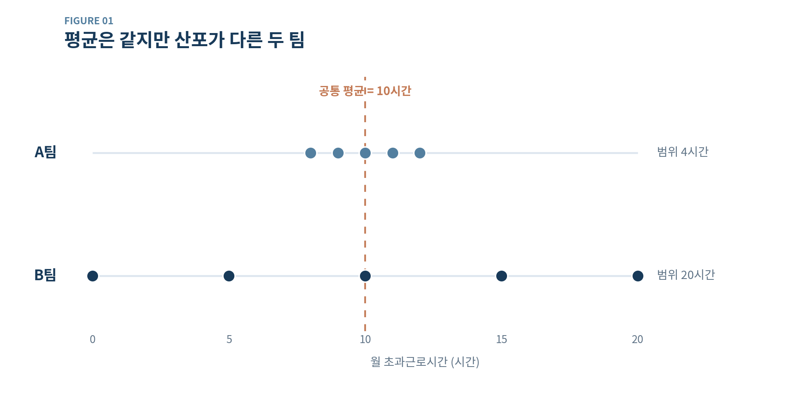
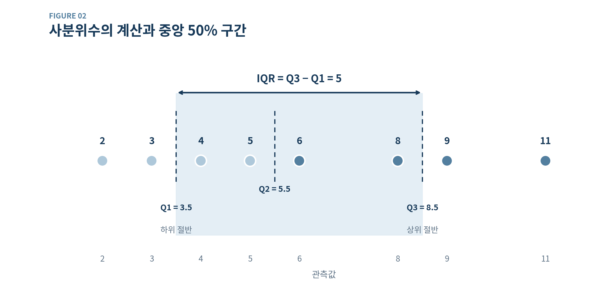
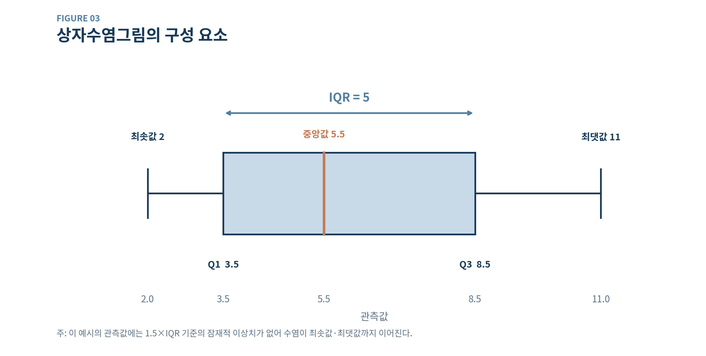

---
title: "데이터의 산포"
date: 2026-11-07
categories: ["LEARN", "산포", "사분위수", "사분위 범위", "상자수염그림"]
description: "평균이 같더라도 데이터의 흩어짐은 다를 수 있다. 범위와 사분위 범위를 통해 산포의 의미와 해석 방법을 살펴본다."
---

> **Governing Message**
>
> 데이터의 중심을 나타내는 값이 같더라도 관측값이 퍼져 있는 정도는 다를 수 있다. 산포를 이해하려면 대표값뿐 아니라 값들이 얼마나 흩어져 있는지, 그 차이가 어떤 맥락에서 발생했는지를 함께 살펴야 한다.

## Key Takeaways

> - **산포(Dispersion)**는 데이터가 얼마나 퍼져 있는지를 나타내며, 중심경향과 함께 분포를 이해하는 데 필요하다.
> - **범위(Range)**는 최댓값과 최솟값의 차이로, 관측된 값들의 전체 폭을 보여준다.
> - **사분위 범위(IQR)**는 제3사분위수(Q3)와 제1사분위수(Q1)의 차이로, 분포의 중앙 50% 구간의 폭을 나타낸다.
> - **상자수염그림(Box Plot)**은 중앙값, 사분위수, 수염과 잠재적 이상치를 시각적으로 비교하는 데 유용하다.

## 데이터의 중심만으로 충분할까?

앞선 Learn 02편에서는 평균(Mean), 중앙값(Median), 최빈값(Mode)을 살펴보았다. 이 값들은 관측값이 어느 위치를 중심으로 분포하는지 보여주지만, 데이터가 얼마나 흩어져 있는지는 충분히 설명하지 못한다.

두 팀에 속한 구성원 다섯 명의 월 초과근로시간이 다음과 같다고 가정해 보자.

| 구성원 | A팀 | B팀 |
|:---:|:---:|:---:|
| 1 | 8시간 | 0시간 |
| 2 | 9시간 | 5시간 |
| 3 | 10시간 | 10시간 |
| 4 | 11시간 | 15시간 |
| 5 | 12시간 | 20시간 |
| **평균** | **10시간** | **10시간** |

두 팀의 평균 초과근로시간은 모두 10시간이고 중앙값도 같다. 그러나 각 구성원의 기록은 서로 다른 양상을 보인다.

**Figure 01. 평균은 같지만 산포가 다른 두 팀의 초과근로시간**

{width=100% style="max-width: 720px; height: auto;"}

*주: 학습을 위해 구성한 가상 데이터다. 두 집단의 평균과 중앙값은 모두 10시간이지만 분포의 폭은 다르다.*

A팀의 초과근로시간은 8~12시간 사이에 모여 있다. 반면 B팀은 0~20시간까지 넓게 분포한다. **평균이 같다고 해서 구성원들이 경험하는 초과근로시간의 차이까지 같은 것은 아니다.**

이처럼 관측값이 얼마나 넓게 퍼져 있는지를 설명하는 특성이 산포(Dispersion)다.

## 데이터의 산포(Dispersion)

데이터 포인트(Data Point)는 관측하거나 측정한 개별 값을 뜻한다. 구성원 100명의 연봉을 수집했다면 각 구성원의 연봉이 하나의 관측값이다.

산포는 이러한 관측값이 서로 얼마나 흩어져 있는지, 또는 특정 중심값에서 얼마나 떨어져 있는지를 설명한다. 산포가 작으면 관측값들이 상대적으로 좁은 구간에 모여 있고, 크면 넓은 구간에 퍼져 있다는 의미다.

산포를 측정하는 방법은 다양하다. **범위(Range)**는 데이터의 전체 폭을, **사분위 범위(Interquartile Range)**는 중앙 50% 구간의 폭을 측정한다. 다음 Learn 편에서 다룰 **분산(Variance)**과 **표준편차(Standard Deviation)**는 평균과의 차이를 이용해 산포를 계산한다.

이번 글에서는 범위와 사분위 범위를 살펴본다.

## 범위(Range)

범위는 데이터의 최댓값에서 최솟값을 뺀 값이다.

$$
R = x_{\max} - x_{\min}
$$

여기서 $x_{\max}$는 최댓값, $x_{\min}$은 최솟값이다. 앞선 두 팀의 초과근로시간에 적용하면 다음과 같다.

$$
R_A = 12 - 8 = 4
$$

$$
R_B = 20 - 0 = 20
$$

| 구분 | A팀 | B팀 |
|:---:|:---:|:---:|
| 평균 | 10시간 | 10시간 |
| 최솟값 | 8시간 | 0시간 |
| 최댓값 | 12시간 | 20시간 |
| **범위** | **4시간** | **20시간** |

두 팀의 평균은 같지만 B팀에서 관측된 초과근로시간의 전체 폭은 A팀보다 다섯 배 넓다.

### 범위의 장점과 한계

범위는 계산이 간단하고 분포의 전체 폭을 직관적으로 보여준다. 그러나 최댓값과 최솟값만 사용하므로, 그 사이에 있는 관측값이 어디에 집중되어 있는지는 알려주지 못한다.

극단적인 값에도 민감하다. 예를 들어 A팀에 초과근로시간이 30시간인 구성원이 한 명 추가되면, 기존 다섯 명의 기록은 변하지 않아도 범위는 4시간에서 22시간으로 늘어난다.

따라서 **범위가 크다는 사실만으로 다수의 관측값이 고르게 넓게 퍼져 있다고 해석해서는 안 된다.** 이 한계를 보완하는 지표 중 하나가 사분위 범위다.

## 사분위수(Quartile)

사분위 범위를 이해하려면 사분위수부터 알아야 한다. 사분위수는 관측값을 크기순으로 정렬했을 때 분포를 네 부분으로 구분하는 기준값이다.

- **제1사분위수(Q1):** 분포의 하위 25% 지점에 대응하는 값
- **제2사분위수(Q2):** 중앙값, 즉 하위 50% 지점에 대응하는 값
- **제3사분위수(Q3):** 분포의 하위 75% 지점에 대응하는 값

사분위수는 반드시 관측된 값 중 하나와 일치하지 않는다. 또한 계산 규칙이 여러 가지이므로 표본이 작을 때는 사용하는 소프트웨어나 방법에 따라 결과가 달라질 수 있다.

### 사분위수 계산

다음 여덟 개의 관측값을 살펴보자.

$$
[4,\ 2,\ 6,\ 8,\ 3,\ 9,\ 5,\ 11]
$$

오름차순으로 정렬하면 다음과 같다.

$$
[2,\ 3,\ 4,\ 5,\ 6,\ 8,\ 9,\ 11]
$$

이번에는 **절반의 중앙값(Median of Halves)** 방식으로 계산한다. 전체 중앙값을 구한 뒤, 하위 절반과 상위 절반의 중앙값을 각각 Q1과 Q3로 정하는 방식이다.

먼저 전체 관측값이 여덟 개이므로 가운데 두 값 5와 6의 평균이 Q2다.

$$
Q_2 = \frac{5+6}{2} = 5.5
$$

하위 절반 $[2,\ 3,\ 4,\ 5]$의 중앙값은 다음과 같다.

$$
Q_1 = \frac{3+4}{2} = 3.5
$$

상위 절반 $[6,\ 8,\ 9,\ 11]$의 중앙값은 다음과 같다.

$$
Q_3 = \frac{8+9}{2} = 8.5
$$

| 구분 | 계산 | 결과 |
|:---:|:---:|:---:|
| Q1 | (3 + 4) ÷ 2 | 3.5 |
| Q2 | (5 + 6) ÷ 2 | 5.5 |
| Q3 | (8 + 9) ÷ 2 | 8.5 |

## 사분위 범위(Interquartile Range, IQR)

사분위 범위는 제3사분위수에서 제1사분위수를 뺀 값이다.

$$
IQR = Q_3 - Q_1
$$

앞서 계산한 값을 적용하면 다음과 같다.

$$
IQR = 8.5 - 3.5 = 5
$$

따라서 이 데이터의 IQR은 5다.

**Figure 02. 사분위수의 계산과 중앙 50% 구간**

{width=100% style="max-width: 720px; height: auto;"}

*주: 절반의 중앙값(Median of Halves) 방식으로 Q1·Q2·Q3를 계산했다. 사분위수 계산 방식에 따라 수치가 달라질 수 있다.*

IQR은 분포의 **중앙 50%에 해당하는 구간의 폭**이다. 범위가 관측된 최솟값부터 최댓값까지의 거리를 측정한다면, IQR은 데이터의 중심부가 얼마나 넓은 구간을 차지하는지 보여준다.

IQR은 분명히 산포를 측정하는 지표다. 다만 전체 분포가 아니라 중앙 구간의 산포를 요약한다는 점에서 범위와 다르다.

### IQR은 왜 유용할까?

기업의 연봉 데이터를 분석할 때 일부 고액 연봉자가 포함되면 최댓값과 최솟값의 차이가 크게 벌어질 수 있다. 이때 범위는 커지지만, 중앙 50%의 폭을 측정하는 IQR은 극단적인 관측값의 영향을 상대적으로 적게 받는다.

따라서 IQR은 연봉이나 근속연수처럼 비대칭적으로 분포할 수 있는 데이터를 살펴볼 때 유용하다. 그러나 IQR만으로는 Q1보다 작거나 Q3보다 큰 관측값들의 규모와 분포를 알기 어렵다. 범위와 IQR은 서로 대체하는 값이 아니라 서로 다른 정보를 제공하는 값이다.

## 상자수염그림(Box-and-Whisker Plot)

상자수염그림은 중앙값, 사분위수, 수염 및 잠재적 이상치를 한눈에 나타내는 시각화 방법이다. 일반적으로 상자(Box)와 양쪽으로 뻗은 수염(Whiskers)으로 구성된다.

앞서 계산한 관측값 $[2,\ 3,\ 4,\ 5,\ 6,\ 8,\ 9,\ 11]$에 대한 상자수염그림을 살펴보자.

**Figure 03. 상자수염그림의 구성 요소**

{width=100% style="max-width: 720px; height: auto;"}

*주: 1.5×IQR 규칙을 적용했으며, 이 데이터에는 해당 기준을 벗어나는 관측값이 없어 수염이 최솟값 2와 최댓값 11까지 이어진다.*

| 요소 | 값 | 그림에서의 의미 |
|:---:|:---:|:---:|
| 최솟값 | 2 | 왼쪽 수염의 끝 |
| Q1 | 3.5 | 상자의 왼쪽 끝 |
| 중앙값(Q2) | 5.5 | 상자 내부의 선 |
| Q3 | 8.5 | 상자의 오른쪽 끝 |
| 최댓값 | 11 | 오른쪽 수염의 끝 |
| IQR | 5 | 상자의 가로 길이 |
| 범위 | 9 | 최댓값 − 최솟값 |

상자의 양 끝은 Q1과 Q3를 나타내므로 상자의 길이는 IQR과 같다. 상자 내부의 선은 중앙값이다.

### 수염과 잠재적 이상치

**상자수염그림의 수염이 언제나 최솟값과 최댓값을 뜻하는 것은 아니다.** 널리 사용되는 Tukey 방식에서는 다음 경계를 기준으로 잠재적 이상치를 구분한다.

$$
\text{하한 경계} = Q_1 - 1.5 \times IQR
$$

$$
\text{상한 경계} = Q_3 + 1.5 \times IQR
$$

수염은 이러한 경계 안에 있는 관측값 중 가장 작은 값과 가장 큰 값까지 이어지며, 경계 밖의 관측값은 별도의 점으로 나타내는 것이 일반적이다.

이번 예시에 적용하면 하한 경계는 $3.5-1.5\times5=-4$, 상한 경계는 $8.5+1.5\times5=16$이다. 모든 관측값이 이 범위 안에 있으므로 수염은 실제 최솟값 2와 최댓값 11을 가리킨다.

다만 상자수염그림의 종류나 소프트웨어 설정에 따라 수염을 최솟값과 최댓값으로 표시하는 경우도 있다. 따라서 그래프를 해석할 때는 수염의 정의를 확인해야 한다.

또한 1.5×IQR 경계 밖의 값은 **추가 검토가 필요한 잠재적 이상치**이지, 반드시 측정 오류이거나 제거해야 할 관측값이라는 의미는 아니다.

## 백분위수(Percentile)와 사분위수의 관계

백분위수는 정렬된 데이터에서 분포상의 위치를 백분율로 나타내는 개념이다. 사분위수와는 다음과 같이 대응한다.

| 사분위수 | 백분위수 | 분위수 수준 |
|:---:|:---:|:---:|
| Q1 | 제25백분위수 | 0.25 |
| Q2 | 제50백분위수 | 0.50 |
| Q3 | 제75백분위수 | 0.75 |

예를 들어 연봉의 제1사분위수가 4,000만 원이라면, 사용한 분위수 계산 방법에 따라 연봉 분포의 하위 25% 지점에 대응하는 금액이 4,000만 원이라는 뜻이다.

다만 작은 표본이나 동일한 값이 반복되는 자료에서는 사분위수보다 작은 실제 관측값의 비율이 반드시 정확히 25%, 50%, 75%가 되는 것은 아니다. **분위수는 분포상의 위치를 요약하는 통계량**으로 이해하는 편이 정확하다.

## HR Analytics에서 산포를 살펴보는 이유

평균 연봉이 같은 두 조직이라도 구성원 간 보상 격차는 다를 수 있다. 평균 근속연수가 같더라도 단기근속 구성원이 많은 조직과 장기근속 구성원이 많은 조직의 구조는 다를 수 있다.

앞서 살펴본 A팀과 B팀 역시 평균 초과근로시간은 같았지만 구성원별 기록이 퍼져 있는 정도는 달랐다. 이러한 차이는 추가적인 분석 질문으로 연결된다.

- 특정 구성원에게 초과근로가 집중되어 있는가?
- 직무나 프로젝트의 특성이 팀마다 다른가?
- 큰 관측값은 일시적인 현상인가, 반복되는 구조적 특징인가?

그러나 산포가 크다고 해서 곧바로 조직 운영에 문제가 있다고 판단해서는 안 된다. 직무, 직급, 근무형태나 프로젝트 수행 조건이 다르다면 분포 차이에는 합리적인 이유가 있을 수 있다.

**산포는 문제의 존재를 단정하는 지표라기보다, 평균 뒤에 가려진 차이를 발견하고 그 원인을 탐색하도록 돕는 지표**에 가깝다.

## 범위와 사분위 범위의 비교

| 구분 | 범위(Range) | 사분위 범위(IQR) |
|:---:|:---:|:---:|
| 산출 기준 | 최댓값 − 최솟값 | Q3 − Q1 |
| 측정 대상 | 관측값의 전체 폭 | 중앙 50% 구간의 폭 |
| 주요 특징 | 계산이 간단함 | 극단값에 상대적으로 둔감 |
| HR 활용 | 근로시간의 전체 폭 | 연봉·근속연수의 중심 구간 |
| 유의사항 | 극단값에 민감 | 양 끝의 분포 정보가 제한적 |

범위와 IQR은 모두 산포를 측정하지만 서로 다른 정보를 보여준다. 범위는 관측값의 양쪽 끝을, IQR은 중앙에 위치한 관측값들의 폭을 요약한다.

Learn 02편에서 살펴본 중심경향과 이번 편의 산포를 함께 고려하면 데이터의 분포를 더 입체적으로 이해할 수 있다.

다음 Learn 04편에서는 **분산(Variance)과 표준편차(Standard Deviation)**를 살펴보자. 평균으로부터 각 관측값이 얼마나 떨어져 있는지를 이용해 산포를 측정하는 방법이다.
