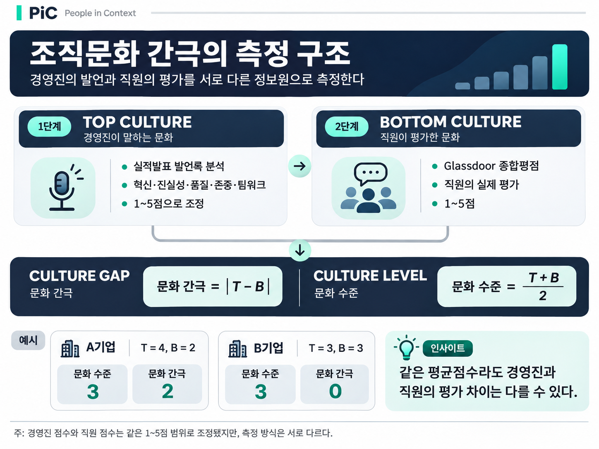
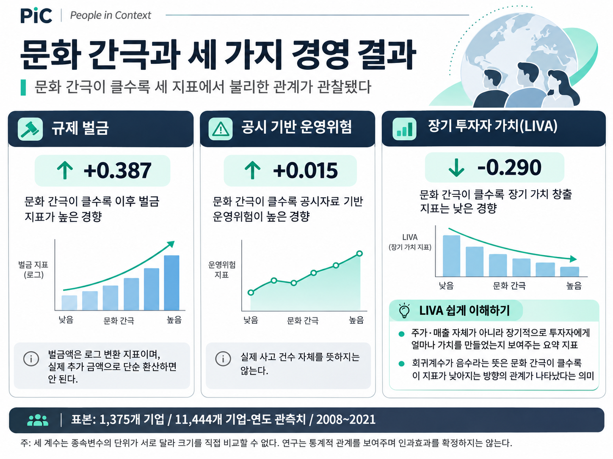
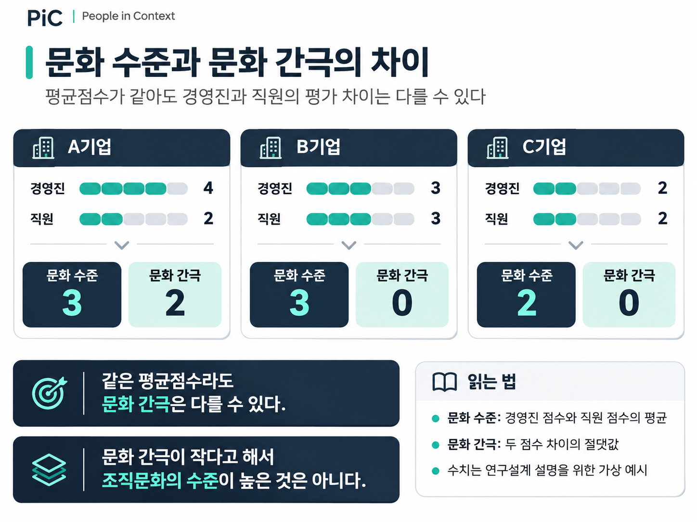

```{=html}
<div class="pic-audio-edition">

<p><strong>🎧 PiC AUDIO</strong></p>
<p>경영진과 직원의 조직문화 인식 차이와 기업 성과의 관계</p>
<audio controls preload="metadata" style="width:100%;">
  <source src="../assets/audio/insights-04-culture-gap.m4a" type="audio/mp4">
  브라우저에서 오디오 재생을 지원하지 않습니다.
</audio>

</div>
```

```{=html}
<style>
/* Insights 04 only — typography and spacing */
.pic-insights-04 h2 { margin-top: 2.6rem; margin-bottom: 1.15rem; }
.pic-insights-04 h3 { margin-top: 2.05rem; margin-bottom: 1.05rem; line-height: 1.45; }
.pic-insights-04 h2 + p, .pic-insights-04 h3 + p { margin-top: 0.85rem; }
.pic-insights-04 p { line-height: 1.82; margin-bottom: 1.1rem; }
.pic-insights-04 p img { max-width: 100%; height: auto; }
.pic-insights-04 hr { margin: 2.3rem 0; }
@media (max-width: 640px) {
  .pic-insights-04 h2 { margin-top: 2rem; }
  .pic-insights-04 h3 { margin-top: 1.7rem; margin-bottom: 0.85rem; }
  .pic-insights-04 p { line-height: 1.76; }
}
</style>
```

::: {.pic-insights-04}

## Governing Message

기업이 강조하는 조직문화와 직원이 실제로 평가하는 조직문화는 얼마나 일치할까? 그리고 두 집단의 문화 인식에 차이가 크다면, 그 차이는 기업의 경영성과와도 관련이 있을까? 미국 상장기업 1,375개의 자료를 분석한 연구는 경영진의 발언과 직원의 평가를 각각 수치화해 비교했다. 연구진은 두 점수의 차이가 큰 기업일수록 이후 규제 벌금과 공시 기반 운영위험이 높고, 장기 투자자 가치 지표는 낮은 경향을 발견했다.

이 연구는 조직문화의 수준뿐 아니라 **경영진이 전달하는 문화와 직원이 평가하는 문화 사이의 차이**에도 주목할 필요가 있음을 보여준다. 다만 두 점수의 차이가 실제 조직문화의 불일치를 얼마나 정확히 나타내는지, 그 차이가 경영성과에 직접 영향을 주는지는 별도로 검토해야 한다.

## Key Takeaways

**01. 조직문화의 평균점수만으로는 경영진과 직원 사이의 인식 차이를 파악하기 어렵다.**

연구진은 경영진의 실적발표 발언과 직원의 Glassdoor 평가를 각각 1~5점 척도로 나타냈다. 이후 두 점수의 차이를 계산해 기업 내부의 문화 불일치를 측정했다. 이는 조직문화의 전반적인 수준과 문화에 대한 두 집단의 평가 차이를 구분하려는 시도다.

**02. 문화 간극이 클수록 세 가지 경영 결과에서 불리한 관계가 관찰됐다.**

문화 간극이 큰 기업은 이후 규제 벌금과 공시 기반 운영위험이 높았고, 장기 투자자 가치 지표는 낮았다. 연구진이 기업 특성과 산업·연도 차이를 통제한 분석에서도 이러한 관계가 통계적으로 유의하게 나타났다.

**03. 문화 간극은 유용한 분석정보일 수 있지만, 검증된 인과적 위험지표는 아니다.**

경영진의 발언에서 추출한 문화점수와 직원의 종합평점은 서로 다른 방식으로 측정됐다. 연구는 두 점수의 차이와 경영 결과 사이의 관계를 확인했지만, 문화 간극 자체가 벌금 증가나 기업가치 하락을 일으켰다고 확정하기는 어렵다.

---

## Research Question

### 회사가 말하는 문화와 직원이 경험하는 문화는 같은가?

기업은 조직문화의 중요성을 다양한 방식으로 강조한다. 경영진은 혁신과 협력을 이야기하고, 회사는 핵심가치를 정리해 구성원에게 전달한다. 조직문화 진단을 실시한 기업이라면 직원들의 평가점수도 확인할 수 있다. 그러나 경영진이 강조하는 가치와 직원들이 평가하는 문화가 반드시 같지는 않다. 예를 들어 어느 기업의 경영진은 실적발표에서 혁신과 존중, 협력을 지속적으로 강조한다고 가정해 보자. 그런데 직원들은 회사의 의사결정 방식과 업무환경을 그다지 긍정적으로 평가하지 않는다.

반대로 경영진이 문화적 가치를 크게 강조하지 않더라도 직원들이 실제 업무환경을 긍정적으로 평가하는 기업이 있을 수 있다. 두 경우 모두 경영진의 발언과 직원의 평가 사이에 차이가 존재한다. 하지만 그 차이만으로 어느 기업의 문화가 더 우수한지 판단하기는 어렵다. 중요한 것은 **서로 다른 위치에 있는 사람들이 조직문화를 어떻게 인식하고 평가하는가**라는 질문이다. 조직문화 연구에서는 오랫동안 기업이 공유하는 가치와 규범에 관심을 기울여 왔다. 그러나 조직 전체가 동일한 문화를 공유하고 있는지 직접 확인하기는 쉽지 않다.

기업의 공식적인 문화 선언은 경영진이 추구하는 가치를 보여줄 수 있다. 직원의 평가는 일상적인 업무 경험에서 형성된 인식을 보여줄 수 있다. 두 정보는 모두 의미가 있지만, 서로 같은 내용을 전달한다고 가정할 수는 없다. Bishal BC와 Thuy Simpson은 이러한 문제에 주목했다. 연구진은 미국 상장기업의 경영진 발언과 직원 평가자료를 결합해 두 집단의 문화점수 차이를 측정했다. 그리고 그 차이가 이후의 규제 벌금, 운영위험, 장기 투자자 가치와 어떤 관계를 갖는지 분석했다.

연구의 핵심 질문은 명확하다.

**경영진과 직원의 문화 평가가 크게 다른 기업에서는 경영위험과 장기적 성과에도 차이가 나타나는가?**

## Research Design

### 경영진의 발언과 직원의 평가를 서로 다른 데이터로 측정하다

연구진은 조직문화를 측정하기 위해 두 가지 자료를 사용했다. 첫 번째는 기업의 실적발표 컨퍼런스콜 발언록이다. 미국 상장기업의 경영진은 정기적으로 실적을 발표하고 투자자와 애널리스트의 질문에 답한다. 연구진은 이러한 발언에 나타나는 단어와 표현을 머신러닝 기법으로 분석했다. 분석에는 기존 연구에서 개발한 조직문화 측정방법이 활용됐다. 이 방법은 혁신, 진실성, 품질, 존중, 팀워크라는 다섯 가지 문화 차원과 관련된 표현을 찾아낸다.

연구진은 다섯 차원의 점수를 종합해 경영진의 문화점수를 계산하고, 이를 1~5점 범위로 조정했다. 다만 이 점수는 실제 구성원들이 해당 문화를 얼마나 경험하고 있는지를 직접 측정한 값이 아니다. 경영진의 발언에서 추출한 문화 관련 언어의 특성을 나타내는 지표다. 두 번째 자료는 미국의 기업 평가 플랫폼 Glassdoor에 등록된 직원들의 종합평점이다. 직원들은 회사에 대한 경험을 바탕으로 1~5점의 평가를 남긴다. 연구진은 기업별·연도별 평균평점을 직원이 인식한 조직문화의 대리 지표로 사용했다.

이 두 자료는 출처와 수집방식이 다르다. 경영진 측정치는 말과 표현에서 추정한 값이고, 직원 측정치는 회사에 대한 평가점수다. 연구진은 두 점수를 같은 1~5점 범위로 맞췄지만, 동일한 척도로 표시했다는 사실만으로 두 점수가 정확히 같은 문화 개념을 측정한다고 보장할 수는 없다. 이 점은 연구 결과를 해석할 때 다시 살펴볼 중요한 문제다.

### 조직문화의 수준과 차이를 따로 계산하다

연구진은 경영진과 직원의 문화점수로 두 가지 변수를 만들었다. 하나는 두 점수의 평균인 **문화 수준(Culture Level)**이다. 다른 하나는 두 점수 차이의 절댓값인 **문화 간극(Culture Gap)**이다. 예를 들어 A기업의 경영진 점수가 4점이고 직원 점수가 2점이라면, 평균은 3점이고 차이는 2점이다. B기업의 경영진과 직원이 모두 3점을 받았다면 평균은 역시 3점이지만, 차이는 0점이다.

두 기업의 평균 문화점수는 같다. 그러나 경영진과 직원의 평가가 얼마나 일치하는지는 다르다. 이 가상 사례는 연구의 측정방식을 설명하기 위한 것이다. 실제 기업의 점수는 아니다. 연구진은 이처럼 문화의 전반적인 수준을 고려하면서, 두 점수의 차이가 별도로 어떤 정보를 제공하는지 살펴봤다. 또한 연구진은 경영진 점수에서 직원 점수를 뺀 값을 활용해 차이의 방향도 분석했다. 이 값은 경영진의 문화점수가 상대적으로 높은지, 직원의 점수가 상대적으로 높은지를 보여준다.

{width=760px fig-align="center"}

*Figure 1. 조직문화 간극의 측정 구조. 경영진 실적발표 발언록과 직원 Glassdoor 평가를 비교한 연구의 측정방식. 그림의 가상 점수는 실제 연구 관측치가 아니다.*

### 1,375개 기업의 자료를 분석하다

연구진은 여러 데이터베이스를 결합해 분석자료를 구성했다. Glassdoor 직원 리뷰 원자료에는 약 178만 건의 평가가 포함되어 있었다. 연구진은 이 자료를 경영진의 문화 측정자료, 기업의 규제 위반 기록, 재무정보와 연결했다. 최종 분석 표본에는 미국 상장기업 1,375개와 2008~2021년의 기업-연도 관측치 11,444개가 포함됐다. 여기서 기업-연도 관측치란 한 기업의 특정 연도 자료를 하나의 관측 단위로 계산한 것을 뜻한다. 한 기업이 여러 해 동안 분석에 포함됐다면 여러 개의 관측치가 생긴다.

연구진은 특정 연도의 문화점수를 사용해 그다음 해의 기업 결과를 설명하는 회귀모형을 설정했다. 이러한 시차 설정은 문화 측정치와 이후의 경영 결과를 구분하는 데 도움이 된다. 그러나 시간상 먼저 측정했다는 이유만으로 문화 간극의 인과효과가 입증되지는 않는다. 연구진은 기업 규모, 수익성, 성장률, 재무구조 등 다양한 특성을 통제했고, 일부 모형에는 산업과 연도에 따른 공통적인 차이도 반영했다.

같은 기업의 여러 연도 자료가 서로 관련될 수 있다는 점 역시 통계적으로 고려했다. 이 연구는 특정 기업에 새로운 조직문화 제도를 도입한 실험이 아니다. **이미 존재하는 기업들의 문화 측정치와 경영 결과를 분석한 관찰자료 기반 연구**다.

---

## Key Findings

### 1. 문화 간극이 큰 기업일수록 규제 벌금이 높았다

연구진이 첫 번째로 분석한 결과는 기업의 규제 위반에 따른 벌금이다. 연구에는 미국 연방·주·지방정부의 규제 집행 기록을 수집한 Violation Tracker 데이터가 사용됐다. 이 자료에는 금융, 환경, 노동, 소비자 보호 등 여러 분야의 규제 위반과 관련된 벌금이 포함된다. 연구진은 다음 해에 부과된 벌금액을 합산한 뒤, 통계분석을 위해 자연로그로 변환했다. 분석 결과, 문화 간극이 큰 기업일수록 이후 벌금액을 로그로 변환한 지표가 높았다.

기업의 재무적 특성과 산업·연도 차이를 고려한 모형에서도 문화 간극의 회귀계수는 +0.387로 나타났으며, 통계적으로 유의했다. 이는 다른 분석 조건이 같을 때 문화 간극이 큰 기업에서 벌금 관련 지표가 더 높게 관찰됐다는 의미다. 그러나 이 계수를 실제 추가 벌금액으로 바로 읽을 수는 없다. 종속변수가 원래의 달러 금액이 아니라 자연로그로 변환된 값이기 때문이다.

연구진은 문화 간극이 1표준편차 커질 때 추가 벌금이 약 176만 달러에 해당한다고 설명했다. 하지만 해당 계산은 로그 회귀계수를 단순한 비율처럼 사용하고 평균 벌금액을 곱하는 방식이므로 주의가 필요하다. 따라서 이 연구에서 확실하게 전달할 수 있는 결과는 **문화 간극이 클수록 이후 벌금 관련 측정치가 높았다는 통계적 관계**다. 실제 추가 벌금액이 얼마인지에 대해서는 연구진이 제시한 환산값을 확정적인 금전 효과로 받아들이기 어렵다.

또한 벌금이 높다는 사실만으로 조직이 의도적으로 비위를 은폐했다고 판단할 수는 없다. 이 연구는 규제 집행 결과를 측정했을 뿐, 은폐 행위 자체를 직접 측정하지 않았다.

### 2. 문화 간극은 공시된 운영위험과도 관련됐다

두 번째 결과는 운영위험이다. 기업이 사업을 운영하는 과정에서는 공급망 차질, 생산 중단, 업무 프로세스의 비효율 등 여러 위험이 발생할 수 있다. 연구진은 미국 기업이 연차보고서의 위험요인 항목에 기재한 내용을 분석해 만든 운영위험 지표를 사용했다. 이 지표는 기업의 공시 내용에서 운영상의 차질과 관련된 표현이 나타날 가능성을 측정한다. 실제 사고 건수나 손실액을 직접 합산한 값은 아니다.

연구 결과, 문화 간극이 큰 기업일수록 이후 운영위험 측정치가 높았다. 기업 특성과 산업·연도 차이를 반영한 모형에서 문화 간극의 회귀계수는 +0.015였으며, 통계적으로 유의했다. 이 결과는 조직문화의 불일치가 기업 운영상의 취약성과 관련될 수 있다는 가능성을 보여준다.

그러나 **공시 기반 운영위험 지표가 높다는 사실과 실제 운영사고가 더 많이 발생했다는 주장은 서로 다르다.**

기업이 위험요인을 얼마나 상세하게 설명하는지, 어떤 사업을 수행하는지에 따라 공시 내용이 달라질 수 있기 때문이다. 따라서 연구가 확인한 결과는 문화 간극과 공시자료에 기반한 운영위험 사이의 통계적 관계라고 설명하는 것이 정확하다.

### 3. 문화 간극이 클수록 장기 투자자 가치 지표가 낮았다

세 번째 결과는 기업의 장기 투자자 가치다. 연구진은 LIVA(Long-term Investor Value Appropriation)라는 지표를 사용했다. 이 이름이 낯설다면, **투자자가 기업에 장기간 자금을 맡겼을 때 자본비용을 고려하고도 얼마나 가치를 얻었는지 평가하려는 지표**로 이해하면 된다. 자본비용은 투자자가 자금을 제공하면서 기대하는 보상 수준을 뜻한다. 기업이 단순히 이익을 기록하거나 주가가 올랐다는 사실만으로 충분한 가치를 창출했다고 판단하기 어려운 이유다. 투자자는 같은 돈을 다른 곳에 투자했을 때 기대할 수 있는 수익도 고려하기 때문이다.

가령 투자자가 어떤 기업에 100을 투자했고 그 투자에서 요구하는 수익률이 연 8%라고 가정해 보자. 단순화를 위해 한 해 후 108이 되면 기대한 보상 수준을 충족한 셈이고, 112가 되면 그 기준을 넘어선다. 반대로 104라면 투자금보다 늘어났더라도 기대한 보상에는 미치지 못한다. **이 숫자들은 자본비용의 의미를 이해하기 위한 가상 사례이며, LIVA의 실제 산식을 재현한 것은 아니다.** LIVA는 장기간의 투자자 가치 창출을 별도의 방법으로 계산한다.

연구진은 이러한 LIVA 자료를 문화 간극과 연결해 분석했다. 그 결과 문화 간극이 큰 기업일수록 LIVA가 낮은 경향이 나타났다. 기업 특성과 산업·연도 차이를 고려한 모형에서 문화 간극의 회귀계수는 **−0.290**이었고, 통계적으로 유의했다. 여기서 마이너스 기호는 **문화 간극이 커질수록 LIVA가 낮아지는 방향의 관계**를 뜻한다. 다른 통제변수가 동일하다고 가정한 이 회귀모형에서 문화 간극 점수가 1점 높을 때 LIVA의 추정값은 0.290만큼 낮았다. 그러나 이 0.290은 연구가 정의한 LIVA 지표의 단위이며, 매출 29% 감소나 주가 29% 하락을 의미하지 않는다.

또한 회귀계수가 음수라는 사실만으로 문화 간극이 기업가치를 직접 떨어뜨렸다고 단정할 수 없다. 기업의 경영환경 악화가 직원들의 문화 평가를 낮췄을 가능성도 남아 있기 때문이다.

{width=760px fig-align="center"}

*Figure 2. 문화 간극과 규제 벌금·공시 기반 운영위험·LIVA의 회귀 결과. 서로 다른 종속변수의 회귀계수를 직접 비교하면 안 되며, 통계적 연관성을 인과효과로 해석해서는 안 된다.*

### 4. 두 점수 중 어느 쪽이 높은지도 결과와 관련됐다

연구진은 문화 간극의 크기뿐 아니라 차이의 방향도 분석했다. 앞선 분석에서 문화 간극은 두 점수의 차이를 절댓값으로 계산했다. 따라서 경영진 점수가 높은 기업과 직원 점수가 높은 기업을 구별하지 않았다. 추가 분석에서는 경영진 문화점수에서 직원 문화점수를 뺀 값을 사용했다. 그 결과 경영진 점수가 직원 점수보다 상대적으로 높은 경우에는 벌금 및 운영위험 지표가 낮고, LIVA는 높은 경향이 관찰됐다.

연구진은 이러한 결과를 경영진의 문화적 메시지가 조직의 행동 기준을 형성하는 데 중요한 역할을 할 수 있다는 설명과 연결했다. 그러나 이 분석을 해석할 때 특히 조심해야 한다. 경영진의 문화점수가 높다는 것은 경영진에게 의사결정 권한이 집중돼 있거나 직원의 발언권이 약하다는 뜻이 아니다. 이 변수는 경영진의 언어에서 추정한 점수가 직원의 종합평점보다 높다는 사실만 보여준다.

따라서 이 결과를 근거로 하향식 조직문화가 직원 중심의 조직문화보다 효과적이라고 결론 내릴 수 없다. 또한 차이의 방향을 분석했다는 사실만으로 두 점수가 동일한 문화 개념을 측정한다는 문제가 해결되는 것도 아니다. 이 결과는 흥미로운 추가 발견이지만, 조직 내 권력관계에 대한 직접적인 증거로 받아들여서는 안 된다.

---

## Interpretation

### 조직문화의 불일치는 왜 경영위험과 연결될 수 있을까?

연구진은 경영진이 전달하는 문화적 가치와 직원이 경험하는 조직의 규범이 다를 경우, 직원들이 조직의 행동 기준을 이해하는 데 어려움을 겪을 수 있다고 설명한다. 예를 들어 경영진은 규정 준수와 투명성을 강조하지만, 직원들은 실제 업무에서 문제를 제기하기 어렵다고 느끼는 상황을 생각해 보자. 이때 직원들은 공식적으로 강조되는 규범과 실제 업무에서 적용되는 규범 사이에 차이가 있다고 판단할 수 있다.

그 결과 어떤 행동이 조직에서 용인되는지 불분명해지고, 구성원들의 협력이나 규정 준수 행동에도 영향을 줄 수 있다는 것이 연구진의 설명이다. 연구진은 이러한 가능성을 사회교환이론과 조직의 규범에 관한 선행연구를 통해 설명한다. 하지만 이번 연구는 직원들이 실제로 얼마나 혼란을 경험했는지, 규정 위반을 얼마나 더 용인하게 됐는지, 내부의 문제를 얼마나 자주 은폐했는지를 직접 분석하지 않았다.

따라서 위의 설명은 연구진이 제시한 작동 메커니즘이지, 이 연구에서 개별 단계의 인과효과까지 검증한 결과는 아니다.

### 통계적 관계와 인과관계는 왜 구별해야 할까?

이 연구는 문화 간극과 경영 결과 사이에 비교적 일관된 관계를 보고했다. 하지만 그 관계를 설명하는 경로는 여러 가지일 수 있다. 문화 간극이 큰 조직에서 직원들이 업무규범을 일관되게 이해하지 못하고, 그로 인해 경영위험이 높아졌을 가능성이 있다. 반대로 이미 규제 문제나 경영성과 악화를 경험한 기업에서 직원의 평가가 낮아져 문화 간극이 커졌을 가능성도 있다. 또한 기업의 지배구조나 경영진 특성처럼 분석에서 충분히 측정하지 못한 요인이 문화 간극과 경영 결과에 동시에 영향을 미쳤을 수 있다.

연구진은 이러한 문제를 완화하기 위해 기존 회귀분석 외에 도구변수 분석도 실시했다. 도구변수는 미국 주별 사회규범의 엄격성과 관용도를 나타내는 지수였다. 연구진은 지역사회에서 규범을 강하게 준수하는 특성이 기업 내부 문화 간극과 관련될 수 있다고 보았다. 추가 분석에서도 문화 간극과 세 가지 경영 결과 사이의 관계는 기존 분석과 같은 방향으로 나타났다. 그러나 도구변수 분석이 인과관계를 자동으로 입증하는 것은 아니다.

주별 사회규범은 기업 내부의 문화 차이뿐 아니라 규제 집행, 기업의 행동, 산업적 환경 등에도 영향을 줄 가능성이 있다. 이러한 다른 경로가 존재한다면 도구변수 분석을 통해 문화 간극만의 인과효과를 분리하기 어렵다. 실제로 연구진이 예상한 것과 달리, 사회규범의 엄격성 지수와 문화 간극 사이의 첫 번째 분석 결과는 양의 관계로 나타났다. 이 결과는 도구변수의 작동 원리를 해석할 때도 추가적인 주의가 필요함을 보여준다.

따라서 PiC는 이 연구를 **조직문화의 불일치가 기업의 경영위험 및 장기 투자자 가치와 관련되어 있다는 실증적 증거**로 소개한다. 그 관계가 문화 간극 자체의 인과효과라는 해석은 유보한다.

### 문화점수의 차이는 실제로 무엇을 의미할까?

이번 논문에서 또 하나 검토해야 할 문제는 문화 간극 자체의 의미다. 연구진은 경영진 발언의 문화 관련 표현을 분석한 점수와 직원의 Glassdoor 종합평점을 비교했다. 두 점수는 모두 1~5점 범위로 표시됐지만, 측정 내용과 방식은 다르다. 예를 들어 경영진이 혁신이나 팀워크와 관련된 표현을 많이 사용한다고 해서 직원들이 그 문화를 부정적으로 평가하고 있다는 뜻은 아니다. 경영진의 발언 점수는 문화적 가치를 얼마나 강조했는지에 영향을 받을 수 있다.

반면 직원의 종합평점은 조직문화 이외의 여러 요인에도 영향을 받을 수 있다. 보상이나 복리후생, 업무 강도, 조직의 최근 상황 등이 직원의 회사 평가에 반영될 수 있기 때문이다. 따라서 두 점수의 차이가 실제 조직문화의 불일치를 얼마나 정확히 측정하는지에 대해서는 신중한 판단이 필요하다. 그렇다고 서로 다른 정보원을 결합하는 시도에 가치가 없다는 뜻은 아니다. 오히려 연구의 중요한 기여는 **조직문화를 하나의 관점에서만 측정하지 않고, 서로 다른 정보원이 제공하는 평가 차이까지 분석 대상으로 삼았다**는 데 있다.

다만 이러한 접근을 실무에 적용하려면 두 점수가 같은 문화 차원을 측정하는지, 점수의 차이가 실제 조직의 문제와 어떻게 연결되는지를 별도로 검증해야 한다.

---

## HR Implications

### 1. 조직문화의 평균점수와 인식 차이는 다른 정보다

기업이 조직문화 진단을 실시하면 일반적으로 전체 평균과 조직별 평균, 문항별 점수를 확인한다. 이러한 분석은 조직문화의 전반적인 상태를 이해하는 데 도움이 된다. 그러나 전체 평균만으로는 서로 다른 집단이 조직문화를 얼마나 다르게 경험하고 있는지 충분히 파악하기 어렵다. 예를 들어 전체 평균이 같은 두 조직이라도 경영진과 직원의 평가가 비슷한 조직이 있을 수 있고, 두 집단의 평가가 크게 다른 조직이 있을 수 있다.

따라서 기업은 조직문화의 수준과 함께 집단 간 평가 차이를 살펴볼 필요가 있다. 다만 이번 연구가 사용한 경영진의 발언 점수와 직원 종합평점을 기업 내부 진단에 그대로 적용할 필요는 없다. 실무에서는 동일한 문항을 경영진과 직원에게 제시한 뒤 집단별 점수 차이를 분석하는 방식이 더 직접적인 비교가 될 수도 있다. 그 경우에도 단순한 평균 차이를 해석하기 전에 응답자 수와 표본 구성, 측정 문항의 의미가 집단 사이에서 동일하게 받아들여지는지 확인해야 한다.

**PiC가 이 연구에서 도출하는 첫 번째 실무적 시사점은 조직문화 진단의 평균값만 보지 말고, 어떤 집단 사이에 어떤 평가 차이가 나타나는지도 검토하자는 것이다.**

### 2. 문화의 일치도가 높다고 반드시 긍정적인 조직문화는 아니다

두 번째 시사점은 문화의 수준과 일치도를 구분하는 데 있다. 경영진과 직원이 비슷한 점수를 보였다면 두 집단의 평가 차이는 작다. 하지만 두 집단이 모두 조직문화를 낮게 평가할 수도 있다. 예를 들어 경영진과 직원이 모두 2점을 준 기업은 두 집단의 문화 간극이 0점이다. 그러나 그 기업의 조직문화가 긍정적이라고 판단할 근거는 없다. 반대로 두 집단이 모두 4점을 준 기업도 문화 간극은 0점이다.

두 기업은 일치도만 보면 같지만, 조직문화의 수준은 다르다. 이처럼 조직문화 진단에서는 문화 수준과 집단 간 평가 차이를 함께 살펴보는 것이 중요하다. 연구진 역시 문화의 평균 수준과 문화 간극을 별도의 변수로 구분해 분석했다. 이러한 접근은 HR 담당자가 문화 진단 결과를 해석할 때 평균점수의 높고 낮음뿐 아니라, 조직 내 인식의 일치와 차이를 함께 검토하도록 돕는다.

{width=760px fig-align="center"}

*Figure 3. 가상 기업 사례로 비교한 문화 수준과 문화 간극의 차이. 문화 간극이 작아도 문화의 평균점수가 낮을 수 있다.*

### 3. 조직문화 데이터를 경영위험 분석에 연결할 수 있을까?

세 번째 시사점은 조직문화 진단의 활용 범위에 관한 것이다. 기업의 경영위험은 재무자료나 규제 위반 기록을 통해서만 파악되는 것은 아니다. 조직문화 진단과 직원 경험에 관한 자료도 기업 내부의 문제를 이해하는 데 도움을 줄 수 있다. 이번 연구는 서로 다른 문화정보 사이의 차이가 기업의 규제 벌금 및 운영위험과 관련될 수 있다는 실증적 단서를 제공한다. 그러나 실제 기업에서 이 지표를 위험관리 도구로 활용하려면 추가적인 검증이 필요하다.

예를 들어 조직문화 진단에서 집단 간 점수 차이가 크게 나타난 부서가 있다고 가정해 보자. 그 부서에서 실제로 규정 위반이나 업무상 사고가 더 자주 발생하는지, 내부 신고나 업무 중단과 어떤 관계가 있는지 살펴볼 수 있다. 이때 분석자는 단순한 동시 상관관계뿐 아니라 시간의 흐름도 고려해야 한다. 문화 인식의 차이가 먼저 나타났는지, 실제 문제가 발생한 뒤 평가 차이가 커졌는지 구분해야 하기 때문이다.

또한 조직문화 지표가 기존의 위험관리 지표에 비해 새로운 정보를 제공하는지도 확인해야 한다. 기존 지표만으로 충분히 예측할 수 있는 결과라면 문화 간극을 추가해도 분석의 실질적 가치는 크지 않을 수 있다. 따라서 조직문화 정보를 경영위험 분석에 활용할 때에는 **무엇을 측정하는지, 어떤 결과와 관련되는지, 기존 정보에 비해 무엇을 더 설명할 수 있는지**를 순서대로 검증하는 것이 적절하다.

### 4. 문화의 차이를 발견한 이후에는 원인을 확인해야 한다

집단 간 문화 평가에 차이가 발견됐다고 해서 그 차이가 곧바로 조직의 문제를 의미하는 것은 아니다. 조직별 업무 특성이나 근무환경, 평가 기준이 서로 다를 수 있기 때문이다. 따라서 기업이 문화의 차이를 확인했다면 먼저 어떤 문항에서 차이가 나타났는지, 해당 집단은 실제로 무엇을 경험하고 있는지 살펴봐야 한다. 필요하다면 정량적인 설문분석과 직원 인터뷰, 업무 프로세스에 관한 자료를 함께 활용할 수 있다.

이 과정에서 조직문화 진단의 목적은 평가점수의 차이를 무조건 줄이는 것이 아니다. 조직은 차이가 발생한 이유를 이해하고, 실제 경영활동과 관련된 문제가 있는지 확인해야 한다. 이번 연구는 이러한 실무 절차의 효과를 직접 검증하지는 않았다. 다만 조직문화에 관한 서로 다른 정보원을 비교하는 접근이 왜 의미 있는지 생각해 볼 근거를 제공한다.

---

## Limitations & Notes

### 연구의 결과를 해석할 때 주의해야 할 사항

**첫째, 문화 간극은 서로 다른 측정방식으로 만들어졌다.**

경영진의 텍스트 분석점수와 직원의 Glassdoor 종합평점은 동일한 문화 개념을 직접 측정한 값이 아니다. 두 점수를 같은 범위로 조정했다고 해서 개념적 차이가 사라지는 것은 아니다.

**둘째, 분석에는 자발적으로 작성된 직원 평가자료가 사용됐다.**

Glassdoor에 평가를 남긴 직원들이 해당 기업의 전체 직원과 동일한 특성을 가진다고 보장할 수 없다. 직원 리뷰를 충분히 확보할 수 있는 기업만 최종 표본에 포함됐을 가능성도 있다.

**셋째, 규제 벌금에 관한 경제적 효과의 환산은 신중하게 해석해야 한다.**

연구진은 로그로 변환된 벌금 지표에 대한 추정계수를 활용해 추가 벌금액을 제시했다. 그러나 이 계산을 실제 금전적 인과효과로 그대로 받아들이기 어렵다.

**넷째, 공시 기반 운영위험은 실제 사고 발생 건수와 다르다.**

연구의 운영위험 지표는 기업의 공시자료에서 추출한 값이다. 따라서 이 지표가 높다는 사실을 실제 운영사고나 손실이 동일하게 증가했다는 의미로 해석해서는 안 된다.

**다섯째, 문화 간극과 경영 결과의 관계는 인과효과로 확정되지 않았다.**

연구는 다음 해의 경영 결과를 분석하고 도구변수 분석도 실시했다. 그러나 역인과관계와 누락변수의 가능성, 도구변수의 배제제약에 관한 불확실성이 남아 있다.

**여섯째, 문화 간극의 방향은 권력관계를 측정하지 않는다.**

경영진 점수가 직원 점수보다 높다는 결과를 권위주의나 경영진의 권력 집중으로 해석할 수 없다. 이 연구는 실제 권한 배분이나 직원의 발언권을 직접 측정하지 않았다.

### 방법론 노트

이 연구의 회귀분석은 문화 수준과 문화 간극을 동시에 고려해 다음 해 기업의 경영 결과를 추정했다. 분석에는 기업 규모, 수익성, 성장률, 부채비율 등 기업 특성이 통제변수로 포함됐다. 주요 모형에는 산업·연도 고정효과가 사용됐으며, 같은 기업에서 반복적으로 관찰된 자료의 관련성을 고려해 기업 단위 군집 표준오차를 적용했다. 여기서 고정효과는 특정 산업이나 연도에 공통적으로 존재할 수 있는 차이를 통제하는 방법이다. 군집 표준오차는 같은 기업의 관측치가 서로 연관되어 있을 가능성을 통계적으로 반영하는 방법이다.

다만 이러한 통계적 통제가 관찰되지 않은 모든 기업 특성을 제거하는 것은 아니다. 특히 주요 모형에 기업 고정효과가 포함된 것은 아니다. 따라서 연구의 분석 결과는 문화 간극과 기업의 경영 결과 사이의 조건부 통계적 관계로 이해하는 것이 적절하다.

---

## PiC Perspective

### 조직문화는 얼마나 높은가, 그리고 누구의 평가가 다른가?

기업이 조직문화를 측정하는 이유는 단순히 높은 점수를 얻기 위해서가 아니다. 조직문화에 관한 정보는 구성원들이 업무환경과 조직의 규범을 어떻게 경험하는지 이해하는 데 활용될 수 있다. 그러나 하나의 평균점수만으로는 서로 다른 집단의 평가가 얼마나 일치하는지 알기 어렵다. BC와 Simpson의 연구는 이러한 문제를 새로운 방식으로 다뤘다. 연구진은 경영진의 발언과 직원의 평가라는 서로 다른 정보를 결합하고, 두 측정치의 차이가 기업의 경영위험 및 장기 투자자 가치와 어떤 관계를 갖는지 분석했다.

연구 결과는 문화 간극이 클수록 불리한 경영 결과가 나타나는 통계적 관계를 보여줬다. 그러나 두 점수의 차이가 실제로 무엇을 의미하는지, 그 차이가 경영성과를 직접 변화시키는지는 여전히 검토해야 할 문제다. 이 연구를 통해 PiC가 제안하는 관점은 조직문화의 평균점수보다 집단 간 차이가 더 중요하다는 것이 아니다.

**조직문화의 수준과 인식 차이는 서로 다른 정보이며, 기업은 두 정보를 구분해 이해할 필요가 있다는 것이다.**

그리고 조직문화 데이터를 경영위험이나 성과분석에 연결하려면, 단순한 점수 비교를 넘어 측정의 정확성과 결과의 예측 가능성을 함께 검증해야 한다. 조직문화에 관한 데이터를 더 많이 수집하는 것만으로 분석의 가치가 높아지는 것은 아니다. 그 데이터가 무엇을 보여주고, 무엇을 설명하지 못하는지 분명하게 이해할 때 조직문화 진단은 더욱 유용한 경영정보가 될 수 있다.

---

## References

**Primary Research**

BC, B., & Simpson, T. (2026). *When Culture Diverges: Manager–Employee Misalignment and Firm Outcomes*. *Finance Research Letters*, 108, 110490.  
https://doi.org/10.1016/j.frl.2026.110490

**Detailed Statistical Source**

BC, B., & Simpson, T. (2026). *When Culture Diverges: Manager–Employee Misalignment and Firm Outcomes*. SSRN preprint.  
https://papers.ssrn.com/sol3/papers.cfm?abstract_id=6713064

**Key Methodological References**

Li, K., Mai, F., Shen, R., & Yan, X. (2021). Measuring corporate culture using machine learning. *The Review of Financial Studies, 34*(7), 3265–3315.

Zhou, M., Li, Y., Qiao, Z., & Shi, B. (2024). Employee ratings and reviews data from Glassdoor. *Journal of Information Systems, 38*(3), 93–105.

Wibbens, P. D., & Siggelkow, N. (2020). Introducing LIVA to measure long-term firm performance. *Strategic Management Journal, 41*(5), 867–890.

*편집 주: 세부 통계량과 분석방법은 25페이지 분량의 SSRN 공개 원고를 기준으로 검토했다. 정식 출판본과의 모든 문구·계수 차이를 대조한 것은 아니다. 본문에 제시된 가상 기업의 점수는 연구설계 설명을 위한 예시이며 실제 관측값이 아니다.*
:::
