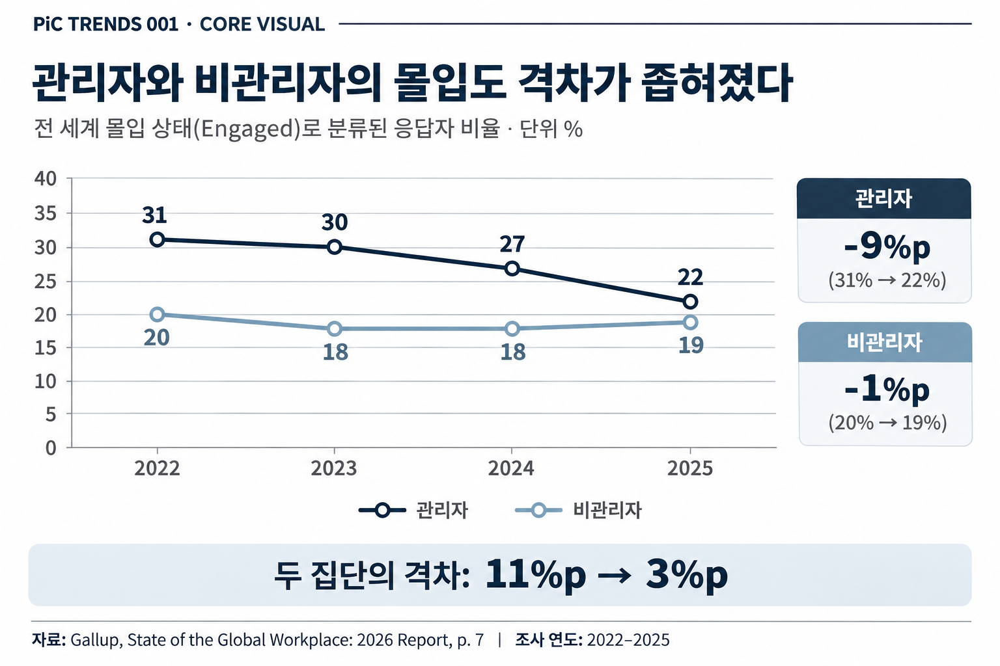
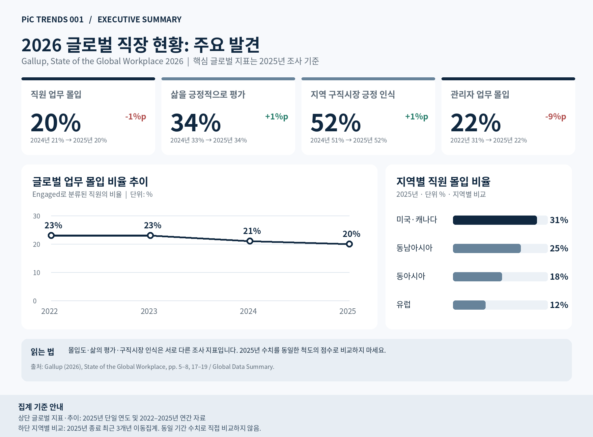

## Key Takeaways

- **관리자 집단의 업무 몰입 비율이 비관리자보다 크게 하락했다.** 2022~2025년 관리자는 31%에서 22%로 9%p, 비관리자는 20%에서 19%로 1%p 낮아졌다.
- **관리계층 축소는 가능한 설명이지만, 원인으로 확인된 것은 아니다.** Gallup은 남아시아의 관리자 비중과 몰입도가 함께 하락한 사례를 제시한다.
- **HR은 관리자에게 요구하는 역할과 이를 수행할 여건을 함께 점검할 필요가 있다.** 관리 대상 인원뿐 아니라 직접 실무를 수행하는 시간, 피드백·코칭 여건, 관리자 자신의 몰입도를 살펴볼 수 있다.

## 01. What Changed? — 관리자의 몰입도에서 나타난 변화

전 세계 직원의 업무 몰입도가 2년 연속 하락했다. Gallup의 2026년 보고서에서 몰입 상태(Engaged)로 분류된 직원의 비율은 2022~2023년 23%에서 2025년 20%로 낮아졌다. 특히 관리자 집단에서 더 큰 하락이 관찰됐다.

여기서 몰입도는 업무·팀·조직에 대한 심리적 연결과 열의를 측정하는 지표다. 단순한 직무만족도나 피로·번아웃의 정도를 뜻하지는 않는다.

## 02. What Does the Data Say? — 관리자와 비관리자의 변화는 어떻게 달랐나?

2022년 관리자 집단의 몰입 비율은 31%로 비관리자(20%)보다 11%p 높았다. 2025년에는 관리자 22%, 비관리자 19%로 격차가 3%p까지 좁혀졌다. 같은 기간 관리자 비율은 9%p, 비관리자는 1%p 하락했다. 특히 관리자는 2024년 27%에서 2025년 22%로 한 해 동안 5%p 낮아졌다.

{fig-align="center" width="100%"}

Gallup은 가능한 설명으로 조직의 관리계층 축소를 제시한다. 실제로 남아시아에서는 2025년 관리자 몰입 비율이 8%p 하락하는 동시에 관리자 비중도 줄었다. 그러나 이 두 변화가 함께 나타났다는 사실만으로 조직개편이 몰입도 하락을 일으켰다고 판단할 수는 없다.

## 03. Why Does It Matter for HR? — 관리자의 역할을 수행할 여건은 충분한가?

이번 결과는 관리자에게 요구하는 책임과 실제 업무 여건을 함께 점검할 필요성을 제기한다. 조직이 팀을 통합하거나 관리계층을 줄인다면, 관리자 한 사람이 담당하는 인원뿐 아니라 직접 실무를 수행해야 하는 시간과 구성원을 지원할 여력이 어떻게 달라지는지도 확인해야 한다.

관리자 수를 늘리거나 교육을 확대하면 몰입도가 회복된다는 뜻은 아니다. 관리 범위, 실무 수행 비중, 피드백·코칭 활동, 관리자 자신의 몰입도를 함께 살피고 조직별 변화의 원인과 지원 효과를 검증하는 것이 바람직하다.

**관리자의 몰입도 변화는 관리자의 숫자뿐 아니라, 그 역할을 수행할 여건을 묻게 한다.**

## Executive Summary — 글로벌 직장 현황

{fig-align="center" width="100%"}

---

## Appendix — 동아시아 직원 경험: 낮은 업무 몰입도와 지표별 차이

Gallup의 동아시아 지역 집계에서 업무에 몰입하는 직원은 18%, 몰입하지 않는 직원은 66%, 적극적으로 몰입하지 않는 직원은 16%였다. 같은 보고서에 실린 글로벌 연간 몰입 비율은 20%다. 다만 **동아시아 지역 수치는 최근 3개년 집계이고 글로벌 값은 2025년 단일 연도 집계**이므로 두 값을 동일한 기간의 엄밀한 비교로 해석할 수는 없다.

동아시아에서 삶을 긍정적으로 평가한 직원은 32%, 전날 스트레스를 많이 경험한 직원은 46%, 외로움을 많이 경험한 직원은 23%였다. 거주 지역에서 지금이 일자리를 찾기 좋은 시기라고 답한 직원은 58%였다. 업무 몰입, 삶의 평가, 감정 경험, 구직시장 인식은 서로 다른 질문으로 측정한 지표다. 이러한 수치가 함께 관찰됐다고 해서 스트레스나 외로움이 낮은 몰입도의 원인이라고 볼 수는 없다.

국가별 업무 몰입 비율(2025년 종료 3개년 이동집계)은 한국 13%, 일본 8%, 중국 20%였다. 구직시장에 대한 긍정적 인식도 한국 27%, 중국 60%로 달랐다. 동아시아의 지역 평균만으로 국가별 직원 경험을 일률적으로 설명하기 어렵다는 점을 보여준다. 이 차이가 문화나 인사제도에서 비롯됐는지는 별도 분석이 필요하다.

### 동아시아 주요 통계

| 조사 지표 | 동아시아 | 글로벌 | 비교 시 유의사항 |
|---|---:|---:|---|
| 업무 몰입(Engaged) | 18% | 20% | 지역은 최근 3개년, 글로벌은 2025년 |
| 삶의 긍정적 평가(Thriving) | 32% | 34% | 집계 기간 차이 존재 |
| 전날 스트레스 경험 | 46% | 40% | 집계 기간 차이 존재 |
| 전날 외로움 경험 | 23% | 22% | 집계 기간·측정 시점 확인 필요 |
| 구직시장 긍정 인식 | 58% | 52% | 집계 기간 차이 존재 |

*동아시아 지역: 한국·중국·일본·홍콩·대만·몽골. 국가별 비율은 2023~2025년 3개년 이동집계값이다. 국가·지역별 수치의 차이에 대한 유의성 검정이나 인과분석을 본 원고에서 수행하지 않았다.*

### PiC Implications — 무엇을 점검할 것인가?

지역 전체의 몰입도 하나로 HR 정책의 필요성을 판단하기보다 국가와 직급, 업무 특성을 나누어 살펴보는 접근이 유용하다. 또한 낮은 업무 몰입도를 스트레스나 이직 가능성의 대체 지표로 취급하지 말고, 각 지표가 무엇을 측정하는지 분리해 확인할 필요가 있다. **이는 특정 해법의 효과가 입증됐다는 결론이 아니라, 직원 경험 진단의 정확성을 높이기 위한 제언이다.**

---

## Sources & Methodological Notes

1. Gallup. (2026). *State of the Global Workplace: 2026 Report*. 특히 글로벌 직원 몰입도 및 직급별 추이, 동아시아 지역 요약, 조사 방법론. https://www.gallup.com/file/workplace/707798/state-of-the-global-workplace-2026-download.pdf
2. Gallup. *State of the Global Workplace 2026: Global Data Summary*. https://www.gallup.com/workplace/697904/state-of-the-global-workplace-globaldata.aspx
3. Gallup. *2026 Regional and Country Data*. https://www.gallup.com/workplace/697850/state-of-the-global-workplace-regional-data.aspx
4. Gallup. *South Korea Country-Level Data*. https://www.gallup.com/workplace/707186/state-global-workplace-south-korea-country-level-data.aspx
5. Gallup. *Japan Country-Level Data*. https://www.gallup.com/workplace/705794/state-global-workplace-japan-country-level-data.aspx
6. Gallup. *China Country-Level Data*. https://www.gallup.com/workplace/704906/state-global-workplace-china-country-level-data.aspx

**해석상 유의사항.** '몰입 비율'은 Gallup의 기준에 따라 Engaged로 분류된 응답자의 비율이며 평균 점수가 아니다. 본문 직급별 수치는 Gallup의 2022~2025년 글로벌 직급별 추이표와 공식 웹페이지를 기준으로 한다. 일부 원문 도표에서 2022년 관리자 값이 32%로 표기되는 불일치가 있으므로 본문과 Core Visual에서는 일관되게 31%를 사용한다. 연도별 비교는 동일 개인을 추적한 패널연구가 아니며, 집단의 변화 차이를 조직개편의 인과효과로 해석할 수 없다. 동아시아 Appendix의 지역·국가별 이동집계는 글로벌 연간 지표와 엄밀히 같은 시간 범위를 뜻하지 않는다.
