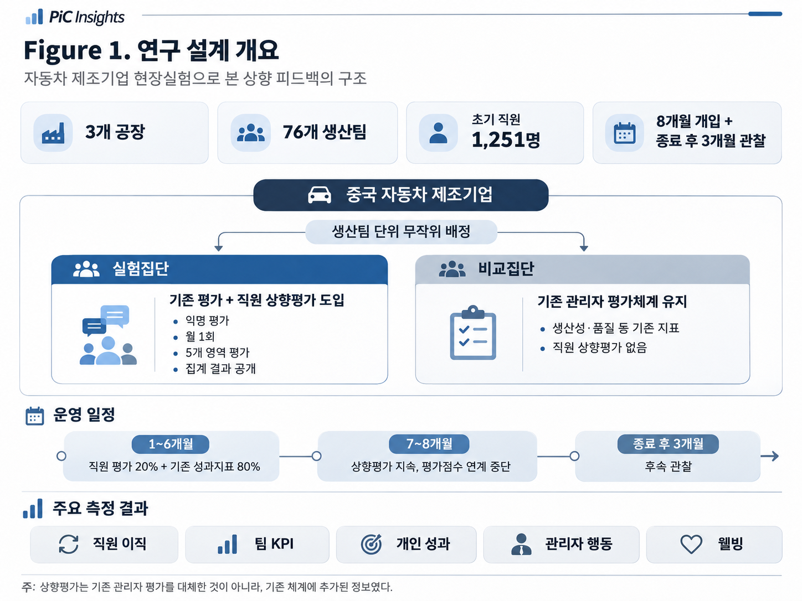
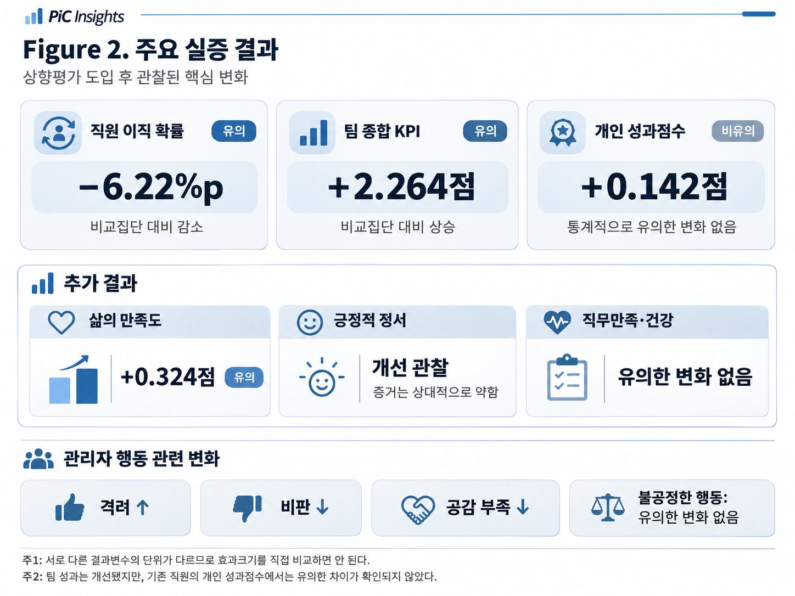
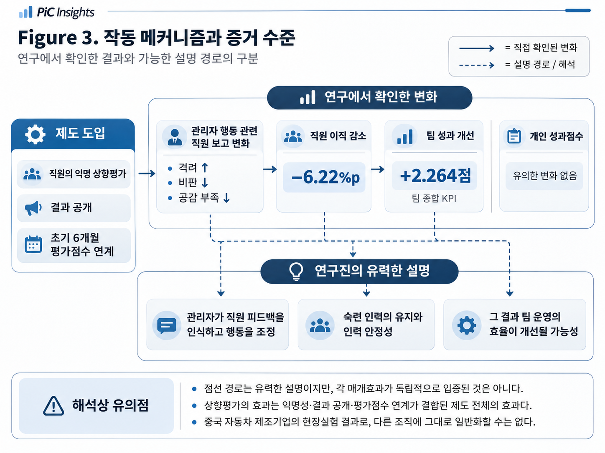

<strong>🎧 PiC AUDIO</strong>

직원의 상향 평가가 조직 행동에 가져온 변화

<audio controls preload="metadata" style="width:100%;">
  <source src="../assets/audio/manager-upward-feedback.m4a" type="audio/mp4">
  브라우저에서 오디오 재생을 지원하지 않습니다.
</audio>

## Governing Message

관리자의 성과를 평가할 때 조직은 생산성, 품질, 목표 달성률과 같은 결과지표를 활용한다. 그러나 이런 지표만으로 관리자가 구성원들과 어떻게 상호작용하고, 직원들이 그 행동을 어떻게 경험하는지 충분히 알기는 어렵다.

중국 자동차 제조기업의 무작위 현장실험에서 연구진은 기존 관리자 평가체계에 직원의 익명 상향평가를 추가했다. 그 결과 실험집단에서 직원 이직 확률이 낮아지고 팀 성과가 개선됐으며, 직원이 보고한 관리자의 격려·비판·공감 관련 행동에서도 변화가 나타났다.

이 연구는 관리자 평가에서 **무엇을 측정하는가뿐 아니라 누구의 정보를 반영하는가**가 조직의 결과와 연결될 수 있음을 보여준다. 다만 관찰된 변화와 그 변화가 발생한 이유는 구분해서 읽어야 한다.

## Key Takeaways

**01. 직원의 상향평가를 추가한 팀에서 이직은 감소하고 팀 KPI는 개선됐다.** 직원이 회사를 떠날 확률은 비교집단 대비 약 6.22%포인트 낮았고, 팀 종합 KPI는 약 2.26점 높았다. 반면 계속 근무한 직원의 개인 성과점수에서는 통계적으로 유의한 차이가 확인되지 않았다.

**02. 관리자 행동의 일부 변화가 직원 설문에서 관찰됐다.** 실험집단 직원들은 관리자가 더 많이 격려하고, 덜 비판하며, 공감이 부족한 행동을 덜 보인다고 응답했다. 이것은 직원이 보고한 행동 경험에 관한 결과이지, 모든 관리자 행동을 독립적으로 관찰한 기록은 아니다.

**03. 실험의 효과를 '상향평가 설문만의 효과'로 좁힐 수는 없다.** 익명 평가, 결과 공개, 초기 6개월간 관리자 성과평가점수 연계가 함께 시행됐다. 이후 보상 관련 점수 연계가 종료된 뒤에도 일부 결과가 지속됐지만, 보상 연계 없이 시작했어도 같은 효과가 나타났을지는 알 수 없다.

---

## Research Question — 성과지표는 관리자의 행동을 얼마나 보여주는가?

두 생산팀이 비슷한 생산성과 품질 목표를 달성했다고 가정해 보자. 한 팀의 관리자는 구성원의 의견을 듣고 작업상 어려움을 함께 해결한다. 다른 팀의 관리자는 같은 성과를 달성하지만 직원의 실수를 자주 비판하고 의견을 충분히 듣지 않는다. 최종 실적만 보면 두 관리자 사이의 차이는 잘 드러나지 않을 수 있다.

물론 관리자의 행동이 다르다는 사실만으로 장기 성과를 단정할 수는 없다. 팀 실적 역시 직원의 숙련도, 인력 구성, 설비와 업무환경 등 여러 요인에 영향을 받는다. 바로 이런 이유로 생산량과 품질 같은 결과지표만으로 관리자의 역량과 행동을 모두 판단하기는 어렵다.

직원은 상급자가 직접 관찰하기 어려운 관리자의 일상적인 행동을 경험한다. 관리자가 업무를 어떻게 조직하는지, 구성원의 제안에 어떻게 반응하는지, 오류가 발생했을 때 어떤 태도를 보이는지를 가까이에서 지켜본다.

그렇다면 **직원의 경험을 관리자 평가정보에 추가하면 관리자와 직원, 팀의 결과는 실제로 달라질까?** Jing Cai와 Shing-Yi Wang은 중국 자동차 제조기업의 현장실험을 통해 이를 검증했다.[^source]

## Research Design — 76개 생산팀에서 실시한 상향평가 실험

연구는 중국의 대형 자동차 제조기업 내 3개 공장, 76개 생산팀에서 진행됐다. 연구 등록자료상 초기 직원 표본은 1,251명이며, 공개 연구 요약은 이를 약 1,250명으로 소개한다. 이 수는 모든 결과분석의 관측치 수와 같지는 않다.[^sample]

생산팀을 단위로 무작위 배정해 약 절반의 팀에 직원 상향평가를 도입했다. 실험집단 직원은 매월 자신의 관리자를 익명으로 평가했고, 비교집단에는 기존 관리자 평가체계가 유지됐다.

평가 영역은 **업무 조직화, 적응력, 공정성, 직원 의견 수용, 공감 능력**의 다섯 가지였다. 직원은 각 항목을 1~5점으로 평가했다. 연구진은 개별 응답의 익명성을 유지해 수집했고, 집계된 평가 결과는 팀의 게시판에 공개됐다.

실험에서 특히 중요한 것은 보상 관련 설계다. **첫 6개월 동안** 직원의 평가 결과는 관리자 월별 성과평가점수의 20%를 차지했고, 기존 실적지표의 비중은 80%가 됐다. 이 성과평가점수는 관리자 성과급과 향후 임금인상·승진 가능성에 영향을 주는 평가체계의 일부였다. **마지막 2개월 동안** 직원 평가는 계속 실시했지만 관리자의 공식 성과평가점수에는 더 이상 반영하지 않았다.

따라서 이 연구는 기존 성과평가를 직원 평가로 전면 대체한 실험도, 직원 의견을 단 한 번 수집한 설문 실험도 아니다. 직원의 익명 상향평가를 기존 평가에 추가하고, 결과를 공개하며, 일정 기간 성과평가점수와 연계한 **복합적인 제도 도입**의 효과를 측정했다.

*Figure 1. 중국 자동차 제조기업의 생산팀 단위 무작위 실험과 8개월 개입 구조. 처음 6개월의 공식 평가점수 연계와 이후 2개월의 피드백 유지 기간을 구분했다. 자료: Cai & Wang(2020), 연구설계.*

연구진은 기업의 행정자료에서 이직, 개인 성과점수, 팀 KPI 및 보상 자료를 확인하고, 직원 설문을 통해 삶의 만족도, 정서 상태, 직무만족도, 관리자의 행동 경험을 조사했다. 통계분석에서는 무작위 배정에 사용한 조건과 개입 이전 결과를 고려했으며, 같은 팀 소속 관측치의 상관성을 반영하기 위해 **생산팀 단위 군집 표준오차**를 사용했다.[^methods]

이런 설계는 단순한 상관관계 분석에 비해 제도 도입의 인과적 효과를 파악하는 데 강점이 있다. 다만 개입의 여러 구성요소를 각각 독립적으로 무작위화한 것은 아니다.

## Key Findings — 직원 이직과 팀 성과에서 나타난 변화

### 1. 직원이 회사를 떠날 확률은 약 6.22%포인트 낮아졌다

실험집단 직원이 회사를 떠날 확률은 비교집단보다 **6.22%포인트 낮았다**. 이 차이는 통계적으로 유의했다(p<0.01). 공개 연구원고의 분석표에 제시된 이직 여부의 전체 평균은 약 10.7%다.[^turnover]

6.22%포인트는 6.22%의 상대적 감소율과 다르다. 예컨대 이직률이 10%에서 4%로 감소했다면 감소 폭은 6%포인트이고, 최초 수준 대비 상대 감소율은 60%다. 또한 연구에서 측정한 것은 조사 전후 기존 직원의 이직 여부로, 기업 전체의 연간 이직률과 동일한 개념은 아니다.

이 결과는 직원이 관리자에 관한 피드백을 제공할 수 있게 된 이후 **인력 유지에 의미 있는 차이가 나타났음**을 보여준다. 직원이 왜 퇴사하지 않았는지는 추가 분석과 해석의 영역이다.

### 2. 팀 KPI는 개선됐지만, 개인 성과점수에는 유의한 변화가 없었다

실험집단의 **팀 종합 KPI는 2.264점 높았다**(p<0.05). 세부 지표 중 생산 KPI는 약 3.714점(p<0.01), 관리 KPI는 약 1.899점(p<0.05) 높았다. 반면 품질·안전·설비 관련 KPI의 추정 효과는 통계적으로 유의하지 않았다.[^kpi]

계속 근무한 직원의 개인 종합 성과점수는 약 +0.142점으로 추정됐지만 통계적으로 유의하지 않았다. 이것은 개인 성과에 **효과가 없다고 입증했다는 의미가 아니라**, 이 자료에서 유의한 차이가 확인되지 않았다는 뜻이다.

왜 팀 성과에서는 변화가 나타났을까? 연구진은 **직원 이직 감소와 숙련 인력 유지**에 주목한다. 신규 입사자는 작업을 익히고 숙련도를 높이기까지 시간이 필요하기 때문에 잦은 인력 교체는 팀 성과를 낮출 수 있다. 기존 직원의 생산성이 크게 달라지지 않아도 숙련된 직원이 안정적으로 남아 있으면 팀의 종합 성과가 개선될 가능성이 있다.

다만 **이직 감소가 팀 KPI 상승의 전부를 설명한다는 매개효과가 독립적으로 입증된 것은 아니다.** 연구 결과의 조합과 신규 직원 생산성에 관한 추가 분석이 이 경로를 뒷받침한다는 정도로 읽는 편이 정확하다.

*Figure 2. 비교집단 대비 추정 효과. 직원 이직 −6.22%포인트, 팀 종합 KPI +2.264점은 통계적으로 유의하며, 개인 성과점수 +0.142점은 유의하지 않다. 서로 다른 단위의 효과크기를 직접 비교해서는 안 된다. 자료: 공개 연구원고 Tables 3–5, 7.*

### 3. 직원이 보고한 관리자의 일부 행동에도 변화가 나타났다

실험집단 직원들은 비교집단보다 관리자가 자신을 더 격려하고, 덜 비판하며, 공감이 부족한 행동을 덜 보인다고 보고했다. 반면 불공정한 행동에 관한 항목에서는 유의한 변화가 확인되지 않았다.[^behavior]

이 결과는 관리자에 대한 전반적인 호감도가 일괄적으로 높아졌다는 설명과 다르다. **격려, 비판, 공감 관련 행동 경험 중 일부가 달라졌다는 결과**다. 동시에 행동의 주요 지표가 직원 응답에 기반하므로, 객관적 관찰자가 관리자의 모든 행동을 기록한 결과로 바꾸어 설명해서도 안 된다.

### 4. 웰빙에는 선택적인 변화가 있었다

실험집단 직원의 **삶의 만족도는 10점 척도에서 약 0.324점 높았다**(p<0.01). 긍정적 정서의 추정치 역시 증가했지만 통계적 근거는 10% 유의수준에 해당해 상대적으로 약했다. 반면 직무만족, 부정적 정서, 자기보고 건강에서는 유의한 변화가 확인되지 않았다.[^wellbeing]

따라서 이 연구의 결과를 ‘직원의 모든 만족도와 웰빙이 높아졌다’고 요약해서는 안 된다. **어떤 항목에서 변화가 있었고 어떤 항목에서는 확인되지 않았는지** 구체적으로 구분해야 한다.

## Interpretation — 변화는 어떻게 발생했는가?

### 관리자가 직원 피드백을 인식하고 행동을 조정했을 가능성

연구진이 제시하는 주요 설명은 관리자에게 새로운 정보가 제공됐다는 것이다. 생산성과 품질 같은 결과지표는 팀의 실적을 보여주지만, 직원들이 관리자의 의사소통이나 지시를 어떻게 경험하는지까지 알려주지는 않는다.

직원 평가를 통해 관리자는 업무 조직화, 공정성, 공감, 의견 수용 등에 관해 자신이 알지 못했던 정보를 접했을 수 있다. 이러한 정보가 관리자 자신의 행동을 돌아보고 조정하는 계기가 됐을 가능성이 있다.

연구진은 제도에 대한 관리자와 직원의 인식 차이를 추가로 분석했다. 관리자가 피드백 제도를 인식하는 정도는 일부 팀 성과와 유의한 관련이 있었으나, 직원의 제도 인식과 관련해서는 같은 패턴이 확인되지 않았다. 연구진은 이를 단순히 직원에게 발언 기회를 제공하는 효과보다 **관리자의 정보 인식과 반응**이 중요할 수 있다는 증거로 해석한다.[^mechanism]

하지만 피드백을 적극적으로 인식한 관리자와 그렇지 않은 관리자를 별도로 무작위 배정한 것은 아니다. 관리자 학습, 낮은 평가를 피하기 위한 행동 조정, 보상 관련 압력의 상대적인 기여를 완전히 구분할 수는 없다.

### 보상 관련 점수 연계가 끝난 후에도 일부 효과가 이어졌다

처음 6개월 뒤 관리자의 성과평가점수 연계는 중단됐지만, 이후 2개월에는 직원의 피드백이 계속됐다. 연구진의 월별 분석에서는 일부 팀 성과의 개선이 연계 종료와 동시에 사라지지 않는 패턴이 확인됐다. 공식 피드백 종료 이후 관찰기간에도 일부 개선이 이어졌다.[^persistence]

또한 평가 제도가 끝난 후에 입사한 직원들을 살펴본 추가 분석에서는, 이전 실험집단 팀에 들어온 신규 직원이 관리자의 격려와 공감을 더 긍정적으로 보고하는 경향이 있었다. 다만 이 분석은 소규모 표본에 기반하고 신규 입사자의 팀 배정이 무작위화된 것은 아니므로 신중하게 해석해야 한다.

이 결과는 **관리자의 행동 변화가 단기적인 평가 압력에만 국한되지 않았을 가능성**을 보여준다. 그러나 처음부터 보상 관련 점수 연계가 없었어도 같은 변화가 나타났을 것이라는 결론까지 지지하지는 않는다.

### 이직 감소가 팀 성과 개선을 설명할 수 있을까?

연구진은 실험집단의 이직 감소, 개인 성과의 비유의적 변화, 팀 KPI 상승이라는 결과를 함께 해석했다. 숙련 직원이 더 오래 남으면 신규 인력의 채용·적응과 교육 부담이 줄고, 팀 성과가 안정적으로 유지될 수 있다는 설명이다.

이 설명은 추가 분석과 일치하지만, 관리자 행동 변화 → 이직 감소 → 팀 KPI 상승의 **각 단계가 독립적으로 실험 검증된 인과경로**는 아니다. 이 연구가 가장 강하게 식별하는 것은 **상향평가를 포함한 제도 도입의 총효과**다. 그 결과가 발생한 경로에 관한 설명은 그다음 수준의 증거로 구분해야 한다.

*Figure 3. 관찰된 제도 도입 효과와 연구진의 유력한 설명 경로를 구분한 도식. 점선으로 표시된 관리자 학습·행동 조정·숙련 인력 유지의 연결은 각 매개효과가 별도로 입증된 인과경로를 뜻하지 않는다. 자료: Cai & Wang(2020)의 본문 및 메커니즘 분석.*

## HR Implications — 관리자 평가체계에 어떤 질문을 남기는가?

### 1. 결과지표가 포착하지 못하는 관리 행동을 어떻게 측정할 것인가?

관리자의 성과를 파악하는 데 생산성이나 품질 지표는 중요하다. 그러나 그 지표는 직원이 경험하는 일상적인 관리 행동에 관한 정보와 다르다. 같은 성과를 낸 팀에서도 업무 배분과 소통, 의견 수용 방식은 달라질 수 있다.

직원 상향평가는 이러한 정보의 공백을 보완할 수 있는 방법 중 하나다. 그렇다고 직원 평가점수가 기존 성과지표보다 본질적으로 우월하다는 의미는 아니다. 직원의 응답에도 관계, 선호, 최근 경험 및 평가 부담이 영향을 줄 수 있다.

이 연구에서 실무적으로 제기할 질문은 **결과지표를 버리고 직원 평가로 대체할 것인가**가 아니다. **서로 다른 정보원이 측정하는 대상을 명확히 구별하고, 그 정보를 어떻게 결합할 것인가**다.

### 2. 피드백의 수집과 실제 활용 사이에는 어떤 설계가 필요한가?

직원의 의견을 수집하는 것만으로 관리자의 행동 변화가 자동으로 발생하지는 않는다. 이번 실험에는 정기적인 익명 평가, 집계 결과 공개, 초기 성과평가점수 연계가 함께 포함됐다.

조직이 상향평가를 설계한다면 질문의 내용, 익명성 보장, 결과의 전달 방식, 평가 이후 관리자의 행동 조정을 지원하는 과정, 보상 및 승진과 연결할 때의 공정성 문제를 함께 검토해야 한다. 이것은 이 연구에서 각 설계요소의 우열이 입증됐다는 뜻이 아니라, **실험의 구성과 결과로부터 도출할 수 있는 실무적 검토 기준**이다.

### 3. 팀 성과를 개인 생산성만으로 설명할 수 있는가?

팀 성과 개선이 항상 구성원 한 사람 한 사람의 생산성 증가로 나타나는 것은 아니다. 이 연구에서는 기존 직원의 개인 성과점수에 유의한 변화가 확인되지 않았음에도 팀 KPI가 개선됐다.

팀 운영에서 숙련 인력의 유지, 신규 입사자의 적응 기간, 인력 교체에 따른 학습·조정 부담은 성과를 형성하는 또 다른 조건이 될 수 있다. 다만 이를 근거로 모든 조직에서 이직률이 낮을수록 성과가 높다는 일반 법칙을 도출해서는 안 된다.

### 4. 상향평가를 평가점수 생산보다 정보 활용의 문제로 볼 필요

직원의 상향평가는 관리자에게 새로운 정보를 제공하는 수단일 수 있다. 이 정보는 관리자 개발, 팀 운영 점검, 성과평가의 보완 자료 등 여러 용도로 활용할 수 있다.

그러나 서로 다른 활용 방식이 같은 성과를 낸다는 증거는 이번 실험에 없다. 따라서 제도를 검토할 때에는 **어떤 관리 행동을 파악하고 싶은지**, **그 정보를 누가 어떤 목적으로 사용할지**, **변화를 어떤 지표로 검증할지**를 먼저 구체화하는 편이 타당하다.

## Limitations & Notes — 어디까지 해석할 수 있는가?

**연구 환경의 한계.** 중국의 한 자동차 제조기업 생산현장에서 수행된 실험이다. 한국의 사무직, 전문서비스업, 원격·하이브리드 조직에 동일한 효과가 발생한다고 일반화하기 어렵다.

**복합 처치의 한계.** 익명 평가, 결과 공개, 초기 평가점수 연계가 결합됐다. 개별 구성요소의 독립적 효과를 분리한 실험이 아니다.

**관리자 행동 측정의 한계.** 주요 행동 변화는 직원 설문 응답으로 측정됐다. 직원이 경험한 행동 변화에 관한 증거이지 모든 실제 행동의 독립적 관찰자료는 아니다.

**메커니즘 식별의 한계.** 관리자의 학습과 행동 조정, 직원 이직 감소, 팀 성과 개선이라는 설명은 연구 결과와 일치한다. 그러나 인과적 매개경로가 각 단계별로 별도 식별된 것은 아니다.

**비유의 결과의 해석.** 개인 성과와 일부 웰빙 항목에서 유의한 차이가 확인되지 않았다는 것은 효과가 정확히 0임을 입증한다는 뜻이 아니다.

**분석 단위와 표본의 차이.** 무작위 배정 단위는 생산팀이다. 초기 참여 직원 수와 각 회귀분석에서 사용된 관측치 수는 다르다. 군집 표준오차는 같은 팀 소속 관측치의 상관성을 고려하기 위한 것이다.[^methods]

## PiC Perspective — 관리자 평가의 정보 범위를 다시 묻다

관리자 평가체계는 조직이 무엇을 중요한 성과로 보는지 드러낸다. 기업은 실적을 측정하지만, 그 결과가 만들어지는 과정과 구성원이 경험하는 관리 행동까지 같은 수준으로 파악하고 있는지는 별개의 문제다.

Cai와 Wang의 실험에서 직원의 평가정보를 추가한 집단은 이직과 팀 KPI에서 유의한 변화를 보였고, 관리자의 일부 행동에 대한 직원 응답도 달라졌다. 이 결과는 **평가정보의 범위를 바꾸는 일이 조직의 실제 결과와 연결될 수 있다는 실증적 가능성**을 보여준다.

그러나 그 변화가 왜 발생했는지는 한 단계 더 조심스럽게 살펴야 한다. 관리자 학습과 행동 변화, 숙련 인력 유지라는 설명은 설득력 있지만 모든 경로가 직접 입증된 것은 아니다. 실험의 맥락과 제도 구성 역시 다른 조직에 그대로 옮길 수 없다.

따라서 이 연구가 남기는 질문은 '상향평가를 도입해야 하는가'라는 단일한 처방보다 더 구체적이다.

**우리는 관리자에게 어떤 성과를 기대하며, 그 성과가 만들어지는 과정을 이해하기 위해 누구에게서 어떤 정보를 수집하고 있는가?**

이 질문을 명확히 하고 실제 결과로 검증하는 것. 그것이 관리자 평가를 점수의 문제가 아니라 조직을 이해하는 정보체계의 문제로 바라보는 출발점일 수 있다.

---

## References & Method Notes

[^source]: Cai, J., & Wang, S.-Y. (2022). *Improving Management Through Worker Evaluations: Evidence from Auto Manufacturing.* The Quarterly Journal of Economics, 137(4), 2459–2497. https://doi.org/10.1093/qje/qjac019. 상세 수치와 표는 Cai & Wang(2020), [NBER Working Paper 27680](https://www.nber.org/papers/w27680) 공개본에 근거한다.

[^sample]: AEA RCT Registry의 사후 등록정보에는 76개 팀·1,251명으로 제시돼 있으며, NBER 본문과 J-PAL 요약에서는 약 1,250명으로 서술한다. https://doi.org/10.1257/rct.2286-2.1

[^methods]: 공개 연구원고의 연구설계·분석 설명. 팀 단위 무작위 배정, 층화 변수 및 별도의 병행 실험 요인 통제, 팀 단위 군집 표준오차. https://www.nber.org/papers/w27680

[^turnover]: Cai & Wang(2020), Table 3. 이직 −0.0622(표준오차 0.0178, 1% 수준 유의), 표에 제시된 종속변수 평균 0.107. 이 평균을 ‘비교집단 평균’이라고 단정하지 않는다.

[^kpi]: Cai & Wang(2020), Tables 4–5. 개인 종합 성과 +0.142(표준오차 0.375, 비유의); 팀 종합 KPI +2.264(1.075), 생산 KPI +3.714(1.289), 관리 KPI +1.899(0.808).

[^behavior]: Cai & Wang(2020), 관리자·직원 상호작용에 대한 설문 및 부가 분석. 격려 증가, 비판 감소, 공감 부족 감소가 확인됐으나 모든 행동 항목에 유의한 변화가 있었던 것은 아니다.

[^wellbeing]: Cai & Wang(2020), Table 7. 삶의 만족도 +0.324(표준오차 0.116, 1% 수준 유의), 긍정적 정서 +0.633(표준오차 0.378, 10% 수준 유의); 직무만족·부정적 정서·건강 비유의.

[^mechanism]: Cai & Wang(2020), 관리자의 제도 인식·행동 변화 및 대안 설명 분석. 연구진의 메커니즘 해석과 무작위 배정에 기초한 총효과 추정을 구별한다.

[^persistence]: Cai & Wang(2020), 월별 팀 KPI 추이 및 종료 후 신규 입사자 추가 분석. 일부 효과의 지속 가능성을 제시하지만 보상 연계 없는 초기 도입의 효과를 독립적으로 검증하지는 않는다.

**자료 검증 안내:** QJE 정식 출판본의 서지와 초록을 확인했고, 세부 수치는 접근 가능한 NBER 공개 원고의 표를 기준으로 검수했다. 정식 출판본 전체 및 최종 온라인 부록의 모든 수치를 일대일 대조한 것은 아니다.
