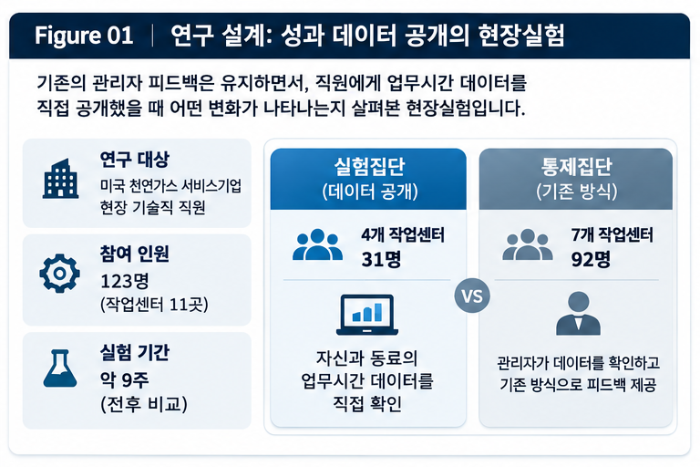
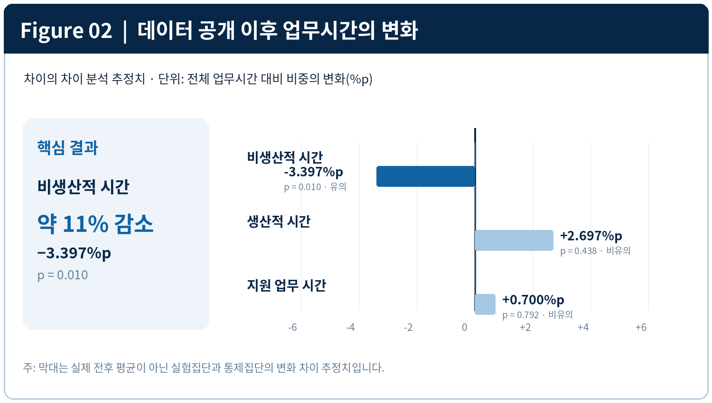
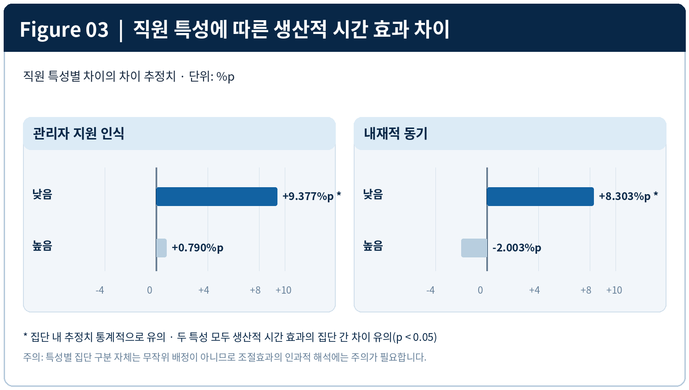
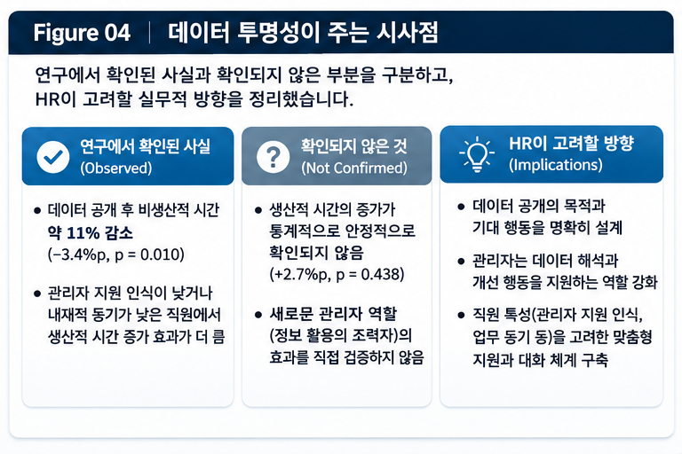

<strong>🎧 PiC AUDIO</strong>

성과 데이터 공개가 생산성 증가에 미치는 영향

<audio controls preload="metadata" style="width:100%;">
  <source src="../assets/audio/performance-data-transparency.m4a" type="audio/mp4">
  브라우저에서 오디오 재생을 지원하지 않습니다.
</audio>

## Governing Message

성과 데이터를 직원에게 직접 공개하면 행동은 달라질 수 있다. 그러나 비생산적 시간이 줄었다고 해서 더 높은 생산성이 실현되었다고 단정할 수는 없다. 직원은 더 뛰어난 성과를 내기보다 부정적으로 평가될 행동을 피하는 데 집중할 수도 있다.

데이터의 투명성은 직원이 무엇을 하는지 보여준다. 하지만 무엇을 개선해야 하고, 그 개선이 어떤 가치로 이어지는지까지 충분히 설명해 주지는 않는다. 이 지점에서 관리자의 역할은 사라지는 것이 아니라 새로운 질문과 마주한다.

## Key Takeaways

- **성과 데이터 공개는 비생산적 시간을 줄였다.** 미국 천연가스 서비스기업의 현장실험에서 비생산적 시간 비중은 실험 전 평균 대비 약 11% 감소했다.
- **전체 표본에서 생산적 시간의 유의한 증가는 확인되지 않았다.** 부정적 행동을 줄이는 것과 긍정적 성과를 확대하는 것은 구별해야 한다.
- **직원의 특성에 따라 반응이 달랐다.** 특히 관리자 지원을 낮게 인식한 직원과 내재적 동기가 낮은 직원에게서 생산적 시간 증가가 관찰되었다.
- **관리자의 역할도 다시 생각할 필요가 있다.** 직원이 데이터를 직접 볼 수 있다면, 관리자는 수치를 대신 읽어주는 것보다 왜 그런 결과가 나왔는지 함께 살피고 어떤 행동을 바꿀 수 있을지 돕는 데 가치를 제공할 수 있다. 이는 논문 결과에서 발전시킨 PiC의 해석이지, 실험으로 검증된 새 관리모델은 아니다.

## Research Question — 성과정보의 전달자를 거치지 않는다면

직원이 자신의 성과를 어떻게 알게 되는지는 오랫동안 관리자에게 달려 있었다.

관리자는 성과정보를 확인하고, 의미 있는 내용을 선택하며, 직원에게 필요한 피드백을 전달한다. 직원은 관리자가 설명해 준 정보를 통해 자신의 업무를 돌아보고 개선 방향을 결정한다.

그런데 디지털 기술은 이 구조를 변화시키고 있다. 직원은 이제 관리자가 설명해 주기를 기다리지 않고도 대시보드에서 자신의 성과를 확인할 수 있다.

이 변화는 두 가지 질문을 제기한다. 직원에게 성과 데이터를 직접 공개하면 실제 행동이 달라질까? 그리고 관리자의 정보 중개 역할이 약해진다면 성과관리는 어떻게 달라져야 할까?

Ethan Bernstein과 Shelley Xin Li는 미국의 한 천연가스 서비스기업에서 진행한 현장실험으로 이 문제를 살펴보았다. 새로운 평가제도를 도입하거나 보상을 추가한 것이 아니라, 기존에 관리자만 확인하던 업무시간 데이터를 직원에게도 직접 제공한 실험이다.

## Research Design — 성과 데이터를 직접 보게 된 31명의 직원

연구에는 현장 기술직 직원 123명과 11개 작업센터가 참여했다. 연구진은 작업센터를 무작위로 배정했다. 4개 센터의 직원 31명은 업무시간 데이터에 직접 접근할 수 있게 되었고, 나머지 7개 센터의 직원 92명은 기존 방식을 유지했다.

실험집단에서는 직원들이 자신과 같은 작업센터 동료들의 지표를 확인할 수 있었다. 통제집단에서는 관리자가 먼저 데이터를 확인한 뒤 피드백했다. 실험집단에서도 관리자와 직원의 일상적인 피드백 대화는 계속되었다. 관리자를 제거하거나 피드백을 금지한 실험은 아니었다.

{fig-alt="작업센터 11곳의 실험집단 31명과 통제집단 92명을 비교한 연구 설계" width="85%" fig-align="center"}

*Figure 1. 연구 설계. 무작위 배정 단위는 개인이 아니라 작업센터 11곳이다. 도식은 인과 추정의 기본 구조를 요약한 것으로, 개별 직원의 무작위 배정을 의미하지 않는다.*

연구기업은 업무시간을 세 가지로 분류했다. **생산적 시간(Productive Time)**은 고객 현장에서의 작업이나 업무상 이동 등 직접적인 서비스 제공과 관련된 시간이다. **지원 업무 시간(Support Time)**은 안전회의, 교육, 작업 준비, 동료 지원처럼 즉각적인 수익 창출은 아니어도 필요한 활동이다. **비생산적 시간(Nonproductive Time)**은 앞의 두 범주에 해당하지 않는 시간이다.

이 구분은 중요하다. 지원 업무 시간은 낭비가 아니며, 생산적 시간이라는 명칭도 기업이 정의한 업무시간 범주이지 조직 성과 전체를 뜻하지 않는다.

연구진은 실험집단과 통제집단의 실험 전후 변화를 **차이의 차이(Difference-in-Differences)** 방식으로 비교했다. 예를 들어 실험집단의 비생산적 시간이 5%포인트 감소하고 같은 기간 통제집단에서는 2%포인트 감소했다면, 두 감소폭의 차이인 3%포인트를 실험집단에서 나타난 추가 변화로 추정한다. 이 숫자는 방법을 이해하기 위한 가상의 사례이지 실제 연구 결과가 아니다. 두 집단의 전후 변화를 함께 비교함으로써 공통된 시간 변화의 영향을 일정 부분 고려할 수 있지만, 실험 이전의 추세가 비교 가능하다는 등의 조건도 중요하다.

분석에는 **개인 고정효과(Individual Fixed Effects)**도 포함됐다. 이는 직원마다 비교적 일정하게 유지되는 특성, 예를 들어 평소 업무 습관이나 경험의 차이가 데이터 공개 효과와 혼동되지 않도록 고려하는 방법이다. 다만 시간이 지나며 변하는 모든 요인까지 제거해 주는 것은 아니다.

또한 연구진은 **작업센터 단위 군집 표준오차(Clustered Standard Errors)**를 사용했다. 같은 작업센터 직원들은 관리자와 업무환경을 공유하므로 관측값이 서로 유사할 수 있다. 이를 완전히 독립적인 자료처럼 취급하면 결과를 지나치게 확실하게 판단할 위험이 있어, 작업센터 안의 유사성을 반영해 불확실성을 계산한 것이다.

## Key Findings — 비생산적 시간은 줄었지만

실험에서 가장 분명하게 나타난 변화는 **비생산적 시간 비중의 약 3.4%포인트 감소**였다. 실험 전 평균에 비추면 약 11%의 상대적인 감소이며, 통계적으로 유의했다.

그러나 생산적 시간 비중의 추정 변화는 약 +2.7%포인트였지만 통계적으로 유의하지 않았다. 지원 업무 시간도 약 +0.7%포인트 증가한 것으로 추정됐으나 유의하지 않았다. **유의하지 않다는 말은 변화가 전혀 없었다는 뜻이 아니라, 자료의 불확실성을 고려할 때 실제 효과가 있다고 충분히 확신하기 어렵다는 뜻**이다.

아래 Figure 02는 공개 전후의 실제 평균을 나열한 그래프가 아니다. 실험집단과 통제집단의 전후 변화를 함께 고려한 차이의 차이 추정치를 표시한다. 따라서 각 막대는 데이터 공개에 따른 업무시간 비중의 추가적인 변화에 대한 추정치로 읽어야 한다.

{fig-alt="비생산적 시간 비중은 3.397%포인트 감소했으며, 생산적 시간과 지원 시간의 변화는 통계적으로 유의하지 않은 차이의 차이 추정 결과" width="85%" fig-align="center"}

*Figure 2. 주요 회귀계수는 비생산적 시간 −3.397%p(p=0.010), 생산적 시간 +2.697%p(p=0.438), 지원 업무 시간 +0.700%p(p=0.792)이다. 약 11% 감소는 비생산적 시간의 상대적 변화율이지 전체 생산성의 11% 증가가 아니다. 출처: 원문 Table 3.*

비생산적 시간이 줄었다는 것은 해당 기업이 개선 대상으로 삼은 지표가 나아졌다는 의미다. 그렇지만 감소한 시간이 실제로 얼마나 추가적인 고객 서비스로 연결됐는지, 매출·품질·고객 만족이나 장기 생산성이 높아졌는지는 이 분석만으로 알 수 없다. **업무시간의 배분과 실제 업무 성과는 같은 개념이 아니다.**

## Interpretation — 더 잘하려는 행동과 나쁘지 않게 보이려는 행동

직원이 자신의 업무시간 데이터를 직접 볼 수 있다면 생산적 시간을 늘릴 것이라고 기대하기 쉽다. 그러나 연구진의 현장 관찰에서 직원들은 생산적 시간이 높은 사람으로 두각을 나타내는 것보다 비생산적 시간이 많은 사람으로 눈에 띄지 않는 데 관심을 보였다. 논문은 이를 ‘탁월함보다 동조(conform, not excel)’라는 표현으로 전달한다.

데이터 공개는 직원에게 무엇이 관찰되고 평가될 수 있는지를 알려준다. 그러나 그 지표를 줄이거나 늘리는 행동이 모두 조직이 기대한 성과로 이어지지는 않는다. 비생산적 시간을 줄인 직원도 절약한 시간을 고객 서비스에 어떻게 활용할지 충분히 알지 못할 수 있다.

**데이터를 보여주는 것과 데이터가 가리키는 바람직한 행동을 설명하는 것은 별개의 과제**다. 더욱이 업무시간 분류는 조직의 운영 목적을 반영하므로, 안전교육이나 동료 지원처럼 지표 하나로 평가하기 어려운 기여도 함께 고려해야 한다.

## Key Findings — 데이터 공개는 누구에게 더 효과적이었는가

연구진은 실험 전 조사한 관리자 지원에 대한 인식, 사회적 비교 성향, 내재적·외재적 동기를 바탕으로 하위집단 분석을 실시했다.

관리자 지원을 낮게 인식한 직원들에게서는 비생산적 시간 비중이 약 5.3%포인트 감소하고 생산적 시간 비중이 약 9.4%포인트 증가한 것으로 추정됐다. 두 결과 모두 해당 집단 안에서는 통계적으로 유의했다. 반면 관리자 지원을 높게 인식한 직원의 생산적 시간 증가 추정치는 약 0.8%포인트였으며 유의하지 않았다. **두 집단의 생산적 시간 증가 효과 차이는 통계적으로 유의했지만**, 비생산적 시간 감소 효과의 집단 간 차이는 유의하지 않았다.

여기서 **어느 한 집단의 효과가 유의하다는 것과 다른 집단보다 효과가 유의하게 크다는 것은 다른 판단**이다. 후자를 말하려면 두 집단의 효과를 직접 비교해 그 차이도 검정해야 한다.

내재적 동기가 낮은 직원들에게서는 비생산적 시간 비중이 약 6.7%포인트 감소하고 생산적 시간 비중은 약 8.3%포인트 증가한 것으로 추정됐다. 반면 내재적 동기가 높은 직원의 생산적 시간 효과는 약 **−2.0%포인트**로 추정됐으나, 이 감소는 통계적으로 유의하지 않았다. 생산적 시간에 관한 두 집단의 효과 차이는 통계적으로 유의했다. 비생산적 시간 효과에서도 두 집단의 차이가 유의했다.

내재적 동기는 업무 자체에서 흥미나 보람을 느끼며 일하려는 동기를 말한다. 내재적 동기가 낮다는 것이 업무능력이 낮거나 성실하지 않다는 뜻은 아니다. 따라서 이 결과는 직원의 동기 수준에 따라 데이터 공개의 효과가 달랐다는 증거로 해석해야지, 동기가 낮은 직원이 반드시 더 큰 성과를 낸다는 일반적인 결론으로 확대해서는 안 된다.

{fig-alt="관리자 지원 인식과 내재적 동기 수준별 생산적 시간 변화 효과를 비교한 하위집단 분석 결과" width="85%" fig-align="center"}

*Figure 3. 생산적 시간 비중의 집단별 처리효과 추정치. 관리자 지원 낮음 +9.377%p / 높음 +0.790%p, 내재적 동기 낮음 +8.303%p / 높음 −2.003%p. 각각의 집단 간 효과 차이는 5% 수준에서 유의했다. 단, 집단 특성을 무작위 배정한 실험은 아니며 여러 하위집단 비교에 유의해야 한다. 출처: 원문 Tables 4, 6.*

반면 동료와 자신을 비교하려는 성향에 따라 데이터 공개의 효과가 유의하게 달랐다는 증거는 확인되지 않았다. 외재적 동기에 따른 차이는 일부 관찰됐지만 모든 지표에서 일관되게 강한 집단 간 차이가 확인된 것은 아니었다.

같은 정보를 공개해도 직원들이 똑같이 반응하지 않는다는 뜻이다. 다만 이런 특성을 무작위로 배정한 것은 아니므로, 관리자 지원이나 업무 동기 그 자체가 효과의 원인이라고 단정해서는 안 된다.

## Interpretation — 관리자에게 덜 지원받는다고 느낀 직원은 왜 달랐을까

이 결과를 이해하려면 단순히 ‘관리가 부족했기 때문’이라는 설명을 피해야 한다.

연구진의 현장 관찰에서 일부 직원은 기존 관리자와의 피드백이 형식적이거나 실질적인 도움이 적었다고 설명했다. 직접 공개된 데이터에는 관리자에게 선별된 설명을 듣지 않고 자신의 상태를 확인할 수 있다는 장점이 있었다. 동료의 성과정보를 살펴보고 도움을 구할 상대를 찾을 가능성도 생겼다.

기존 피드백에 만족하지 못한 직원에게 정보의 직접 접근은 새로운 선택지를 제공했을 수 있다. 반면 이미 충분한 피드백을 받고 있었다고 느낀 직원에게는 그 추가적인 가치가 작았을 가능성도 있다.

하지만 어느 경로가 실제로 얼마나 작동했는지는 검증되지 않았다. 데이터에 대한 신뢰, 동료 지원, 부정적 평가 회피가 서로 어떤 영향을 미쳤는지도 분리해 측정하지 않았다. 무엇보다 직원이 평가한 관리자 지원 수준은 관리자의 객관적인 역량을 측정한 값이 아니다.

따라서 **‘지원이 부족한 관리자를 데이터가 대체했다’는 해석은 지나치다.** 이 연구가 더 강하게 뒷받침하는 것은 기존 관리자 지원에 대한 인식에 따라 데이터 접근의 효과가 달라졌고, 특히 생산적 시간에서 그 차이가 확인됐다는 사실이다.

## HR Implications — 직원이 데이터를 직접 본다면 관리자는 무엇을 도와야 할까

이 연구가 던지는 실무적 질문은 관리자를 줄여도 되는가가 아니다. 직원이 자신의 업무시간을 직접 확인할 때, **관리자가 그다음에 무엇을 도울 수 있는가**라는 질문이다.

과거에는 관리자가 데이터를 확인한 뒤 직원에게 ‘당신의 비생산적 시간이 많다’고 전달했다. 이제 직원은 그 사실을 대시보드에서 스스로 볼 수 있다. 그러나 왜 그런 차이가 발생했는지, 무엇을 바꿔야 하는지는 숫자만으로 해결되지 않을 수 있다.

가령 비생산적 시간이 높은 직원이 있다고 하자. 원인은 작업 숙련도의 차이일 수도 있지만, 고객 현장 배정이나 장비 문제 같은 근무조건 때문일 수도 있다. 좋은 피드백이라면 수치를 반복해서 읽는 대신 해당 직원의 업무 맥락을 살피고, 스스로 개선할 수 있는 행동과 조직이 해결해야 할 장애요인을 구별해 주는 방향으로 나아갈 수 있다.

논문은 관리자가 정보의 유일한 전달자(intermediary)에서 벗어나, 직원이 직접 얻은 정보를 이해하고 활용하도록 곁에서 돕는 역할(apomediary)을 수행할 수 있다는 개념적 틀을 제시한다.

**다만 ‘관리자가 수치의 맥락을 설명하고 개선 행동을 함께 찾는 것이 효과적이다’라는 주장은 이 실험에서 직접 검증된 결론이 아니다.** 논문의 개념적 논의와 결과를 바탕으로 PiC가 제시하는 실무적 제언이다. 연구는 특정한 새 관리자 피드백 모델을 도입해 비교한 것이 아니다.

성과 대시보드를 도입하는 기업이라면 화면에 어떤 숫자를 보여줄지 못지않게, 그 숫자를 놓고 관리자와 직원이 어떤 대화를 나눌지 고민할 필요가 있다. 이는 데이터 공개의 가치를 실제 행동 개선으로 연결하기 위한 후속 설계 과제다.

{fig-alt="연구에서 확인된 결과와 검증되지 않은 주장, 그리고 PiC가 제안하는 HR 실무적 시사점을 구분한 요약 도식" width="85%" fig-align="center"}

*Figure 4. 왼쪽은 연구에서 관찰한 결과, 오른쪽은 이 연구만으로 입증하지 못한 사항이다. 하단의 관리자에 관한 질문은 실험의 직접 결론이 아니라 PiC가 제안하는 향후 설계 과제다.*

## Limitations — 연구 결과를 해석할 때 주의할 점

첫째, 연구는 미국의 한 천연가스 서비스기업에서 수행됐다. 다른 산업, 사무직이나 전문직에도 같은 결과가 나타날지는 알 수 없다.

둘째, 무작위 배정은 직원 개개인이 아니라 **11개 작업센터** 단위로 이루어졌다. 연구진은 소수 군집에 따른 문제를 고려해 군집 표준오차와 wild cluster bootstrap 강건성 검토를 보고했지만, 배정 단위가 적다는 제한은 남는다.

셋째, 연구가 직접 측정한 것은 업무시간의 배분이다. 비생산적 시간의 감소를 서비스 품질·매출·이익이나 장기적인 생산성 향상의 증거로 확장해서는 안 된다.

넷째, 자신과 동료의 정보에 동시에 접근하게 했으므로 직접 접근과 동료 공개 효과를 분리할 수 없다.

다섯째, 관리자 지원과 업무 동기에 따른 이질적 효과는 하위집단 분석에 기초한다. 해당 특성을 무작위 배정한 것은 아니며 여러 비교에서 우연한 발견이 나올 가능성도 고려해야 한다.

여섯째, 연구는 새 관리자 역할을 도입해 그 성과를 측정하지 않았다. 데이터 공개의 결과만으로 관리자 수를 줄이거나 기존 피드백을 없애야 한다고 결론 낼 수 없다.

## PiC Perspective — 투명성은 성과관리의 출발점이다

기업이 직원의 업무를 측정하고 그 결과를 직접 제공하기는 이전보다 쉬워졌다. 그러나 **데이터에 접근할 수 있다는 것과 그 데이터를 더 나은 성과로 연결할 수 있다는 것은 다르다.**

이번 실험에서 직원들은 공개된 업무시간 데이터를 보고 실제 행동을 바꾸었다. 가장 분명하게 나타난 변화는 비생산적 시간의 감소였다. 반면 전체 표본에서 생산적 시간 증가가 유의하게 확인되지는 않았다. 데이터 공개가 행동을 바꿀 수 있지만, 그 변화의 방향과 실질적 가치를 따로 물어야 하는 이유다.

기존 관리자의 지원을 충분히 받지 못한다고 느낀 직원들에게서는 생산적 시간 증가 효과가 더 컸다. 이는 데이터 공개의 가치가 정보 자체만이 아니라 이미 존재하는 피드백 관계에 따라서도 달라질 수 있음을 시사한다.

데이터가 직접 공개되면 직원은 더 이상 관리자가 알려주기만을 기다릴 필요가 없다. 그러나 자신의 수치가 왜 그렇게 나타났는지 이해하고, 어떤 행동이나 업무조건을 바꿀 수 있을지 판단하는 일에는 여전히 대화와 지원이 필요할 수 있다.

**데이터의 투명성은 성과관리의 완성이 아니라 출발점이다.** 이제 HR이 물어야 할 질문은 얼마나 많은 데이터를 공개할 것인가뿐 아니라, 그 데이터를 통해 직원과 관리자가 무엇을 이해하고 어떤 개선을 만들어 갈 것인가이다.

---

## Reference

Bernstein, E., & Li, S. X. (2025). *The Performance Effects of Giving Front-Line Employees Direct Access to Performance Data and Thereby Limiting the Supervisor’s Feedback-Intermediation Role: Evidence from a Field Experiment*. *Management Science, 72*(2), 805–835. https://doi.org/10.1287/mnsc.2022.02395

온라인 선공개 2025년 5월 15일 · 정식 권호 2026년 2월.
