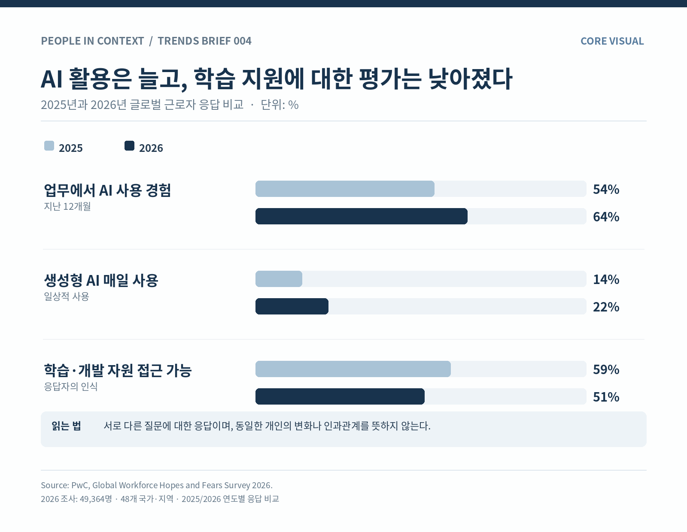
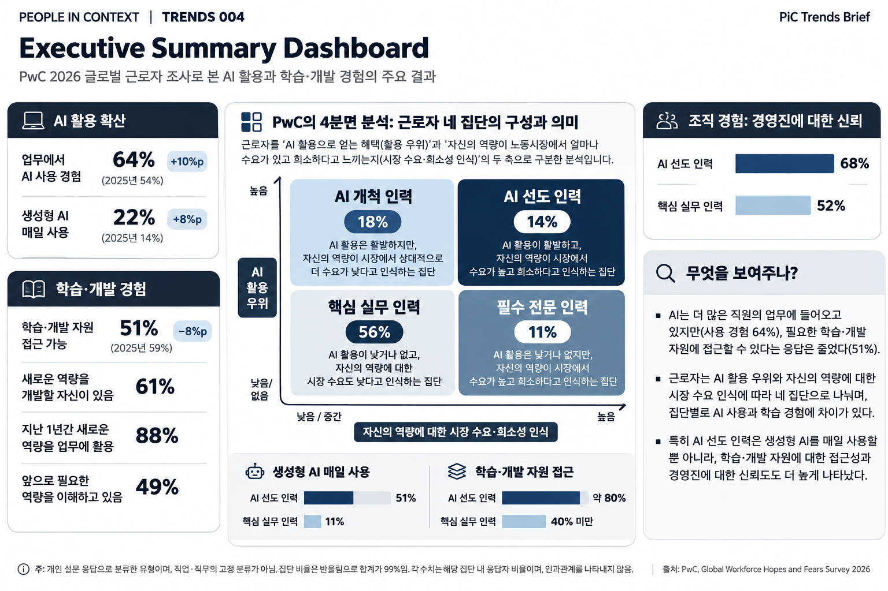

### Key Takeaways

- **AI 사용은 늘었다.** 지난 1년 동안 업무에서 AI를 사용했다는 응답은 2025년 54%에서 2026년 64%로 증가했다. 생성형 AI를 매일 사용한다는 응답도 14%에서 22%로 높아졌다.
- **학습 지원에 대한 평가는 오히려 낮아졌다.** 필요한 학습·개발 자원에 접근할 수 있다는 응답은 같은 기간 59%에서 51%로 감소했다. 이는 실제 교육 프로그램이나 예산의 감소를 측정한 결과는 아니다.
- **AI 활용 경험은 직원마다 다르다.** PwC는 AI 활용으로 얻었다고 느끼는 혜택과 자신의 역량에 대한 시장 수요·희소성 인식을 기준으로 근로자를 네 집단으로 나눴다. 분류는 직무별 평가가 아닌 개인의 응답에 기반하며, 집단 간 학습 경험에도 차이가 나타났다.

### 01. What Changed? — AI는 업무에 빠르게 들어오고 있다

AI는 이제 일부 직원만 사용하는 도구가 아니다. PwC가 2026년 전 세계 근로자 4만 9,364명을 조사한 결과, 64%가 지난 12개월 동안 업무에서 AI를 사용했다고 답했다. 전년보다 10%포인트 높아진 수치다.

일상적인 사용도 늘었다. 생성형 AI를 매일 사용한다는 응답은 2025년 14%에서 2026년 22%로 증가했다. 다만 업무에서 AI를 한 번이라도 사용한 경험과 생성형 AI를 매일 사용하는 것은 서로 다른 지표다. AI 사용 경험이 있다고 해서 실제 업무에 능숙하게 활용하고 있다는 의미는 아니다.

그런데 같은 조사에서 반대 방향으로 움직인 지표가 있다. 직원들이 평가한 학습·개발 기회다. 업무에서 AI를 사용하는 사람은 늘고 있지만, 필요한 역량을 배울 수 있는 환경에 대해서는 긍정적인 응답이 줄어든 것이다.

{fig-alt="2025년과 2026년 AI 사용 경험, 생성형 AI 매일 사용, 학습·개발 자원 접근 가능 응답 비교. " fig-align="center" width="100%" fig-cap="Core Visual | AI 활용은 증가했지만 학습·개발 자원 접근성에 대한 긍정 응답은 감소했다. 서로 다른 설문 문항의 연도별 응답 비교다."}

### 02. What Does the Data Say? — 새로운 역량은 필요하지만, 배울 여건은 충분할까?

2026년 조사에서 필요한 학습·개발 자원에 접근할 수 있다고 답한 근로자는 51%였다. 2025년의 59%보다 8%포인트 낮아졌다.

그렇다고 직원들의 역량개발 의지가 낮다고 단정하기도 어렵다. 61%는 새로운 역량을 개발할 자신이 있다고 답했고, 88%는 지난 1년 동안 업무에 새로운 역량을 활용한 경험이 있다고 응답했다. 그러나 앞으로 어떤 역량이 필요할지 이해하고 있다는 응답은 49%에 그쳤다.

이 수치들은 서로 다른 질문에 대한 응답이다. 따라서 직원들이 배우고 싶어 하는데 기업이 교육을 줄였다고 단정할 수는 없다. 다만 변화하는 업무에 적응하려는 직원들의 경험과 학습 지원에 대한 평가를 함께 살펴볼 필요가 있음을 보여준다.

#### PwC는 근로자를 왜 네 집단으로 나눴을까?

PwC는 직원들의 차이를 설명하기 위해 **AI 활용 우위(AI advantage)**와 **노동시장 압력(Labour market pressure)**이라는 두 축을 만들었다. 이름만 보면 AI 활용 능력과 실제 취업 경쟁력을 측정한 것 같지만, 두 축 모두 근로자 자신의 응답을 이용한 지표다.

세로축인 **AI 활용 우위**는 AI가 업무 품질, 창의성, 역량 향상, 조직에 대한 기여 가치에 얼마나 도움이 됐다고 느끼는지를 나타낸다. AI 사용 횟수나 객관적인 성과평가 점수가 아니다. AI를 사용하지 않는 사람은 이 축의 '낮음/없음'에 포함된다.

가로축인 **노동시장 압력**은 자신의 직무와 역량이 시장에서 얼마나 요구되는지, 비슷한 역량을 가진 사람을 기업이 확보하거나 육성하기 얼마나 어렵다고 인식하는지를 나타낸다. 노동시장의 실제 구인배율이나 임금 프리미엄을 측정한 값은 아니다. PwC는 이 지수를 세 구간으로 나눈 뒤 아래 두 구간을 묶어 '낮음'으로 분류했다. 따라서 아래 그림의 '낮음'은 정확하게 말하면 **낮음과 중간 수준이 합쳐진 집단**이다.

이 두 축을 교차하면 네 집단이 나타난다.

- **AI 선도 인력(14%) — AI 활용 우위 높음 / 시장 수요 인식 높음.** 자신의 전문 역량에 대한 수요가 높다고 느끼면서 AI를 통해 업무의 질이나 자신의 기여도도 높아졌다고 답한 집단이다.
- **AI 개척 인력(18%) — AI 활용 우위 높음 / 시장 수요 인식 낮음·중간.** 현재 자신의 역량이 특별히 희소하다고 생각하지 않더라도, AI 사용을 통해 뚜렷한 혜택을 얻는 집단이다.
- **필수 전문 인력(11%) — AI 활용 우위 낮음·없음 / 시장 수요 인식 높음.** 자신의 전문성이 시장에서 필요하다고 느끼지만, 아직 AI를 이용해 큰 혜택을 얻지는 못한 집단이다.
- **핵심 실무 인력(56%) — AI 활용 우위 낮음·없음 / 시장 수요 인식 낮음·중간.** 자신의 역량에 대한 시장 수요를 상대적으로 낮게 평가하고 AI 사용의 혜택도 제한적으로 경험한 집단이다. '핵심 실무'는 이들의 업무가 중요하지 않다는 의미가 아니다. PwC가 조직의 일상적 운영을 담당하는 다수 집단에 붙인 이름이다.

집단 비율은 조사에 응답한 근로자 중 각 유형이 차지하는 비중으로, 반올림 때문에 합계가 99%다. **특정 직무의 종사자 비율이나 실제 AI 역량 점수는 아니다.**

가령 같은 직무를 맡은 두 명의 HRBP를 생각해 보자. A는 자신의 전문성에 대한 시장 수요가 높다고 느끼고, AI로 조직진단 보고서의 품질도 개선했다고 답한다. 이 응답이라면 AI 선도 인력에 가까울 수 있다. B도 자신의 전문성에 대한 수요는 높게 평가하지만 AI를 거의 사용하지 않았거나 뚜렷한 혜택을 느끼지 못했다면 필수 전문 인력에 가까울 수 있다. **직무는 같아도 두 축에 대한 응답이 다르면 집단이 달라진다.** 이 예시는 분류 방식을 설명하기 위한 가상 사례이지 PwC가 관찰한 HRBP 조사 결과가 아니다.

#### 네 집단의 차이에서 무엇을 확인할 수 있을까?

PwC가 'AI 선도 인력'과 '핵심 실무 인력'을 비교한 결과, 생성형 AI를 매일 사용한다는 응답은 각각 51%와 11%였다. 필요한 학습·개발 자원에 접근할 수 있다는 응답도 선도 인력은 약 80%, 핵심 실무 인력은 40% 미만이었다.

다만 이 차이를 'AI를 사용해서 좋은 집단이 됐다'는 증거로 읽어서는 안 된다. **AI로부터 얻은 혜택 자체가 집단 분류 기준에 포함**되어 있기 때문이다. 더구나 공개 자료에서는 각 집단에 어떤 직무가 얼마나 포함됐는지, 직무와 조직의 특성을 보정했을 때도 차이가 유지되는지 충분히 확인할 수 없다.

예를 들어 고객 응대 직원과 데이터 분석가가 활용할 수 있는 AI 도구나 업무 환경은 다를 수 있다. 두 직무의 응답이 특정 집단에 집중된다면, 집단 간 차이에는 개인의 선택뿐 아니라 직무 특성이나 조직의 지원 수준도 반영될 수 있다. 따라서 **56%가 AI 역량이 부족하다거나, 14%가 객관적으로 우수한 인재라는 뜻이 아니다.**

그럼에도 이 분류를 참고할 이유는 있다. 같은 조직 안에서도 직원들이 AI의 혜택과 자신의 시장 가치를 다르게 경험하고 있다는 사실을 살펴보게 하기 때문이다. PwC의 네 집단은 확정적인 인재 등급이 아니라, **어떤 집단에 어떤 지원이 필요한지 질문을 시작하는 분석 틀**로 보는 편이 적절하다.

### 03. Why Does It Matter for HR? — AI 도입률만으로 충분할까?

기업이 AI 활용을 확대하려면 직원에게 도구를 제공하는 것만으로는 충분하지 않을 수 있다. 직원들이 어떤 업무에 AI를 사용할 수 있는지 알고 있는지, 새로운 기술을 익힐 시간과 기회가 있는지, 배운 내용을 실제 업무에 적용할 수 있는지도 함께 살펴봐야 한다.

HR은 AI 교육의 이수율이나 도구 사용률 외에도 직원이 인식하는 학습 기회, 직무별 활용 여건, 필요한 역량에 대한 이해, 업무 적용 경험을 구분해 확인할 수 있다. 특정 집단에서 활용이나 학습 기회가 낮게 나타난다면 그 이유를 조사하는 것이 다음 단계가 될 것이다.

무엇보다 PwC의 네 집단을 인사평가나 인재 선별의 기준으로 그대로 적용할 일은 아니다. 직무별 업무 특성과 AI 도구에 접근할 기회를 함께 살펴야 한다. 같은 직무 안에서도 지원 여건에 따라 활용 경험은 달라질 수 있기 때문이다.

물론 이번 PwC 조사만으로 AI 사용 증가가 학습 기회를 줄였다고 말할 수는 없다. 학습 기회에 대한 낮은 평가가 AI 사용의 격차를 만들었다는 인과관계도 확인되지 않았다.

다만 기업이 AI의 확산을 성공적으로 관리하려면 기술이 얼마나 보급됐는지만 물어서는 부족하다.

**직원들은 AI를 사용할 수 있을 뿐 아니라, 달라지는 업무에 필요한 것을 배우고 있는가?**

{fig-alt="PwC 2026 글로벌 근로자 조사 AI 활용, 학습·개발 경험 및 네 집단을 종합한 대시보드. " fig-align="center" width="100%" fig-cap="Executive Summary Dashboard | PwC 2026 글로벌 근로자 조사 주요 응답과 네 집단의 차이. 집단별 수치는 자기보고 응답이며 인과관계를 뜻하지 않는다."}

---

### Sources & Notes

**Primary Source**

PwC. (2026, September 29). *Global Workforce Hopes and Fears Survey 2026: Unlock the workforce advantage.*

<https://www.pwc.com/gx/en/1/issues/workforce/hopes-and-fears.html>

**Methodological Notes**

- 2026년 5~6월, 48개 국가·지역, 29개 산업의 근로자 49,364명을 대상으로 실시한 설문. 국가·지역별 근로인구의 성별·연령 분포를 고려한 가중치를 적용했다.
- 2025년과 2026년 수치는 연도별 설문 응답이며 동일한 개인을 추적한 패널 변화로 해석하지 않는다.
- 학습·개발 자원 접근성은 자기보고 응답으로, 기업의 실제 교육예산 또는 교육 프로그램 수를 뜻하지 않는다.
- PwC의 인력 집단은 AI의 자기보고 혜택과 자신의 역량에 대한 시장 수요·희소성 인식을 조합한 것이다. AI 비사용자도 AI 활용 우위가 낮거나 없는 집단에 포함된다. 노동시장 축의 낮은 범주에는 하위 두 구간이 합쳐져 있다.
- 14%·18%·11%·56%는 전체 응답자 내 각 집단의 비율이다. 51%·11%와 약 80%·40% 미만은 각각 해당 집단 내부의 응답 비율이다.
- 직무별 집단 구성, 상세 지수 절단점·가중치, 객관적 성과와의 인과관계는 공개 자료에서 충분히 확인되지 않는다. 직무 사례는 PiC가 구성한 가상 설명이다.
- HR 시사점은 관측 결과를 바탕으로 한 PiC의 해석이다.

