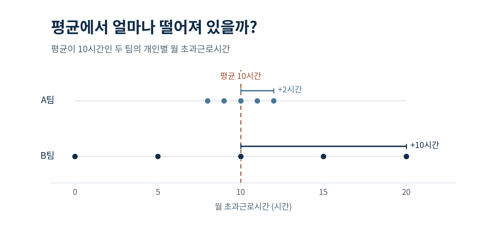
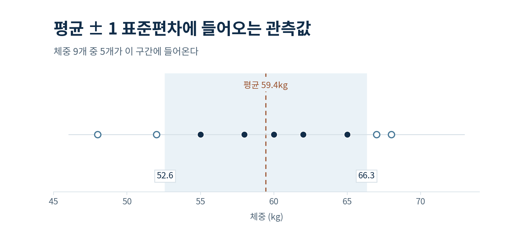

## Governing Message

평균이 같아도 구성원별 기록이 퍼진 정도는 다를 수 있다. 분산은 평균에서 벗어난 정도를 편차의 제곱으로 요약하고, 표준편차는 그 결과를 원래 데이터와 같은 단위로 나타낸다.

## Key Takeaways

- 각 관측값에서 평균을 빼면 **편차**가 된다. 편차를 그대로 더하면 0이 되므로, 분산을 계산할 때는 편차를 각각 제곱한다.
- **표준편차**는 분산의 제곱근이다. 초과근로시간을 시간으로 기록했다면 표준편차도 시간으로 읽는다.
- **평균 ± 1표준편차**에 들어오는 비율은 분포에 따라 달라진다. 약 68%는 정규분포의 성질이다.

## 평균이 10시간인 두 팀

[Learn 03편](dispersion.html)에서 구성원이 다섯 명씩인 A팀과 B팀의 월 초과근로시간을 비교했다. 두 팀의 평균과 중앙값은 모두 10시간이었다. 하지만 A팀은 8~12시간, B팀은 0~20시간에 걸쳐 있었다. 범위는 두 팀의 양 끝값 사이가 얼마나 벌어졌는지 알려줬다.

이번에는 **각 구성원의 기록이 평균 10시간에서 얼마나 벗어났는지** 살펴보자. A팀에서 12시간을 기록한 구성원은 평균보다 2시간 더 일했다. B팀에서 20시간을 기록한 구성원은 평균보다 10시간 더 일했다. 이처럼 관측값에서 평균을 뺀 값을 **편차(Deviation)**라고 한다.

{#fig-deviation width="800px" fig-alt="A팀은 8, 9, 10, 11, 12시간에, B팀은 0, 5, 10, 15, 20시간에 점이 찍혀 있다. 두 팀의 공통 평균인 10시간을 세로 점선으로 표시했다."}

*주. Learn 03편에서 사용한 학습용 가상 데이터다.*

## 편차를 왜 제곱할까?

편차에는 방향이 있다. A팀의 8시간은 평균보다 2시간 적으므로 편차가 $-2$시간이고, 12시간은 평균보다 2시간 많으므로 $+2$시간이다. 평균을 기준으로 편차를 모두 더하면 양수와 음수가 상쇄된다. 두 팀 모두 편차의 합은 0이다.

분산을 계산할 때는 **편차를 하나씩 제곱한 뒤 더한다.** 이렇게 하면 $-2$와 $+2$는 둘 다 제곱값이 4가 된다. 평균에서 더 멀리 떨어진 값은 제곱합에 더 크게 반영된다. A팀의 편차 제곱합은 10이고 B팀은 250이다.

| 항목 | A팀 | B팀 |
|---|---:|---:|
| 초과근로시간(시간) | 8, 9, 10, 11, 12 | 0, 5, 10, 15, 20 |
| 평균(시간) | 10 | 10 |
| 편차(시간) | −2, −1, 0, +1, +2 | −10, −5, 0, +5, +10 |
| 편차 제곱합(시간²) | 4 + 1 + 0 + 1 + 4 = **10** | 100 + 25 + 0 + 25 + 100 = **250** |

## 분산에서 표준편차로

**분산(Variance)**은 편차 제곱합을 관측값의 수를 기준으로 나누어 구한다. 이때 분모는 [Learn 01편](population-sample.html)에서 살펴본 모집단과 표본의 구분에 따라 달라진다.

- **관측한 집단 전체가 관심 대상이라면** 그 집단의 평균 $\mu$를 기준으로 구한 편차 제곱합을 집단 크기 $N$으로 나눈다. 이렇게 구한 모집단 분산은 $\sigma^2$로 쓴다.
- **표본으로 더 큰 모집단의 분산을 추정한다면** 표본평균 $\bar{x}$를 기준으로 구한 편차 제곱합을 $n-1$로 나누는 공식을 흔히 쓴다. 이렇게 구한 표본분산은 $s^2$로 쓴다.

표본분산과 표본 표준편차의 공식은 다음과 같다.

$$
s^2 = \frac{\sum_{i=1}^{n}(x_i-\bar{x})^2}{n-1},
\qquad
s = \sqrt{s^2}
$$

$x_i$는 개별 관측값, $\bar{x}$는 표본평균, $n$은 표본 크기다. $\sum$은 각 관측값에서 평균을 뺀 뒤 **제곱한 값을 모두 더하라**는 뜻이다. 같은 모집단에서 독립적으로 뽑은 표본의 경우, $n-1$로 나누면 표본분산의 기댓값이 모집단 분산과 같아진다. 그 이유는 다음 편에서 살펴본다.

이번에 관심 있는 대상은 A팀과 B팀의 구성원 전원이다. 각 팀에서 5명 모두의 기록을 갖고 있으므로 편차 제곱합을 5로 나눈다. A팀의 분산은 $10/5=2$, B팀의 분산은 $250/5=50$이다. 편차를 제곱했으므로 분산의 단위는 시간²이다.

여기서 제곱근을 취하면 원래 단위인 시간으로 돌아온다. **표준편차(Standard Deviation)**는 A팀이 약 1.4시간, B팀이 약 7.1시간이다. 평균은 둘 다 10시간이지만, B팀 구성원의 기록이 평균 주변에 더 넓게 퍼져 있다.

## 평균 ± 1표준편차에는 몇 개가 들어올까?

표준편차를 평균에서 한 번 빼고 한 번 더하면, 평균을 중심으로 한 구간을 그릴 수 있다. 체중을 기록한 9개의 관측값으로 실제로 몇 개가 들어오는지 확인해 보자.

| 관측값(kg) | 표본평균(kg) | 편차 제곱합(kg²) | 표본분산(kg²) | 표본 표준편차(kg) |
|---|---:|---:|---:|---:|
| 48, 52, 55, 58, 60, 62, 65, 67, 68 | 59.44 | 376.22 | 47.03 | 6.86 |

이 9개를 더 큰 집단에서 뽑은 표본이라고 가정한다. 편차 제곱합을 $9-1=8$로 나누면 표본분산이 약 47.03kg²이고, 그 제곱근을 취하면 표본 표준편차가 약 6.86kg이다.

평균과 표준편차를 반올림하기 전의 값으로 구간을 계산하면 **약 52.6~66.3kg**이다. 구간 안에 들어오는 값은 55, 58, 60, 62, 65kg으로, 9개 중 5개(약 56%)다.

{#fig-one-sd width="800px" fig-alt="52.6~66.3kg 구간이 옅은 파란색으로 표시돼 있다. 55, 58, 60, 62, 65kg은 구간 안에, 48, 52, 67, 68kg은 구간 밖에 있다."}

정규분포에서는 모집단 평균에서 양쪽으로 1표준편차씩 떨어진 구간에 전체 확률의 약 68%가 들어온다. 실제 표본에서 평균과 표준편차로 구간을 계산한 뒤 관측값을 세면, 그 비율은 표본마다 달라질 수 있다.

## 평균과 표준편차, 중앙값과 사분위수

팀별 초과근로시간을 한 줄로 요약한다면 무엇을 함께 제시하면 좋을까? 평균을 중심으로 기록이 얼마나 퍼져 있는지 보여주려면 **평균과 표준편차**를 함께 제시할 수 있다. 그달에 유독 오래 일한 몇 사람의 기록이 있거나 분포가 한쪽으로 길게 늘어져 있다면, **중앙값과 제1·제3사분위수**도 함께 살펴보자. 가운데에 위치한 구성원들의 기록이 어느 구간에 모여 있는지 읽을 수 있다.

| 요약 방식 | 무엇을 보여주나 | 표기 예시 |
|:---|:---|:---|
| 평균과 표준편차 | 평균을 중심으로 한 산포의 크기 | 평균 10시간, 표준편차 7.1시간 |
| 중앙값과 $Q_1$, $Q_3$ | 중앙 50% 관측값의 분포 범위 | 중앙값 10시간, $Q_1$ 6시간, $Q_3$ 13시간 |

*주. 첫째 행은 앞에서 계산한 B팀의 수치이며, 둘째 행은 별도의 가상 예시다. 둘째 행의 사분위 범위(IQR)는 $13-6=7$시간이다.*

B팀의 표준편차가 크다는 것을 알았다면, 다음 질문은 **누가, 언제, 어떤 업무에서 평균과 크게 다른 기록을 보였는가**다. 구성원별 기록을 여러 달에 걸쳐 확인하면 높은 초과근로시간이 특정 인원에게 반복되는지, 프로젝트 일정에 따라 달라지는지 살펴볼 수 있다.

다음 Learn 05편에서는 **표본분산을 구할 때 왜 $n-1$로 나누는지** 알아본다. 우리는 앞서 각 관측값이 평균에서 얼마나 떨어져 있는지를 이용해 분선을 계산했다. 그런데 데이터가 아닌 일부 표본만 가지고 모집단의 분산을 추정할 때는 한 가지 문제가 생긴다. 모집단의 실제 평균을 알 수 없어 표본에서 계산한 평균을 대신 사용하면, 데이터가 흩어진 정도를 실제보다 작게 평가하는 경향이 있기 때문이다.

왜 이런 일이 생길까? 그리고 n-1로 나누면 이 문제를 어떻게 보완할 수 있을까? 다음 편에서는 그 이유를 구체적인 이셰와 함께 알아본다.
